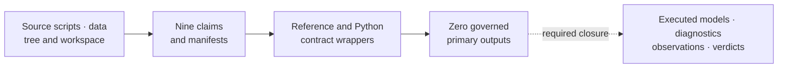
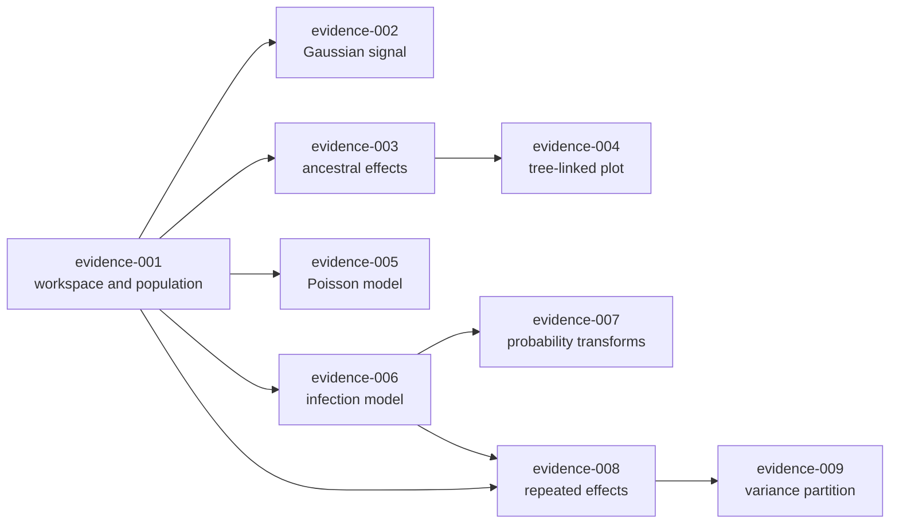

# PCM5 Generalized Mixed-Model Evidence Boundary

PCM5 extends the cichlid workflow into generalized mixed models and derived
posterior quantities. Its governed records currently stop at source identity,
claim decomposition, and executable contract wrappers. They do not contain a
governed posterior result or numerical comparison.

## Record Inventory

| Surface | Retained state | What remains absent |
| --- | --- | --- |
| source | `PCM5_PGLMM.R`, `PCM5_extra_code.R`, data, tree, workspace, provenance | a governed invocation that captures source-model outputs |
| claim map | nine stable evidence and claim IDs | claim-level observed comparison rows |
| reference program | contract writer naming source locators and scripts | Poisson, multinomial, ancestral, and repeated-measure execution |
| Bijux program | `bundle_contract_only` writer with no build script | a matched native or adapter-backed scientific computation |
| result inventory | reviewer summaries and a manifest with zero primary outputs | retained posterior draws, diagnostics, parameters, and derived quantities |
| verdict | nine `not_comparable` records | numerical correspondence adjudication |

## Claim-Specific Closure Requirements

| Bundle | Required governed evidence |
| --- | --- |
| `evidence-001` | exact repeated-observation workspace identity, species/tip mapping, and input comparison |
| `evidence-002` | draw-wise phylogenetic-signal numerator, denominator, scale, and posterior summary |
| `evidence-003` | stable node identities joined to ancestral posterior draws and intervals |
| `evidence-004` | plotted node/branch ledger linked to the exact analytical rows and tree |
| `evidence-005` | Poisson family, link, exposure or offset, priors, random effects, draws, and diagnostics |
| `evidence-006` | source multinomial coding, latent scale, category baseline, priors, and posterior summaries |
| `evidence-007` | draw-wise inverse-link transformation with response-scale intervals and comparison rules |
| `evidence-008` | distinct species and phylogenetic random effects under matched covariance and priors |
| `evidence-009` | draw-wise phylogenetic, species, residual, and family-specific variance partition |

## Closure Dependency Graph

The evidence records form a scientific dependency graph. Input identity feeds
every model; posterior diagnostics qualify every derived quantity; tree and
node identity connect ancestral values to their visualization:

Closing a downstream record requires immutable links to the exact upstream
artifacts it consumed. Similar column names, the latest local file, or a shared
execution directory are not sufficient provenance.

## Model-Family Identity

A comparison record identifies the observation unit, response family, link,
category baseline, offset or exposure, fixed effects, random effects,
phylogenetic covariance, residual convention, priors, chain policy, retained
parameters, and transformation formulas. Those identities are evaluated
before numerical tolerances.

Poisson, multinomial, and Gaussian quantities cannot share a variance or
response-scale interpretation by name alone. Species and phylogenetic random
effects remain distinct. Node and branch outputs resolve against the exact tree
revision rather than an incidental row order.

## Observation And Diagnostic Ledger

A future lane needs one denominator across reference execution, comparison
execution, chain diagnostics, parameter observations, transformations, and
exclusions. Each observation identifies its claim, parameter or node, source
and Bijux values or distributions, rule, tolerance, outcome, and mismatch
reason.

Non-convergence and absent parameters remain visible. A missing comparable
execution retains `not_comparable`; an unexplained observed disagreement can
support `mismatch_unexplained`; agreement supports a matched verdict only after
the full eligible observation set is adjudicated.

## Derived-Quantity Ledger

| Quantity | Draw-wise source expression | Identity that must be retained |
| --- | --- | --- |
| Gaussian phylogenetic signal | `treetip / (treetip + units)` | model, chain, draw, covariance scaling, and both variance columns |
| infection phylogenetic signal | `treetip / (treetip + units + pi^2 / 3)` | `multinomial2` family, latent-scale convention, chain, draw, and variance columns |
| response probability | `inverse_logit(intercept + slope * predictor)` | chain, draw, predictor value and units, coefficient keys, and category coding |
| repeated phylogenetic share | `treetip / (species + treetip + units)` | repeated-record population and all three same-draw variance columns |
| repeated species share | `species / (species + treetip + units)` | the same denominator and draw identity as the phylogenetic share |
| ancestral response | intercept plus named tip or node effect | exact tree digest, node identity, chain, draw, and summary convention |

The ledger is part of the comparison contract, not explanatory decoration. A
governed artifact should retain the input columns or their content identities,
the expression version, the output scale, and the resulting observation key.

## What Execution Would Change The Verdict State

A scientific execution changes a bundle only when it produces governed primary
outputs and an observation ledger, not merely a successful process exit. The
reference and Bijux lanes must declare the same analytical identity, preserve
raw or losslessly normalized posterior records, publish chain diagnostics, and
account for every expected parameter, node, transform, and exclusion.

The comparison then applies claim-specific structural and numerical rules. If
the comparable population is absent, the verdict remains `not_comparable`; if
observed comparable values disagree without an accepted explanation, the
record can become `mismatch_unexplained`; only complete adjudicated agreement
can support a matched verdict.

## Safe Present-Tense Claims

- PCM5 source scripts, data identities, provenance, and nine claim boundaries
  are checked in and reviewable.
- All nine bundle manifests record `not_comparable` and zero governed primary
  outputs.
- The runtime contains narrower comparative, Bayesian, ancestral, and
  visualization capabilities, but these dossiers do not establish their
  equivalence to the PCM5 `MCMCglmm` models.
- No checked-in PCM5 result currently supports posterior signal, ancestral,
  count, infection, probability-scale, repeated-effect, or variance-partition
  correspondence.

Do not describe PCM5 as a reproduced PGLMM study until executed outputs,
diagnostics, comparison observations, and claim-level adjudication are retained.
