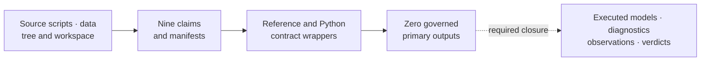
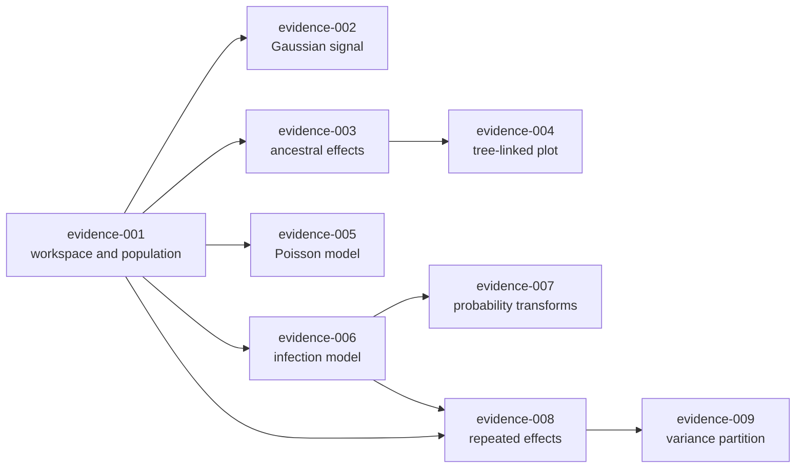
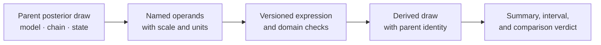
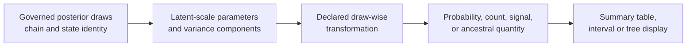

# PCM5 Generalized Mixed-Model Evidence Boundary

PCM5 extends the cichlid workflow into generalized mixed models and derived
posterior quantities. Its governed records currently stop at source identity,
claim decomposition, and executable contract wrappers. They do not contain a
governed posterior result or numerical comparison.

## What PCM5 Is Designed To Establish

PCM5 asks whether phylogenetic mixed-model evidence remains coherent when the
response is no longer Gaussian and when reported quantities are derived from
posterior draws. That creates three coupled proof problems:

| Proof problem | Why it is scientifically material |
| --- | --- |
| generalized model identity | Poisson and multinomial families, links, baselines, offsets, and latent scales define different estimands |
| random-effect identity | phylogenetic, species, residual, and family-specific components require distinct covariance and variance meanings |
| derived posterior identity | signal ratios, probabilities, ancestral summaries, and plots must be computed from the same retained draw population |

The nine dossiers partition those problems so a favorable low-level check
cannot promote an unobserved derived claim. At the current boundary they show
exactly which source analysis and transformations a future comparison must
own; they supply no posterior observations and therefore no numerical evidence.

### Derived Quantities Are Part Of The Analysis

PCM5's headline quantities are not columns emitted directly by a sampler.
Probabilities, phylogenetic-signal ratios, variance shares, and ancestral
responses are functions of linked posterior operands. Their scientific identity
includes the parent model, chain and draw, input point or node, transformation,
and denominator.

That dependency is why a printed posterior mean is insufficient. Nonlinear
transformations and ratios must be applied within each admitted draw so
posterior dependence and asymmetry survive. The derived draw population then
receives its own summary and comparison rule; it cannot be reconstructed
faithfully from separately rounded marginal summaries.



## Record Inventory

| Surface | Retained state | What remains absent |
| --- | --- | --- |
| source | `PCM5_PGLMM.R`, `PCM5_extra_code.R`, data, tree, workspace, provenance | a governed invocation that captures source-model outputs |
| claim map | nine stable evidence and claim IDs | claim-level observed comparison rows |
| reference program | contract writer naming source locators and scripts | Poisson, multinomial, ancestral, and repeated-measure execution |
| Bijux program | `bundle_contract_only` writer with no build script | a matched native or adapter-backed scientific computation |
| result inventory | reviewer summaries and a manifest with zero primary outputs | retained posterior draws, diagnostics, parameters, and derived quantities |
| verdict | nine `not_comparable` records | numerical correspondence adjudication |

## Claim-Specific Closure Requirements

| Bundle | Required governed evidence |
| --- | --- |
| `evidence-001` | exact repeated-observation workspace identity, species/tip mapping, and input comparison |
| `evidence-002` | draw-wise phylogenetic-signal numerator, denominator, scale, and posterior summary |
| `evidence-003` | stable node identities joined to ancestral posterior draws and intervals |
| `evidence-004` | plotted node/branch ledger linked to the exact analytical rows and tree |
| `evidence-005` | Poisson family, link, exposure or offset, priors, random effects, draws, and diagnostics |
| `evidence-006` | source multinomial coding, latent scale, category baseline, priors, and posterior summaries |
| `evidence-007` | draw-wise inverse-link transformation with response-scale intervals and comparison rules |
| `evidence-008` | distinct species and phylogenetic random effects under matched covariance and priors |
| `evidence-009` | draw-wise phylogenetic, species, residual, and family-specific variance partition |

## Closure Dependency Graph

The evidence records form a scientific dependency graph. Input identity feeds
every model; posterior diagnostics qualify every derived quantity; tree and
node identity connect ancestral values to their visualization:



Closing a downstream record requires immutable links to the exact upstream
artifacts it consumed. Similar column names, the latest local file, or a shared
execution directory are not sufficient provenance.

## Model-Family Identity

A comparison record identifies the observation unit, response family, link,
category baseline, offset or exposure, fixed effects, random effects,
phylogenetic covariance, residual convention, priors, chain policy, retained
parameters, and transformation formulas. Those identities are evaluated
before numerical tolerances.

Poisson, multinomial, and Gaussian quantities cannot share a variance or
response-scale interpretation by name alone. Species and phylogenetic random
effects remain distinct. Node and branch outputs resolve against the exact tree
revision rather than an incidental row order.

## Observation And Diagnostic Ledger

A future lane needs one denominator across reference execution, comparison
execution, chain diagnostics, parameter observations, transformations, and
exclusions. Each observation identifies its claim, parameter or node, source
and Bijux values or distributions, rule, tolerance, outcome, and mismatch
reason.

Non-convergence and absent parameters remain visible. A missing comparable
execution retains `not_comparable`; an unexplained observed disagreement can
support `mismatch_unexplained`; agreement supports a matched verdict only after
the full eligible observation set is adjudicated.

## Same-Draw Algebra Is Part Of The Estimand

Nonlinear posterior quantities must be computed from operands belonging to the
same model, chain, and retained draw. In general:

```text
mean(inverse_link(eta_draw)) != inverse_link(mean(eta_draw))

mean(A_draw / (A_draw + B_draw))
    != mean(A_draw) / (mean(A_draw) + mean(B_draw))
```

The difference is scientific, not merely numerical: the draw-wise calculation
preserves posterior dependence and nonlinear uncertainty. A valid child
ledger therefore retains:

| Child field | Required parent identity |
| --- | --- |
| model and parameter keys | exact family, link, fixed/random terms, priors, covariance and scale |
| chain and draw key | one admitted posterior state shared by every operand |
| predictor/category/node key | the response-scale target or structural object being derived |
| expression identity | versioned operands, constants, inverse link, denominator and domain rules |
| child state | finite, missing, refused, or excluded with the inherited parent reason |

Pairing operands by row position after chains are filtered independently is
not same-draw evidence. Neither is reconstructing a ratio from published
marginal summaries. Those outputs may be retained as separate descriptive
records, but they cannot close the registered derived-posterior claim.

## Derived-Quantity Ledger

| Quantity | Draw-wise source expression | Identity that must be retained |
| --- | --- | --- |
| Gaussian phylogenetic signal | `treetip / (treetip + units)` | model, chain, draw, covariance scaling, and both variance columns |
| infection phylogenetic signal | `treetip / (treetip + units + pi^2 / 3)` | `multinomial2` family, latent-scale convention, chain, draw, and variance columns |
| response probability | `inverse_logit(intercept + slope * predictor)` | chain, draw, predictor value and units, coefficient keys, and category coding |
| repeated phylogenetic share | `treetip / (species + treetip + units)` | repeated-record population and all three same-draw variance columns |
| repeated species share | `species / (species + treetip + units)` | the same denominator and draw identity as the phylogenetic share |
| ancestral response | intercept plus named tip or node effect | exact tree digest, node identity, chain, draw, and summary convention |

The ledger is part of the comparison contract, not explanatory decoration. A
governed artifact should retain the input columns or their content identities,
the expression version, the output scale, and the resulting observation key.

## Treat Every Derived Quantity As A Child Evidence Record



The child record must retain enough identity to join back to one parent draw.
Computing a ratio from separately summarized numerator and denominator
posteriors destroys their dependence and is not equivalent to summarizing the
draw-wise ratio.

| Parent condition | Required child state |
| --- | --- |
| parent chain or draw is excluded by the declared diagnostic rule | excluded with the same parent reason |
| a required operand is absent | missing, with the operand key recorded |
| denominator is invalid under the expression contract | refused or non-finite under an explicit domain rule |
| category, node, or predictor identity cannot be resolved | `not_comparable` at the derived-observation layer |
| parent and transform identities align | eligible for summary and numerical adjudication |

A rendered probability, signal fraction, or ancestral label cannot become the
primary evidence owner. It remains a projection of the child draw ledger and
must carry the same exclusions and denominator.

## Adjudicate Each Scale Separately

PCM5 derived quantities cross latent, variance, probability, count, and tree
display scales. Agreement on one scale cannot be projected onto another
without retaining the draw-wise transformation and its denominator.



Create a distinct observation for the latent parameter, transformed draw,
posterior summary, and rendered projection when a claim traverses those
layers. The bundle can match at one layer and remain `not_comparable` or
disagree at another. A matching posterior mean cannot repair a different
category baseline, link, residual convention, tree-node identity, or
same-draw variance denominator.

Transformation failures, non-finite draws, absent categories or nodes, and
discarded chains remain counted at the layer where they occur. Summarizing
only transformable draws without publishing that reduced denominator is not a
complete comparison.

## What Execution Would Change The Verdict State

A scientific execution changes a bundle only when it produces governed primary
outputs and an observation ledger, not merely a successful process exit. The
reference and Bijux lanes must declare the same analytical identity, preserve
raw or losslessly normalized posterior records, publish chain diagnostics, and
account for every expected parameter, node, transform, and exclusion.

The comparison then applies claim-specific structural and numerical rules. If
the comparable population is absent, the verdict remains `not_comparable`; if
observed comparable values disagree without an accepted explanation, the
record can become `mismatch_unexplained`; only complete adjudicated agreement
can support a matched verdict.

## Safe Present-Tense Claims

- PCM5 source scripts, data identities, provenance, and nine claim boundaries
  are checked in and reviewable.
- All nine bundle manifests record `not_comparable` and zero governed primary
  outputs.
- The runtime contains narrower comparative, Bayesian, ancestral, and
  visualization capabilities, but these dossiers do not establish their
  equivalence to the PCM5 `MCMCglmm` models.
- No checked-in PCM5 result currently supports posterior signal, ancestral,
  count, infection, probability-scale, repeated-effect, or variance-partition
  correspondence.

Do not describe PCM5 as a reproduced PGLMM study until executed outputs,
diagnostics, comparison observations, and claim-level adjudication are retained.
