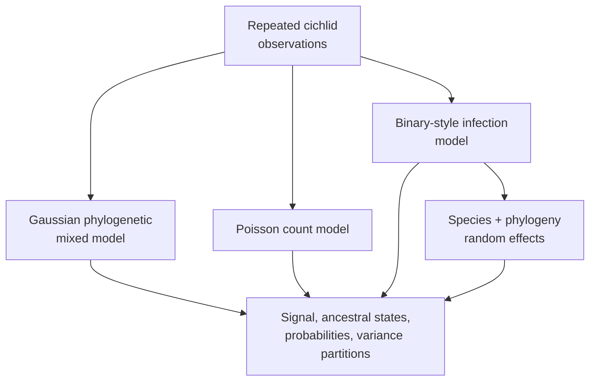
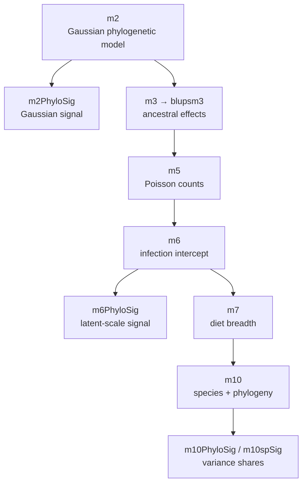
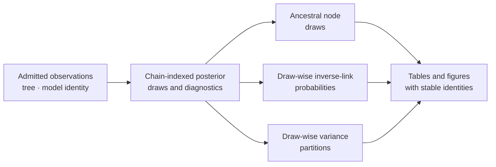

# PCM5: Cichlid Phylogenetic Generalized Linear Mixed Models

PCM5 extends the cichlid analysis beyond Gaussian responses. It covers
posterior-derived phylogenetic signal, ancestral node effects, Poisson parasite
counts, binary-style infection outcomes, probability-scale summaries, and
repeated observations with both species and phylogenetic random effects.

## The Derived-Scale Question In One View

| Dimension | PCM5 contract |
| --- | --- |
| scientific object | cichlid Gaussian, Poisson, infection, ancestral, and repeated-observation posterior models linked to draw-wise signal, probability, and variance-partition quantities |
| central idea | family, link, residual convention, random-effect denominator, and inverse-link transformation determine the scale on which every posterior quantity is meaningful |
| evidence role | requires each derived value to remain a child of identified model, chain, draw, operand, tree/node, and transformation records |
| present conclusion | all nine manifests are `not_comparable`, use `bundle_contract_only`, and report `governed_primary_output_count: 0`; the generalized posterior comparison has not run |
| relation to PCM4 | consumes the Gaussian mixed-model discipline, then adds model-family separation, repeated-measure structure, and draw-wise derivation lineage |
| forbidden inference | a logistic helper, plotted probability, similar posterior mean, or large draw count cannot substitute for an aligned governed posterior denominator |

PCM5 is the evidence sequence's scale-discipline study. Its current record says
exactly how future posterior claims must be derived and joined; it does not
provide those posterior observations today.

## What PCM5 Adds To PCM4

PCM4 establishes the contract for a Gaussian phylogenetic mixed model. PCM5
changes the response distribution, observation unit, link scale, and derived
posterior questions. Each change creates a new evidence obligation.

| Extension | Scientific question | Evidence that must be added |
| --- | --- | --- |
| Gaussian variance → phylogenetic signal ratio | what share of modeled variance is phylogenetic under the declared convention? | same-draw variance components and complete denominator |
| species summary → repeated observations | how are within-species records separated from species and phylogenetic heterogeneity? | observation keys, species levels, tree levels, and all random-effect components |
| Gaussian response → Poisson counts | how does expected parasite abundance change on the log-linked count scale? | count coding, offset/exposure, link, dispersion treatment, priors, posterior draws |
| infection categories → binary-style latent model | how does infection probability change under the source category and residual convention? | category order, link/latent scale, residual convention, coefficient draws |
| coefficient posterior → probability curve | what response-scale probability is implied across predictor values? | paired coefficient draws, predictor grid, inverse link, draw-wise summaries |
| tip/random effects → ancestral node effects | what node-linked posterior quantities follow from the exact tree? | tree and node identity, parameter scale, parent draws, intervals, diagnostics |

PCM5 is therefore a dependency graph, not a larger coefficient table. A
derived probability, signal ratio, or variance share is trustworthy only when
its parent model, chain, draw, parameter, and transformation identities remain
linked.

## Observation Grain Changes The Scientific Population

PCM5 moves between species summaries and repeated records. Those populations
cannot share a denominator merely because they contain the same species names.

| Grain | Unit represented by one row | Dependence that must be modeled or retained |
| --- | --- | --- |
| species-level summary | one aggregated species response | aggregation members and rule, tree-linked species covariance |
| parasite count record | one declared count observation | exposure or offset, sampling unit, overdispersion policy, species/tip link |
| infection composition | infected and not-infected outcomes for one sampling unit | trial/composition denominator, category coding, link and latent residual convention |
| repeated observation | one measurement nested within species | record identity, within-species repetition, species effect, phylogenetic effect |
| ancestral node quantity | one model-derived node effect or response | exact tree, descendant identity, parent posterior, parameter and scale |

Collapsing repeated records changes the response and removes a variance layer;
expanding a species summary without source records invents replication. Every
model and derived quantity must state which grain it consumes and how that
population maps to species and tree identities.

## Why Model Families Stay Separate

Gaussian, Poisson, and binary-style models operate on different likelihood and
link scales. A coefficient on the log or latent scale is not already a change
in expected count or infection probability. Residual variance conventions also
differ, which changes posterior phylogenetic-signal calculations.

Repeated observations add another variance component. Species identity and
phylogenetic relatedness must not be merged into one unnamed random effect.

## Preserve The Scale Of Every Quantity

| Model component | Linear-predictor scale | Response-scale interpretation |
| --- | --- | --- |
| Gaussian response | identity | expected response changes directly with the coefficient |
| Poisson count | log | exponentiated coefficient is a multiplicative expected-count ratio |
| binary-style outcome | logit or source-declared latent scale | inverse-link transformation yields probability; averaging and transforming do not generally commute |
| phylogenetic random effect | model-specific latent scale | variance contribution depends on covariance scaling and family convention |
| species random effect | model-specific latent scale | repeated-observation heterogeneity distinct from phylogenetic covariance |

Posterior intervals should be transformed draw by draw when a response-scale
summary is required. Transforming only posterior means can conceal asymmetry
and does not preserve interval coverage.

## The Preserved Source Model Sequence

The preserved source moves from a Gaussian phylogenetic model into ancestral,
count, infection, and repeated-observation questions. Each object changes a
scientific assumption or derives a quantity from named posterior columns:

| Source object | Model or derivation | Scientific role |
| --- | --- | --- |
| `m2` | Gaussian fixed effect plus phylogenetic `treetip` random effect | establishes the continuous-response phylogenetic model |
| `m2PhyloSig` | `treetip / (treetip + units)` for every retained draw | derives Gaussian phylogenetic signal |
| `m3` | intercept-only Gaussian model with `pr = TRUE` | retains tip and node effects for ancestral reconstruction |
| `blupsm3` | intercept-plus-effect posterior modes and HPD intervals | maps posterior ancestral summaries to explicit effect identities |
| `m5` | intercept-only Poisson phylogenetic model | models parasite counts on their declared family scale |
| `m6` | intercept-only `multinomial2` model of `infected` and `not_infected` | models infection composition on the latent scale |
| `m6PhyloSig` | `treetip / (treetip + units + pi^2 / 3)` per draw | applies the source binary-style residual convention |
| `m7` | `multinomial2` model with `diet_breadth` | estimates intercept and slope probability effects |
| `m10` | repeated records with `species + treetip` random effects | separates species heterogeneity from phylogenetic structure |
| `m10PhyloSig` and `m10spSig` | draw-wise variance shares over `species + treetip + units` | partition repeated-observation variance |

The arrows describe the conceptual progression of the source analysis. They do
not authorize inheritance of evidence: every derived quantity still needs its
own governed inputs, observations, diagnostics, and verdict.

## Evidence Decomposition

| Bundle | Evaluated surface | Manifest verdict |
| --- | --- | --- |
| `evidence-001` | workspace reload and repeated-measure data contract | `not_comparable` |
| `evidence-002` | posterior phylogenetic signal for the Gaussian model | `not_comparable` |
| `evidence-003` | ancestral-node posterior extraction and export | `not_comparable` |
| `evidence-004` | tree-linked ancestral plotting contract | `not_comparable` |
| `evidence-005` | Poisson phylogenetic parasite-count model | `not_comparable` |
| `evidence-006` | infection model and logit-scale summaries | `not_comparable` |
| `evidence-007` | intercept and slope transformation to probability scale | `not_comparable` |
| `evidence-008` | repeated-measure `species + treetip` random effects | `not_comparable` |
| `evidence-009` | phylogenetic, species, and residual variance partition | `not_comparable` |

The nine claim records and bundle contracts are checked in, and all nine
comparison verdicts are `not_comparable`. The repository's binary comparative
utilities provide adjacent capability but do not reproduce the external
generalized mixed-model posterior. No governed comparison execution or
observation ledger currently closes that gap.

## Preserve Dependencies Between Derived Claims

Several PCM5 quantities are derived from the same posterior draws. Their
dependency is part of the evidence contract: an ancestral export, transformed
probability, or variance share cannot be admitted when its source draws,
parameter keys, or chain diagnostics are absent.

| Derived claim | Material parent record | Required identity join |
| --- | --- | --- |
| ancestral-node posterior | model draws and exact tree | chain, draw, node descendant set, tree revision and parameter scale |
| probability curve or contrast | paired intercept/slope draws | chain, draw, predictor value, link and inverse-link convention |
| phylogenetic signal | phylogenetic and residual variance draws | chain, draw, component names, covariance scaling and family-specific denominator |
| species-versus-phylogeny partition | species, phylogenetic and residual draws | chain, draw, random-effect levels and complete variance denominator |
| plotted node or curve | governed derived rows | source-row key, rendering transform, exclusions and artifact identity |

Passing a parent identity check would not automatically match every child
quantity; each transformation still needs its own observation and rule.
Conversely, a visually plausible derived figure cannot compensate for absent
draws or diagnostics upstream. The current contract-only state stops before
the posterior-draw node in this graph.

## Retained Record State

| Record layer | Present in every bundle | What it establishes |
| --- | --- | --- |
| claim and manifest | yes | stable claim ID, direct-parity intent, source basis, limitation, and `not_comparable` verdict |
| authored `reference.R` | yes | writes a contract naming `PCM5_PGLMM.R` and `PCM5_extra_code.R`; it does not execute their posterior models |
| authored `analysis.py` | yes | writes a `bundle_contract_only` record with `BUILD_SCRIPT = None` and no primary outputs |
| checks, provenance, and reviewer summaries | yes | source identity, required bundle structure, and readable current status |
| governed primary outputs | no | all nine results manifests record `governed_primary_output_count: 0` |
| claim-level observations | no | no aligned draws, coefficients, node summaries, transformed probabilities, diagnostics, or variance partitions are adjudicated |

Contract wrappers make the missing work locatable; they are not implementations
of the generalized posterior workflow. The results manifests describe possible
local `reference-contract.json` and `analysis-run.json` rerun products, but
those ephemeral files are not governed scientific outputs.

## Keep The Nested Denominators Separate

PCM5 conclusions can depend on several populations at once. Each denominator
must reconcile before a derived posterior comparison can be complete.

| Population | Required accounting | Consequence of loss |
| --- | --- | --- |
| source observations | declared, admitted, excluded, repeated, and missing records | response and repeated-measure population becomes ambiguous |
| represented species and tree tips | source species, matched tips, pruned tips, duplicates, and ordering | phylogenetic covariance and ancestral identities cannot be reconstructed |
| model executions and chains | initialized, completed, failed, excluded, and retained chains | convergence and independent-chain claims are not interpretable |
| posterior draws | generated, burn-in, thinned, non-finite, transformed, and retained draws per chain | intervals and variance shares acquire an unknown population |
| parameters, categories, nodes, and variance components | expected, present, absent, aliased, and comparable keys | successful rows hide missing scientific quantities |
| claim observations | selected, comparable, matched, mismatched, and not comparable rows | the bundle verdict lacks a complete eligible denominator |

These counts are linked but not interchangeable. Ten thousand retained draws
cannot compensate for one chain, missing species, an absent variance
component, or an unidentifiable node. Report the denominator that owns each
conclusion instead of citing the largest available count.

## Current Verdict

All nine bundle manifests record `not_comparable`. The dossiers identify the
source code, datasets, claim boundaries, and required outputs, but their
governed primary-output count is zero and no governed lane currently reproduces
the `MCMCglmm` Poisson, multinomial, ancestral, or multiple-random-effect
posteriors under matched priors and chain policy.

This status also prevents an unsafe substitution: a phylogenetic logistic
approximation, a Gaussian model, or a non-phylogenetic generalized model cannot
inherit the PCM5 claim merely because it accepts similar columns.

## Why The Logistic Surface Is Only Adjacent Capability

`summarize_phylogenetic_logistic` owns a reviewer-facing phylogenetic logistic
fit. PCM5's infection claims instead come from `MCMCglmm` `multinomial2`
posteriors, latent-scale residual conventions, draw-wise probability
transforms, and—in the repeated-observation model—both `species` and `treetip`
random effects.

The shared binary response vocabulary does not make these estimands equal. A
governed comparison would first need to decide whether any quantity is
scientifically correspondent, state the mapping and limitations, and retain
both executions. Until then the logistic surface may inform design and
diagnostics, but it supplies no PCM5 primary output and closes no bundle.

## Verdict And Follow-Through

| Axis | Current state | Consequence |
| --- | --- | --- |
| bundle verdict | all nine are `not_comparable` | no count, infection, ancestral, probability-scale, or variance-partition claim has posterior correspondence |
| source and input identity | governed | scripts, datasets, tree, workspace objects, and claim decomposition are reviewable; analytical rerun success is not implied |
| adjacent runtime capability | narrower binary and comparative methods exist | similar inputs or output columns do not make the model, link, priors, or random effects equivalent |
| resolution work | open | matched `MCMCglmm` execution, posterior observations, diagnostics, and claim adjudication remain required |

Do not use open follow-through as the bundle verdict. Do not interpret
`not_comparable` as a failed chain: the required comparable execution is absent,
so a numerical pass/fail conclusion is not yet available.

## Comparison Contract By Model Family

| Family | Identity that must match before values are compared |
| --- | --- |
| Poisson count | link, exposure or offset, overdispersion treatment, priors, random effects, and count scale |
| binary-style infection | source family, latent or link scale, residual convention, threshold or category coding, and probability transform |
| repeated measures | observation unit, species identity, phylogenetic effect, residual structure, and covariance among repeated records |
| ancestral posterior | node identity, tree revision, state/parameter scale, retained draws, and summary rule |
| variance partition | every numerator and denominator component, covariance scaling, family-specific residual convention, and draw-wise calculation |

Only after those identities align, both computational surfaces execute, and
the eligible denominator is complete should a governed lane compare posterior
draws or summaries and assign an Evidence Book verdict.

## Inputs And Provenance

The dossier contains `cichlid.csv`, `cichlidtree.nex`, `fishdata.RData`,
`PCM5_PGLMM.R`, and `PCM5_extra_code.R`. Identities and sources are recorded
in the [dataset catalog](https://github.com/bijux/bijux-phylogenetics/blob/main/evidence-book/studies/cichlid-phylogenetic-generalized-linear-mixed-models/datasets/README.md),
[provenance record](https://github.com/bijux/bijux-phylogenetics/blob/main/evidence-book/studies/cichlid-phylogenetic-generalized-linear-mixed-models/provenance/README.md),
and [runtime/reference mapping](https://github.com/bijux/bijux-phylogenetics/blob/main/evidence-book/studies/cichlid-phylogenetic-generalized-linear-mixed-models/reference/README.md).

## Derived Quantity Discipline

Probability-scale values must retain their link-scale source and transformation
formula. Posterior phylogenetic signal must name the variance components and
denominator; the convention for a binary-style model cannot be silently copied
from the Gaussian model. Ancestral node effects must retain node-to-tree
identity rather than relying on plotting order.

When a denominator contains phylogenetic, species, residual, or
distribution-specific variance, record every term and the scale on which it is
defined. Two quantities labelled “phylogenetic signal” are not comparable if
their denominators or latent-scale conventions differ.

### Transform Draws Before Summarizing

For `m7`, retain the paired intercept and slope draw identity, compute the
linear predictor for each declared predictor value, apply the inverse-logit to
each draw, and only then compute posterior modes, intervals, or contrasts. For
`m2PhyloSig`, `m6PhyloSig`, `m10PhyloSig`, and `m10spSig`, calculate each ratio
from variance components belonging to the same draw before summarizing.

This rule preserves posterior dependence and asymmetry. Applying a nonlinear
transform to marginal modes, interval endpoints, or independently summarized
variance components constructs a different quantity and cannot be treated as
the source result.

## Review Priorities

- Confirm response family, link, and observation unit for every model.
- Compare posterior values on matching scales and parameterizations.
- Preserve chain diagnostics before interpreting derived quantities.
- Keep species and phylogenetic variance components identifiable.
- Verify node identities in ancestral exports and figures.
- Retain the external `MCMCglmm` dependency in provenance and verdicts.

## Current Scope

PCM5 provides nine explicit review units and the data/source context needed to
close them. It does not claim a native PGLMM implementation or governed
posterior parity. See the
[generalized mixed-model evidence boundary](generalized-mixed-model-evidence-boundary.md)
for closure requirements.
