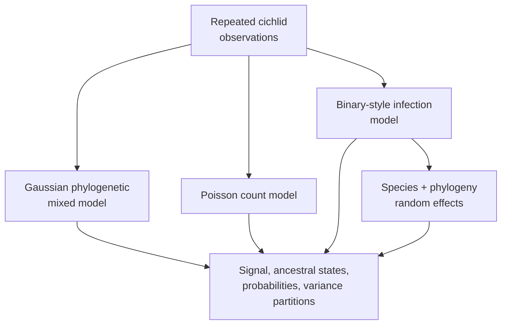

# PCM5: Cichlid Phylogenetic Generalized Linear Mixed Models

PCM5 extends the cichlid analysis beyond Gaussian responses. It covers
posterior-derived phylogenetic signal, ancestral node effects, Poisson parasite
counts, binary-style infection outcomes, probability-scale summaries, and
repeated observations with both species and phylogenetic random effects.

## Why Model Families Stay Separate

Gaussian, Poisson, and binary-style models operate on different likelihood and
link scales. A coefficient on the log or latent scale is not already a change
in expected count or infection probability. Residual variance conventions also
differ, which changes posterior phylogenetic-signal calculations.

Repeated observations add another variance component. Species identity and
phylogenetic relatedness must not be merged into one unnamed random effect.

## Preserve The Scale Of Every Quantity

| Model component | Linear-predictor scale | Response-scale interpretation |
| --- | --- | --- |
| Gaussian response | identity | expected response changes directly with the coefficient |
| Poisson count | log | exponentiated coefficient is a multiplicative expected-count ratio |
| binary-style outcome | logit or source-declared latent scale | inverse-link transformation yields probability; averaging and transforming do not generally commute |
| phylogenetic random effect | model-specific latent scale | variance contribution depends on covariance scaling and family convention |
| species random effect | model-specific latent scale | repeated-observation heterogeneity distinct from phylogenetic covariance |

Posterior intervals should be transformed draw by draw when a response-scale
summary is required. Transforming only posterior means can conceal asymmetry
and does not preserve interval coverage.

## Evidence Decomposition

| Bundle | Evaluated surface |
| --- | --- |
| `evidence-001` | workspace reload and repeated-measure data contract |
| `evidence-002` | posterior phylogenetic signal for the Gaussian model |
| `evidence-003` | ancestral-node posterior extraction and export |
| `evidence-004` | tree-linked ancestral plotting contract |
| `evidence-005` | Poisson phylogenetic parasite-count model |
| `evidence-006` | infection model and logit-scale summaries |
| `evidence-007` | intercept and slope transformation to probability scale |
| `evidence-008` | repeated-measure `species + treetip` random effects |
| `evidence-009` | phylogenetic, species, and residual variance partition |

The nine claim records and bundle contracts are checked in, and all nine
comparison verdicts are `not_comparable`. The repository's binary comparative
utilities provide adjacent capability but do not reproduce the external
generalized mixed-model posterior. No governed comparison execution or
observation ledger currently closes that gap.

## Retained Record State

| Record layer | Present in every bundle | What it establishes |
| --- | --- | --- |
| claim and manifest | yes | stable claim ID, direct-parity intent, source basis, limitation, and `not_comparable` verdict |
| authored `reference.R` | yes | writes a contract naming `PCM5_PGLMM.R` and `PCM5_extra_code.R`; it does not execute their posterior models |
| authored `analysis.py` | yes | writes a `bundle_contract_only` record with `BUILD_SCRIPT = None` and no primary outputs |
| checks, provenance, and reviewer summaries | yes | source identity, required bundle structure, and readable current status |
| governed primary outputs | no | all nine results manifests record `governed_primary_output_count: 0` |
| claim-level observations | no | no aligned draws, coefficients, node summaries, transformed probabilities, diagnostics, or variance partitions are adjudicated |

Contract wrappers make the missing work locatable; they are not implementations
of the generalized posterior workflow. The results manifests describe possible
local `reference-contract.json` and `analysis-run.json` rerun products, but
those ephemeral files are not governed scientific outputs.

## Current Verdict

All nine bundle manifests record `not_comparable`. The dossiers identify the
source code, datasets, claim boundaries, and required outputs, but their
governed primary-output count is zero and no governed lane currently reproduces
the `MCMCglmm` Poisson, multinomial, ancestral, or multiple-random-effect
posteriors under matched priors and chain policy.

This status also prevents an unsafe substitution: a phylogenetic logistic
approximation, a Gaussian model, or a non-phylogenetic generalized model cannot
inherit the PCM5 claim merely because it accepts similar columns.

## Verdict And Follow-Through

| Axis | Current state | Consequence |
| --- | --- | --- |
| bundle verdict | all nine are `not_comparable` | no count, infection, ancestral, probability-scale, or variance-partition claim has posterior correspondence |
| source and input identity | governed | scripts, datasets, tree, workspace objects, and claim decomposition are reviewable; analytical rerun success is not implied |
| adjacent runtime capability | narrower binary and comparative methods exist | similar inputs or output columns do not make the model, link, priors, or random effects equivalent |
| resolution work | open | matched `MCMCglmm` execution, posterior observations, diagnostics, and claim adjudication remain required |

Do not use open follow-through as the bundle verdict. Do not interpret
`not_comparable` as a failed chain: the required comparable execution is absent,
so a numerical pass/fail conclusion is not yet available.

## Comparison Contract By Model Family

| Family | Identity that must match before values are compared |
| --- | --- |
| Poisson count | link, exposure or offset, overdispersion treatment, priors, random effects, and count scale |
| binary-style infection | source family, latent or link scale, residual convention, threshold or category coding, and probability transform |
| repeated measures | observation unit, species identity, phylogenetic effect, residual structure, and covariance among repeated records |
| ancestral posterior | node identity, tree revision, state/parameter scale, retained draws, and summary rule |
| variance partition | every numerator and denominator component, covariance scaling, family-specific residual convention, and draw-wise calculation |

Only after those identities align, both computational surfaces execute, and
the eligible denominator is complete should a governed lane compare posterior
draws or summaries and assign an Evidence Book verdict.

## Inputs And Provenance

The dossier contains `cichlid.csv`, `cichlidtree.nex`, `fishdata.RData`,
`PCM5_PGLMM.R`, and `PCM5_extra_code.R`. Identities and sources are recorded
in the [dataset catalog](https://github.com/bijux/bijux-phylogenetics/blob/main/evidence-book/studies/cichlid-phylogenetic-generalized-linear-mixed-models/datasets/README.md),
[provenance record](https://github.com/bijux/bijux-phylogenetics/blob/main/evidence-book/studies/cichlid-phylogenetic-generalized-linear-mixed-models/provenance/README.md),
and [runtime/reference mapping](https://github.com/bijux/bijux-phylogenetics/blob/main/evidence-book/studies/cichlid-phylogenetic-generalized-linear-mixed-models/reference/README.md).

## Derived Quantity Discipline

Probability-scale values must retain their link-scale source and transformation
formula. Posterior phylogenetic signal must name the variance components and
denominator; the convention for a binary-style model cannot be silently copied
from the Gaussian model. Ancestral node effects must retain node-to-tree
identity rather than relying on plotting order.

When a denominator contains phylogenetic, species, residual, or
distribution-specific variance, record every term and the scale on which it is
defined. Two quantities labelled “phylogenetic signal” are not comparable if
their denominators or latent-scale conventions differ.

## Review Priorities

- Confirm response family, link, and observation unit for every model.
- Compare posterior values on matching scales and parameterizations.
- Preserve chain diagnostics before interpreting derived quantities.
- Keep species and phylogenetic variance components identifiable.
- Verify node identities in ancestral exports and figures.
- Retain the external `MCMCglmm` dependency in provenance and verdicts.

## Current Scope

PCM5 provides nine explicit review units and the data/source context needed to
close them. It does not claim a native PGLMM implementation or governed
posterior parity. See the
[generalized mixed-model evidence boundary](generalized-mixed-model-evidence-boundary.md)
for closure requirements.
