# Reading An Evidence Bundle

An Evidence Book bundle is a claim record with executable and reviewable
dependencies. Read it from identity to observation; starting with the summary
report makes it too easy to miss a narrower claim, excluded output, or stale
dependency.

## Answer Six Questions Before Citing

A first review should be able to answer these questions directly from governed
records:

| Question | Owning record |
| --- | --- |
| What exact statement is evaluated? | `claims.json` claim text and scope |
| Which population and method does it cover? | claim dependencies, input manifest, and provenance |
| Did both named computations produce identified primary outputs? | provenance and results inventory |
| Which observations are required, missing, excluded, or mismatched? | claim dependency map and machine result ledgers |
| What rule turns those observations into a verdict? | `checks.json` and observation-level comparison fields |
| Is that verdict current for this repository revision? | freshness, integrity, and resolution indexes |

If any answer comes only from `report.md`, a plot, a filename, or contextual
prose, continue to the owning machine record. If no owning record exists, the
claim is not ready for citation at that point in the chain.

### A Short First Review

For an initial assessment, open only five records in this order:

1. `manifest.json` for bundle identity, claim roster, verdict, and limitations;
2. `inputs.manifest.json` for the exact source and derived analytical objects;
3. `provenance.json` for reference and Bijux execution identities;
4. `checks.json` plus the machine result ledger for the denominator and rule;
5. the freshness index for whether that chain is current.

This route is sufficient to decide whether the bundle contains a governed
comparison, a mismatch, a contract-only design, or stale evidence. Read
`report.md` afterward for interpretation. A report that cannot be reconstructed
from those five records is not the authority for the claim.

## Stop At The First Broken Evidence Edge

Evidence review is not a scavenger hunt for a nearby favorable value. Move
backward from the intended statement and stop when the owning edge is absent,
stale, or contradictory.

| Broken edge | What remains usable | What must stop |
| --- | --- | --- |
| statement → claim | general study context and capability description | citation of the statement as governed evidence |
| claim → required observation | claim design and declared closure contract | a verdict based on the available subset |
| observation → comparison rule | raw values and identities | matched, tolerance, or mismatch language |
| comparison → execution | retained comparison schema or fixture | assertion that either program produced the value |
| execution → primary output | invocation and terminal state | numerical interpretation of a missing or malformed result |
| primary output → input identity | output artifact as an orphaned record | reproduction or transfer to a named population |
| current bundle → freshness indexes | historical bundle inspection | present-tense citation |

Do not bridge the gap with a study-guide number, a runtime capability, a
different bundle, or a hand-computed substitute. Record the exact stopping
edge; that is more informative than flattening every failure into “evidence is
missing.”

## Classify The Bundle Before Reading Its Result

The directory shape is intentionally similar across bundles, but the evidence
state is not. Determine which state is actually retained before interpreting
scripts, tables, or reports.

| Retained state | What exists | Defensible use |
| --- | --- | --- |
| governed comparison | both execution identities, primary outputs, aligned observations, rules, and verdict | cite only the registered claim and its complete denominator |
| governed comparison with mismatches | comparable observations whose rules are violated | report the mismatches and accepted explanations, if any; do not average them away |
| contract-only design record | source, inputs, claim decomposition, wrappers, checks, and explicit absent-output state | explain the intended comparison and exact closure requirements |
| stale comparison | previously governed record whose material dependency changed | historical inspection only until rebuilt and adjudicated |
| internally contradictory record | bundle, result, report, or generated index disagree | stop the affected claim and resolve the canonical owner |

Executable-looking `analysis.py` and `reference.R` files do not distinguish
the first state from the third. Primary output identity, observation records,
and the manifest verdict do.

## Follow The Bundle In Dependency Order

```mermaid
flowchart LR
    manifest["manifest.json<br/>identity and scope"] --> claims["claims.json<br/>bounded statements"]
    claims --> inputs["inputs.manifest.json<br/>source and derived inputs"]
    inputs --> provenance["provenance.json<br/>source and execution identity"]
    provenance --> programs["reference.R<br/>analysis.py"]
    programs --> checks["checks.json<br/>registered rules"]
    checks --> results["results/<br/>machine observations"]
    results --> report["report.md<br/>human review"]
    report --> indexes["freshness and<br/>repository indexes"]
```



The arrows are evidentiary dependencies, not a suggested trust hierarchy.
Human prose is valuable for interpretation, but it cannot create an
observation absent from the governed result files.

## Begin With Identity And Scope

Open `manifest.json` first. Confirm the study and evidence identifiers, title,
owner package, comparison mode, source basis, reference tools, limitations,
freshness dependencies, claim identifiers, and bundle verdict. A familiar
study title is not sufficient identity; several bundles can divide one study
into distinct questions.

Then open `claims.json`. One bundle can register several claim verdicts with
different scopes even when the bundle has one headline verdict. Resolve the
exact statement you intend to use and retain its `claim_id`.

## Reconstruct The Inputs

`inputs.manifest.json` separates source inputs from governed local artifacts
and derived local inputs. Review locator, class, mutability, and checksum. A
derived output reused by a later calculation is not an original source merely
because it appears in an input manifest.

The study dataset registry supplies dataset identity and provenance beyond one
bundle. Follow that registry when a claim depends on a checked-in data copy,
workspace object, tree, or externally sourced table.

## Compare Programs And Execution

`reference.R` and `analysis.py` state the two executable surfaces being
compared. Their presence does not prove they ran or produced primary outputs.
Use `provenance.json`, result inventories, and execution records to establish
versions, invocations, and output identity.

Contract-only bundles intentionally retain code that declares a missing
execution boundary. Check `primary_output_paths` and the results manifest
before interpreting code presence as numerical evidence.

## Read Checks Before Values

`checks.json` defines required local artifacts, required result artifacts,
expected verdict status, comparison mode, source locators, and validation
rules. Observation files may carry additional tolerances or structural keys.

Do not choose a tolerance after reading the difference. Do not compare rows by
position when the check contract identifies taxa, coefficients, nodes, clades,
or parameters. A check that establishes file presence cannot establish
numerical correspondence.

## Inspect Machine Results Before The Report

The `results/manifest.json` inventory identifies the governed result
population. Read the machine JSON, CSV, TSV, or Newick observations that own
the claim before `report.md` and reviewer summaries. Preserve missing rows,
excluded observations, non-comparable entries, and mismatches in the
denominator.

| Record | Question it answers |
| --- | --- |
| result inventory | which outputs were declared and retained? |
| observation ledger | what exact values or structures were compared? |
| check outcome | did each observation satisfy its registered rule? |
| claim record | which bounded statement consumes those observations? |
| bundle report | how should a person interpret the bundle as a whole? |

These records are related but not interchangeable.

## Confirm Currency Outside The Bundle

Finish with the repository freshness, integrity, evidence, parity, coverage,
and resolution indexes. A bundle can be internally coherent but stale after a
material code, source, dataset, or configuration change. A generated index can
also lag its bundle; any contradiction stops citation until the owning records
are rebuilt or investigated.

Currency is claim-specific. An unchanged dataset does not keep a claim current
when its runtime implementation changed; an unchanged implementation does not
keep it current when a source locator, reference execution, tolerance, schema,
or claim dependency changed. Record which dependency triggered review instead
of replacing a specific freshness failure with the word “stale.”

## Produce A Citation Packet

For a defensible downstream statement, retain the repository revision, study
and evidence identifiers, claim identifier and exact wording, source and input
identities, compared observation rows, check and tolerance, verdict,
limitations, freshness state, and links to the owning machine records. Cite the
public study guide for context and the governed bundle records for proof.

If the chain stops before an observation or current verdict, say precisely
where it stops. A well-described gap remains a design or provenance record; it
does not become scientific correspondence.

### Citation Packet Minimum

```text
repository revision:
study_id / evidence_id / claim_id:
population and method:
source and input identities:
reference and Bijux execution identities:
observation keys and complete denominator:
comparison rule and tolerance:
verdict and limitations:
freshness state:
resolution state, when applicable:
```

Every field narrows the statement. If an execution or observation field is
absent because the bundle is contract-only, retain that absence explicitly
instead of filling it from nearby capability documentation.
