# Reading An Evidence Bundle

An Evidence Book bundle is a claim record with executable and reviewable
dependencies. Read it from identity to observation; starting with the summary
report makes it too easy to miss a narrower claim, excluded output, or stale
dependency.

## Follow The Bundle In Dependency Order

```mermaid
flowchart LR
    manifest["manifest.json<br/>identity and scope"] --> claims["claims.json<br/>bounded statements"]
    claims --> inputs["inputs.manifest.json<br/>source and derived inputs"]
    inputs --> provenance["provenance.json<br/>source and execution identity"]
    provenance --> programs["reference.R<br/>analysis.py"]
    programs --> checks["checks.json<br/>registered rules"]
    checks --> results["results/<br/>machine observations"]
    results --> report["report.md<br/>human review"]
    report --> indexes["freshness and<br/>repository indexes"]
```

The arrows are evidentiary dependencies, not a suggested trust hierarchy.
Human prose is valuable for interpretation, but it cannot create an
observation absent from the governed result files.

## Begin With Identity And Scope

Open `manifest.json` first. Confirm the study and evidence identifiers, title,
owner package, comparison mode, source basis, reference tools, limitations,
freshness dependencies, claim identifiers, and bundle verdict. A familiar
study title is not sufficient identity; several bundles can divide one study
into distinct questions.

Then open `claims.json`. One bundle can register several claim verdicts with
different scopes even when the bundle has one headline verdict. Resolve the
exact statement you intend to use and retain its `claim_id`.

## Reconstruct The Inputs

`inputs.manifest.json` separates source inputs from governed local artifacts
and derived local inputs. Review locator, class, mutability, and checksum. A
derived output reused by a later calculation is not an original source merely
because it appears in an input manifest.

The study dataset registry supplies dataset identity and provenance beyond one
bundle. Follow that registry when a claim depends on a checked-in data copy,
workspace object, tree, or externally sourced table.

## Compare Programs And Execution

`reference.R` and `analysis.py` state the two executable surfaces being
compared. Their presence does not prove they ran or produced primary outputs.
Use `provenance.json`, result inventories, and execution records to establish
versions, invocations, and output identity.

Contract-only bundles intentionally retain code that declares a missing
execution boundary. Check `primary_output_paths` and the results manifest
before interpreting code presence as numerical evidence.

## Read Checks Before Values

`checks.json` defines required local artifacts, required result artifacts,
expected verdict status, comparison mode, source locators, and validation
rules. Observation files may carry additional tolerances or structural keys.

Do not choose a tolerance after reading the difference. Do not compare rows by
position when the check contract identifies taxa, coefficients, nodes, clades,
or parameters. A check that establishes file presence cannot establish
numerical correspondence.

## Inspect Machine Results Before The Report

The `results/manifest.json` inventory identifies the governed result
population. Read the machine JSON, CSV, TSV, or Newick observations that own
the claim before `report.md` and reviewer summaries. Preserve missing rows,
excluded observations, non-comparable entries, and mismatches in the
denominator.

| Record | Question it answers |
| --- | --- |
| result inventory | which outputs were declared and retained? |
| observation ledger | what exact values or structures were compared? |
| check outcome | did each observation satisfy its registered rule? |
| claim record | which bounded statement consumes those observations? |
| bundle report | how should a person interpret the bundle as a whole? |

These records are related but not interchangeable.

## Confirm Currency Outside The Bundle

Finish with the repository freshness, integrity, evidence, parity, coverage,
and resolution indexes. A bundle can be internally coherent but stale after a
material code, source, dataset, or configuration change. A generated index can
also lag its bundle; any contradiction stops citation until the owning records
are rebuilt or investigated.

## Produce A Citation Packet

For a defensible downstream statement, retain the repository revision, study
and evidence identifiers, claim identifier and exact wording, source and input
identities, compared observation rows, check and tolerance, verdict,
limitations, freshness state, and links to the owning machine records. Cite the
public study guide for context and the governed bundle records for proof.

If the chain stops before an observation or current verdict, say precisely
where it stops. A well-described gap remains a design or provenance record; it
does not become scientific correspondence.
