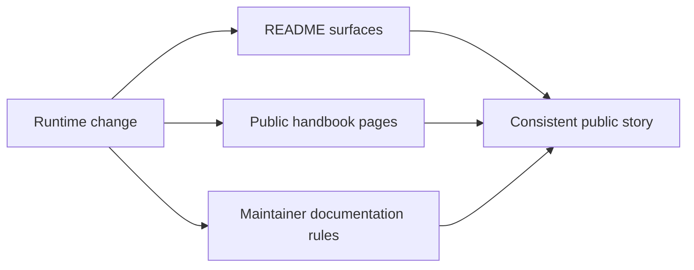

# Documentation System

The documentation system section exists so maintainers can review how the
repository describes itself in public without mixing product behavior, evidence
status, and maintainer-only policy into one blurry surface.

## Section Scope

- [Documentation ownership](documentation-ownership.md) explains which
  documentation layer owns which question.
- [Native surface documentation](native-surface-documentation.md) explains how
  flagship native work stays visible across reference, workflow, and quality
  pages.

## Start With

- Open [Documentation ownership](documentation-ownership.md) when the question
  is where a new claim belongs.
- Open [Native surface documentation](native-surface-documentation.md) when
  the question is whether a new native surface is documented deeply enough to
  be part of the public release story.
