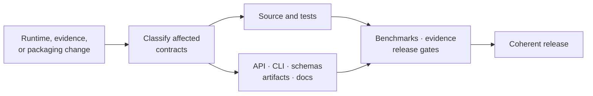

# Maintainer Handbook

Maintaining `bijux-phylogenetics` means preserving one coherent contract across
source, distributions, commands, schemas, artifacts, evidence, documentation,
and release metadata. A change is complete only when every affected surface is
identified and verified.

## Maintained Invariants

| Invariant | Failure signal |
| --- | --- |
| published distributions describe the same runtime contract | alias imports, commands, metadata, or examples diverge |
| native and external computation remain attributable | an adapter is described as a native algorithm |
| structured results remain the source for reports | reports contain values absent from machine-readable output |
| evidence verdicts remain claim-scoped and fresh | broad claims cite stale or neighboring bundles |
| generated files remain generated | synchronized or indexed output is hand-edited |
| local execution leaves a clean source tree | caches, sites, logs, or reports appear outside `artifacts/` |

## Change Classification

| Change | Minimum affected surfaces |
| --- | --- |
| public Python signature or result | source, contract tests, API docs, examples, serialization |
| CLI command or option | command tests, generated reference, workflow guide, exit behavior |
| artifact schema or manifest | producer, consumer tests, compatibility notes, evidence freshness |
| numerical method or default | numerical tests, benchmarks, method docs, affected evidence |
| external-engine adapter | discovery, invocation, parser, provenance, operational guide |
| package metadata or alias | both distribution READMEs, build/install smoke tests, release metadata |
| study claim, check, or input | bundle, indexes, freshness, public study guide |

## Stewardship Workflow

1. Classify the change by scientific and compatibility impact.
2. Identify the canonical owner before editing projections or generated files.
3. Implement and test the owned contract.
4. Regenerate governed derivatives with repository tooling.
5. Review public imports, commands, schemas, artifacts, examples, and package
   metadata for drift.
6. Re-evaluate benchmarks and evidence whose material dependencies changed.
7. Run the narrow checks during development and the release-relevant checks
   before publication.
8. Confirm transient outputs remain under `artifacts/` and the worktree
   contains only intentional source changes.

## Handbook Areas

- [Documentation system](documentation-system/index.md): canonical sources,
  ownership, generated references, and native-surface coverage.
- [Trust surfaces](trust-surfaces/index.md): cross-surface compatibility,
  claim language, artifacts, validation lanes, and study guides.
- [Repository operations](repository-operations/index.md): environment,
  generated artifacts, release alignment, and operational verification.

## Release Evidence

A release decision should retain the revision, exact checks, package build and
install results, documentation build, API/schema validation, evidence
freshness, and any intentionally open scientific boundaries. “CI passed” is
not a sufficient reconstruction record when multiple workflows and optional
engines are involved.

## Escalation Boundaries

Do not repair a failing evidence verdict by weakening its tolerance, removing a
case, or changing prose. Do not patch generated shared standards downstream.
Do not broaden a public claim because an adjacent method passes. Stop
publication when package identity, schema compatibility, artifact integrity,
or evidence provenance cannot be established.
