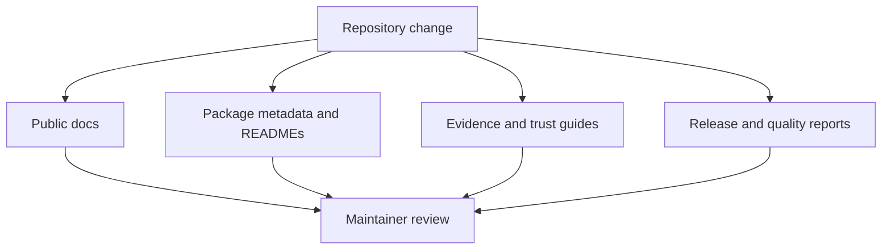
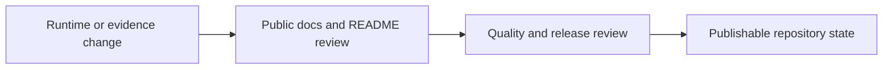

title: Maintainer Handbook
audience: maintainer
type: handbook
status: active
owner: bijux-phylogenetics-dev
last_reviewed: 2026-07-04
---

# Maintainer Handbook

Use this handbook when the question is about repository health, release
alignment, or documentation stewardship rather than runtime product use.

## What Maintainers Are Responsible For

- keeping public docs, package READMEs, and metadata aligned with the actual
  runtime surface
- preserving the boundary between native ownership, wrapper orchestration, and
  evidence closure
- keeping release narratives truthful across documentation and governed
  readiness reports
- preventing root clutter and unmanaged artifact drift

## Stewardship Loop

## What This Handbook Helps Prevent

- public pages that understate the runtime depth now present in the code and
  tests
- native surfaces that appear in code but disappear from package READMEs or
  release guidance
- evidence-book pages that sound conclusive when the governed study record is
  still bounded
- repository runs that leave unmanaged root artifacts behind

## Why This Maintainer Surface Exists

This repository now publishes a much larger public story than a small utility
package would. That means maintainers are responsible not only for keeping the
site green, but also for making sure:

- package READMEs do not undersell what the runtime now owns
- public docs do not hide major native surfaces behind workflow-only language
- evidence guides do not imply more closure than the checked-in record
- release narratives stay aligned across docs, metadata, and governed reports

## Handbook Sections

- [Documentation system](documentation-system/index.md) for documentation
  ownership and native surface documentation rules
- [Trust surfaces](trust-surfaces/index.md) for public trust surface
  maintenance, public interface and artifact maintenance, and trust lane and
  study guide maintenance
- [Repository operations](repository-operations/index.md) for artifact hygiene
  and release surface alignment

## Start With

- Open [Documentation system](documentation-system/index.md) when the question
  is how public docs, package READMEs, and flagship native surfaces should be
  described together.
- Open [Trust surfaces](trust-surfaces/index.md) when the concern is whether
  architecture, evidence-book, interface, and validation pages still tell one
  bounded public story.
- Open [Repository operations](repository-operations/index.md) when the
  question begins with artifact hygiene, release alignment, or repository
  execution discipline.

## Boundary

This handbook exists for repository stewardship, not product semantics. When a
maintainer rule only wraps a runtime surface, this handbook should stop at the
integration point and send the reader back to the owning product page.

For maintainers scanning by keyword, this handbook explicitly covers
documentation ownership, native surface documentation, public trust surface
maintenance, public interface and artifact maintenance, trust lane and study
guide maintenance, artifact hygiene, and release surface alignment.

The maintained review vocabulary in this handbook includes these exact surface
names because they are part of the repository's checked-in trust contract:

- `public trust surface maintenance`
- `trust lane and study guide maintenance`
