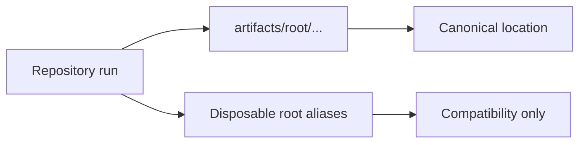

# Artifact Hygiene

Repository execution should leave governed outputs under `artifacts/`, not
durable clutter at the repository root.

## Canonical Paths

Prefer the canonical artifact-owned paths directly when a maintainer command needs a concrete executable or output root:

- root environment: `artifacts/root/check-venv/`
- tox work directory: `artifacts/root/tox/`
- hypothesis state: `artifacts/root/hypothesis/`
- benchmark scratch space: `artifacts/root/benchmarks/`

Those are the durable contract paths. Root aliases exist only as disposable
compatibility conveniences.

## Disposable Root Aliases

The root `.venv`, `.tox`, `.hypothesis`, and `.benchmarks` paths should be
treated as temporary alias links into `artifacts/root/`.

- `make setup` may recreate them
- `make clean-root-artifacts` may remove them
- maintainers should not depend on them as the only route to governed
  environments or caches

If one alias becomes a real directory instead of a symlink, that is drift, not
an acceptable steady state.

## Review Checklist

- Does a new command write into `artifacts/` rather than the root?
- Does a new guide point to the canonical artifact path instead of only to
  `./.venv`?
- Does cleanup remove disposable aliases and stray caches without touching
  checked-in evidence?

## Why This Matters

Public trust is partly operational. A repository that claims governed outputs
but leaves unmanaged root clutter behind looks less reproducible and less
intentional, even when the code itself is sound.
