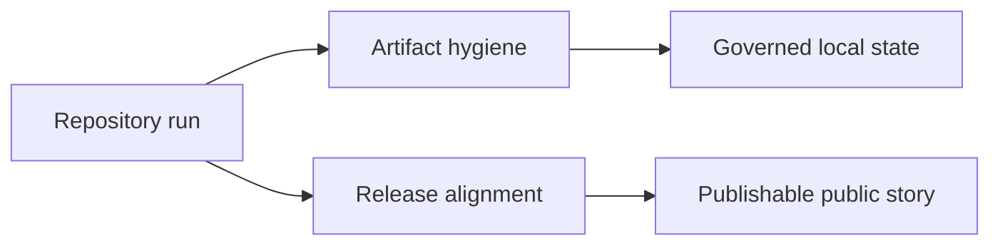

# Repository Operations

Repository operations cover the release-facing and execution-facing rules that
keep the checked-in public story reproducible. They are maintainer concerns,
but they affect whether the repository looks disciplined and publishable to an
external reader.

## Why This Section Matters

Operational drift is visible. A repository that claims governed outputs but
still leaves root clutter, contradictory release language, or unmanaged local
state behind will look less trustworthy even when the code itself is strong.

## Section Scope

- [Artifact hygiene](artifact-hygiene.md) explains canonical artifact paths,
  disposable root aliases, and root-clutter review
- [Release surface alignment](release-surface-alignment.md) explains how docs,
  metadata, and governed reports need to agree before release

## Start With

- Open [Artifact hygiene](artifact-hygiene.md) when a command, cache, or
  report path changes.
- Open [Release surface alignment](release-surface-alignment.md) when docs,
  metadata, or release claims are being revised together.
