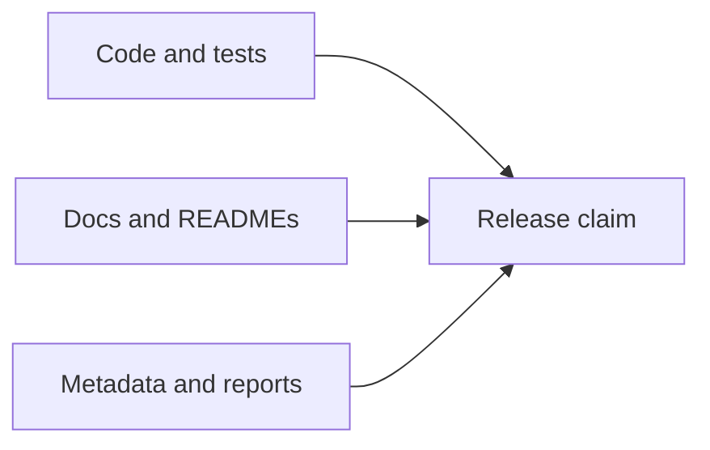

# Release Surface Alignment

Release readiness in this repository depends on narrative alignment as much as
on green checks.

## Surfaces That Must Agree

- root `README.md`
- package `README.md` files
- public docs
- maintainer docs where release rules are described
- package `pyproject.toml` metadata
- publish-readiness and release-readiness reports

## Alignment Questions

- Do the README and public docs name the same product surface?
- Do package descriptions and classifiers match the public maturity story?
- Do native inference claims stay bounded by the actual runtime contracts?
- Do wrapper-backed workflows remain labeled as wrapper-backed where that is
  still the honest boundary?
- Do benchmark and evidence docs describe differences in review language
  instead of flattening them into one generic claim?

## Minimum Validation For Narrative Changes

- run `uv run mkdocs build --strict`
- run the narrow documentation contract tests when they exist
- run publish-readiness or release-readiness validation when metadata or
  package identity changes materially

## Practical Release Rule

If a capable external reader could compare the README, docs site, package
metadata, and release reports and come away with four different impressions of
the product, the repository is not release-ready yet.

## Release-Blocking Failure Mode

The most serious failure is contradiction:

- code says one thing
- package metadata says another
- the public docs say a third

Maintainers should treat that state as release-blocking.
