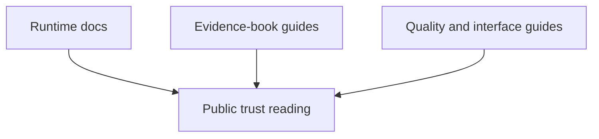

# Trust Surfaces

Trust in this repository comes from alignment across product docs,
evidence-book pages, validation guides, and interface documentation. This
section keeps those reader-facing surfaces reviewable as one bounded system.

## Section Scope

- [Public trust surface maintenance](public-trust-surface-maintenance.md)
  explains how architecture, evidence, release, and package surfaces move
  together.
- [Public interface and artifact maintenance](public-interface-and-artifact-maintenance.md)
  explains how selection guides, reference pages, and artifact docs stay
  synchronized.
- [Trust lane and study guide maintenance](trust-lane-and-study-guide-maintenance.md)
  explains how validation-lane and PCM study language should stay bounded and
  readable.

## Start With

- Open [Public trust surface maintenance](public-trust-surface-maintenance.md)
  when the concern is narrative drift across multiple public surfaces.
- Open [Public interface and artifact maintenance](public-interface-and-artifact-maintenance.md)
  when a workflow or output family changed and discovery routes may now be
  stale.
- Open [Trust lane and study guide maintenance](trust-lane-and-study-guide-maintenance.md)
  when validation language or PCM scope language risks becoming overbroad.
