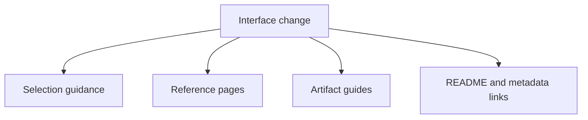

# Public Interface And Artifact Maintenance

The repository documents several public interface layers. Those layers include surface-selection guidance, CLI and Python reference pages, native inference reference pages, artifact guides, and metadata links. They should change together when a workflow, native contract, or output family changes materially.

## Review Surfaces Together

- `docs/phylogenetics/interfaces/index.md`
- `docs/phylogenetics/interfaces/surface-selection.md`
- the affected CLI, API, Python, or native reference pages
- `docs/phylogenetics/interfaces/artifact-contracts.md`
- `docs/phylogenetics/interfaces/artifact-consumption-guide.md`
- root and package README links
- package `pyproject.toml` URLs

## Questions To Ask

- Can a reader still choose the right public surface quickly?
- Do the reference pages still point to the right practical guides?
- Do artifact docs still name stable output families honestly?
- Do package metadata links reinforce the same public interface story?
- Has a new output family become stable enough that it now belongs in the
  public artifact-contract surface?

## Common Drift Pattern

The usual failure is partial interface drift:

- a new workflow exists
- the workflow guide gets updated
- interface selection still points readers elsewhere
- artifact docs never mention the new stable outputs
- package metadata links still describe the older surface map

That leaves the repository looking larger in code than it does in its public
contract story.

## Maintenance Rule

The interface story is only complete when a new reader can discover the
surface, choose it for the right reason, and understand what durable artifacts
it emits without having to inspect source code first.
