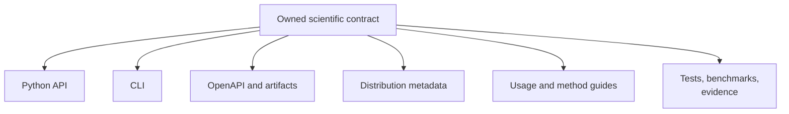

# Cross-Surface Contract Maintenance

One runtime capability can appear as a Python import, CLI command, API schema,
artifact field, package description, workflow example, benchmark subject, and
evidence dependency. These are projections of one contract and must change
together when semantics change.

## Canonical Sources And Projections

| Concern | Canonical source | Projections to inspect |
| --- | --- | --- |
| Python behavior | curated runtime implementation and tests | API guide, examples, serialization |
| command behavior | command registration and tests | generated CLI reference, operations guides |
| service contract | pinned OpenAPI schema | API guide, clients, schema hash |
| artifact meaning | result and manifest contracts | reports, consumer guide, evidence bundles |
| package identity | package metadata | root/package READMEs, badges, release records |
| evidence verdict | bundle claims and checks | indexes, study guides, release claims |

Never edit a projection to conceal disagreement with its canonical source.

## Change Impact Review

For each material change, record:

1. the owned contract and compatibility class;
2. affected Python, CLI, schema, and artifact surfaces;
3. affected package descriptions and examples;
4. benchmarks whose configuration or interpretation changed;
5. evidence bundles made stale by code, input, or configuration changes;
6. verification commands and observed outcomes.

## Drift Patterns

- A new native method exists but only an internal module path exposes it.
- The canonical package shows an example the alias cannot execute.
- CLI help changes while the generated command reference stays unchanged.
- A result field changes meaning without an artifact schema change.
- A study guide summarizes a verdict no longer present in the indexes.
- Package metadata calls an adapter-backed workflow native.
- A report renders successfully while omitting warnings from its structured
  result.

## Confidence Vocabulary

Use `implemented`, `tested`, `benchmarked`, `evidence-backed`, and `released`
only with the scope defined by the corresponding contract. Avoid umbrella
labels such as “validated” when the actual proof is one unit test or one study
bundle.

## Publication Gate

A change is ready for publication when canonical sources and projections
agree, compatibility effects are explicit, generated outputs have been
regenerated rather than hand-edited, evidence freshness has been evaluated,
and the repository's package and documentation checks pass from a clean
environment.

An intentionally open scientific verdict can ship. An unacknowledged mismatch
between runtime behavior and its published contracts cannot.
