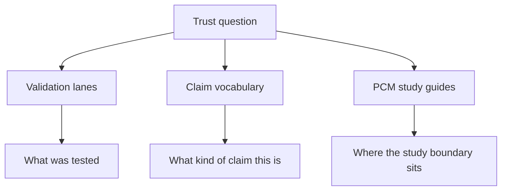

# Trust Lane And Study Guide Maintenance

The public trust story depends on more than general docs and release guides. It also depends on quality pages that explain validation lanes, foundation pages that explain claim types, and PCM study guides that explain bounded analytical scope.

## Review These Together

- `docs/01-bijux-phylogenetics/quality/`
- `docs/01-bijux-phylogenetics/foundation/`
- `docs/02-bijux-phylogenetics-evidence-book/`
- root and package README pointers into those sections

## Questions To Ask

- Does the quality section still explain what each validation lane proves and
  does not prove?
- Does the foundation section still separate runtime, native, wrapper,
  evidence, and release claims clearly?
- Do the PCM study guides still describe their analytical sequence and bounded
  scope honestly?
- Do entry-point pages still route readers toward the strongest trust-reading
  surfaces?

## Failure Pattern

The failure here is trust compression:

- many different proof surfaces exist
- the docs stop distinguishing them clearly
- readers start overreading one lane or one study as broader closure than it is

These guides exist to keep those boundaries readable.

## Maintenance Rule

Every trust-oriented page should answer one distinct question clearly. If two
pages start collapsing into the same vague "confidence" story, the site loses
the precision that makes the evidence-book valuable.
