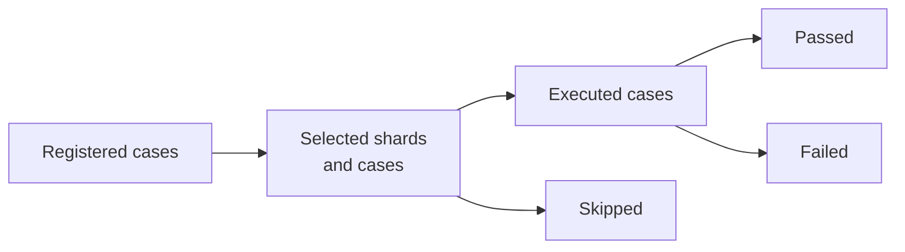

# Artifacts And Reproduction

A parity run is reviewable when its selection, environment, observations, and
failures survive the terminal session. Bijux writes those records explicitly;
the JSON printed to standard output is useful for automation but is not the
whole reproducibility package.

## Reproduce A Checked Fixture

The checked-fixture lane requires no R installation:

```bash
mkdir -p artifacts/parity
bijux-phylogenetics parity \
  --reference-source checked-fixture \
  --summary-out artifacts/parity/checked-summary.tsv \
  --observations-out artifacts/parity/checked-observations.tsv \
  --manifest artifacts/parity/checked-manifest.json \
  --json
```

Use repeated `--reference-method` options to select governed method shards.
Add `--extended` only when the larger posterior tree-set fixtures are intended;
recording that selection matters because the result set changes.

## Reproduce A Live R Case

Live execution is opt-in and tool-specific:

```bash
mkdir -p artifacts/parity/geiger-failures
RUN_LIVE_PARITY=1 bijux-phylogenetics parity \
  --reference-source geiger-live \
  --geiger-shard fit_continuous_bm \
  --summary-out artifacts/parity/geiger-summary.tsv \
  --observations-out artifacts/parity/geiger-observations.tsv \
  --geiger-failure-root artifacts/parity/geiger-failures \
  --manifest artifacts/parity/geiger-manifest.json \
  --json
```

APE and phytools use the corresponding `--ape-*` and `--phytools-*` selection,
executable, and failure-root options. A live label is never retained if the
command silently falls back to frozen data.

## Read The Artifact Set

| Artifact | Review use |
| --- | --- |
| summary table | one row per case with reference source, selection, runtime status, and counts |
| observation table | exact values, differences, tolerances, and per-observation outcomes |
| reproducibility manifest | command context, selected lane, environment and linked outputs |
| failure root | case inputs, external output, diagnostics, and exception context needed to reproduce a mismatch or skip |
| GEIGER review reports | optimizer triage, boundary warnings, likelihood policy, model confidence, parameterization registry, and generated human/machine reports |

Preserve mismatches, skips, warnings, and incomplete outputs. Removing them
from an artifact directory changes the evidentiary meaning of the run even if
the passing summary rows remain.

## Verify The Artifact Set As One Record

After execution, check these relationships rather than opening files in
isolation:

1. The manifest names the requested reference source and the exact selected
   cases or shards.
2. Summary counts reconcile to selected cases and agree with observation
   statuses.
3. Every required observation identifies its case, field, values, rule, and
   outcome.
4. Each failed or skipped case points to enough captured context to diagnose
   execution or comparison failure.
5. Tool and package versions match the environment that produced the files.
6. No downstream report silently drops a non-pass or changes its status name.

Hash or archive the complete directory when it crosses an environment or
review boundary. Copying only the passing table destroys the denominator and
prevents later reviewers from distinguishing absence from success.

## Reconstruct The Denominator

Review registry identity and selection before reading success counts:



The manifest and summary must make each transition countable. Failure roots
explain non-passing cases; they must not be removed before an aggregate is
reported.

## External Engine Bundles

MAFFT, trimAl, IQ-TREE2, FastTree, MrBayes, and BEAST do not use the R parity
command. Their adapters retain the external executable and configuration,
native standard output and error, expected engine files, parsed typed results,
and workflow-level manifests or reports. Review the raw engine artifacts before
the normalized presentation whenever parsing or support semantics are in
question.

An engine bundle establishes governed execution. A cross-engine or native
comparison must separately name aligned fields and statistical meanings; the
presence of two successful run directories is not itself a parity verdict.

## Promotion Into The Evidence Book

Parity artifacts become scientific evidence only when a dossier also binds
them to stable claim identifiers, source references, governed datasets,
explicit checks, freshness records, and a verdict. Promotion does not discard
the parity-level details: the Evidence Book should link or retain the exact
observations that justify its claim. It also preserves the current evidence
verdict and any separate open follow-through or named blocker.

## Reproduction Completion

A rerun is complete when it reconstructs selection, execution identity,
observations, statuses, and failure records—not merely when the command exits
successfully. Differences caused by a newer external package or executable are
new observations. Preserve both revisions and adjudicate the change instead
of overwriting the older run.
