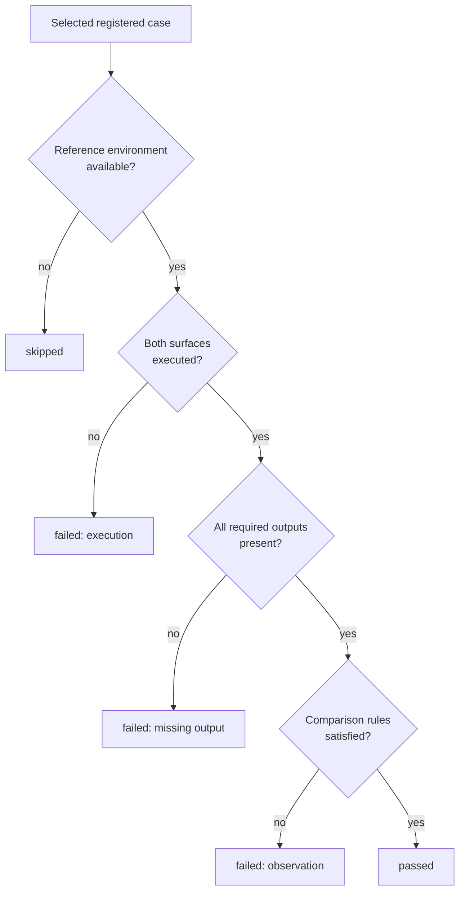

# Interpreting Correspondence

Correspondence is a claim about named outputs under named assumptions. It is
not a promise that two libraries expose identical APIs, optimize identical
objectives, or will agree for every dataset.

## Start With An Equivalence Proposal

Before running either implementation, state why the compared outputs should
represent the same quantity. The proposal must bind scientific meaning before
normalization or tolerance is considered.

| Identity to align | Example review question |
| --- | --- |
| analytical population | are the same taxa, rows, loci, states, and exclusions admitted? |
| estimand | do both outputs answer the same coefficient, likelihood, topology, ancestral-state, or posterior question? |
| parameterization | do bounds, signs, transforms, priors, factors, roots, and branch scales have the same meaning? |
| observation key | can each scalar, row, node, clade, split, matrix entry, replicate, or draw be joined without position guessing? |
| execution owner | is the record comparing native implementations, a Bijux adapter with its external engine, or a frozen reference fixture? |

If the estimands cannot be aligned, record `not_comparable` at the evidence
layer. Do not search for a scale transform or large tolerance that merely makes
the displayed values close.

## Comparison Record

| Field | Reviewer question |
| --- | --- |
| reference source | Did the run use a live tool or a checked fixture? |
| case and shard | Which operation, model, and input family were selected? |
| versions | Which Bijux, Python, R, package, or executable versions ran? |
| normalization | How were taxa, states, units, roots, likelihood signs, and support scales aligned? |
| observations | Which exact scalar, vector, matrix, topology, or distribution summaries were compared? |
| tolerance | What absolute, relative, structural, or distribution rule decides agreement? |
| case status | Did the registered run pass, fail, or skip? |
| mismatch reason | Which execution, normalization, field, row, tolerance, or availability condition explains a non-pass? |
| artifacts | Where are inputs, raw outputs, observations, warnings, and failure details retained? |

## Runtime Case Status

- `passed`: the selected case executed and every registered observation rule
  held, including declared tolerances where applicable;
- `failed`: Bijux or reference execution failed, required output was missing,
  or at least one registered comparison rule was violated;
- `skipped`: the live reference environment was unavailable or the case was
  not executable under the selected lane.

Retain separate selected, passed, failed, and skipped counts. “Passed” is a
runtime harness outcome, not the `matched` verdict stored in a scientific
evidence bundle.

## Audit Normalization Before Tolerance

Normalization is admissible only when it aligns representation without
silently changing the scientific quantity. Review it before applying a
numerical or structural acceptance rule.

| Normalization | Required audit record | Refuse comparison when |
| --- | --- | --- |
| taxon, node, clade, or state labels | original identifiers, mapping, collisions, omissions, and ordering | the mapping is ambiguous or many-to-one without a declared aggregation |
| rooted or unrooted topology | rooting policy, shared taxon set, split/clade definition | the compared topology objects answer different questions |
| likelihood, rate, distance, or support scale | source convention, units, sign/scale transform, and inverse interpretation | the transform cannot recover each source estimand |
| factor, matrix, or parameter ordering | source order, target order, key mapping, and absent keys | row position is the only join identity |
| stochastic or posterior summary | replicate/draw population, estimator, transform, and invalid-value policy | denominators or summary estimands differ |

Retain raw and normalized observations side by side. A transformation chosen
after observing the difference belongs to a new comparison rule; it cannot be
used to rewrite the original failure as a pass.

## Declare A Normalization Loss Budget

Normalization may remove representational differences only when the removed
information is irrelevant to the registered observation. Its loss budget must
be explicit and reviewable.

| Normalization class | Admissible example | Information that must remain |
| --- | --- | --- |
| canonical formatting | equivalent Newick whitespace or stable numeric formatting | topology, labels, branch/support semantics and full-precision source values |
| key reordering | map parameter or matrix rows by stable names | original order, mapping, missing/duplicate keys and reordered values |
| unit conversion | time or distance through a declared invertible factor | source units, target units, factor and unconverted observation |
| sign or objective conversion | negate a documented log-likelihood convention | source objective definition and reversible transform |
| structural projection | compare shared splits under a declared taxon population | full source trees, excluded taxa, rooting policy and projection identity |
| stochastic summary | compare a predeclared distribution statistic | full replicate denominator, invalid members, estimator and threshold |

Reject normalization when it aggregates distinct taxa or parameters, discards
failed members, chooses a root or category after seeing the result, rounds
beyond the registered tolerance, or maps non-invertible estimands merely
because their summaries look close. The normalized value is a child
observation; the raw source remains its audit owner.

## Promotion To An Evidence Verdict

An Evidence Book bundle may interpret retained parity observations only after
it binds them to a claim, source, governed inputs, explicit checks, provenance,
and freshness. Its allowed verdicts are `matched`, `matched_with_tolerance`,
`mismatch_explained`, `mismatch_unexplained`, and `not_comparable`.

Promotion is not a spelling conversion. A failed case needs scientific review
before it can become an explained or unexplained mismatch. A skipped case may
leave evidence unavailable, but does not automatically establish
`not_comparable`. Resolution state—such as open follow-through or a named
blocker—remains a separate axis.

```mermaid
flowchart LR
    proposal["Equivalence proposal"] --> executions["Identified executions"]
    executions --> raw["Raw outputs"]
    raw --> normalized["Audited normalization"]
    normalized --> observations["Keyed observations"]
    observations --> outcome["Runtime case outcome"]
    outcome --> claim["Claim dependency set"]
    claim --> verdict["Evidence verdict"]
    verdict --> freshness["Current or stale"]
```



Every arrow is reviewable. A later layer may narrow or qualify an earlier one,
but it cannot invent a missing execution, observation, or equivalence rule.

## Reproducing A Comparison

The checked-fixture lane runs without R:

```bash
bijux-phylogenetics parity --reference-source checked-fixture --json
```

Live R lanes are explicit and can be narrowed to registered cases or shards:

```bash
RUN_LIVE_PARITY=1 bijux-phylogenetics parity \
  --reference-source ape-live \
  --ape-shard load_tree \
  --summary-out artifacts/parity/ape-summary.tsv \
  --observations-out artifacts/parity/ape-observations.tsv \
  --json
```

Use the tool-specific registry rather than assuming an R function name has a
Bijux equivalent. Unsupported operations should fail with a named boundary,
not fall through to a neighboring approximation.

## Denominator Check

Before quoting correspondence, record how many cases were registered,
selected, executed, passed, failed, and skipped. Then identify the exact
shards. A statement about “all cases” is invalid when it silently means only
the subset that executed successfully.

For stochastic cases, retain a second denominator inside each selected case:
requested replicates or draws, produced members, rejected or invalid members,
and the population consumed by the summary rule. Case-level `passed=1` does
not disclose whether a distributional check used 10, 1,000, or only the
successful subset of 1,000 requested replicates.

## Diagnose A Non-Pass Without Relabeling It



The runtime case status describes what happened in the harness. Scientific
review then decides whether a failed observation is an explained mismatch, an
unexplained mismatch, or evidence that the proposed quantities were not
comparable. Keep the original case status and failure artifact even after that
review; the later verdict adds meaning rather than rewriting execution history.

## Worked Claim Anatomy

Suppose one `ape-live` `load_tree` case passes. The defensible statement names
the selected case, APE and Bijux versions, tree fixture, rootedness and label
normalization, compared topology fields, exact or structural rule, and
`selected=1, passed=1, failed=0, skipped=0`. It does **not** establish parity
for all 180 APE registry cases, other tree formats, tree inference, branch
length semantics, or future versions.

This scale discipline applies equally to stochastic cases. A distributional
rule can pass without any individual simulated history matching exactly, but
the within-case replication denominator and threshold must remain visible.

## Review Resources

- [Verification matrix](verification-matrix.md) identifies the strongest
  current claim for each external reference.
- [Artifacts and reproduction](artifacts-and-reproduction.md) explains how to
  retain selections, observations, manifests, and failures.
