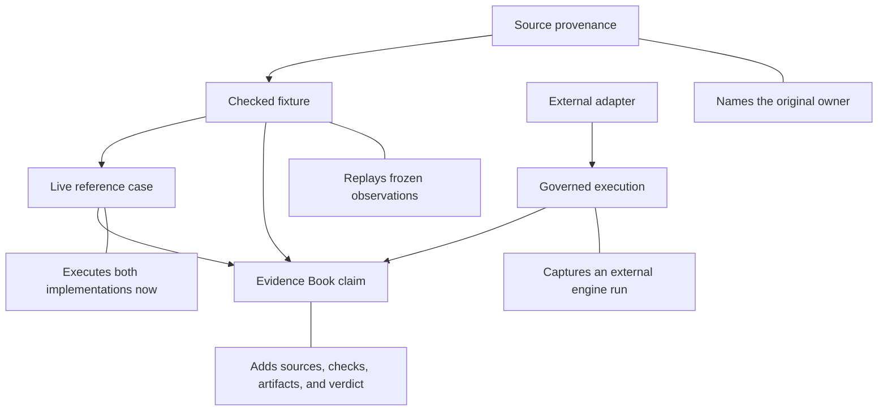

# Verification Matrix

The matrix below names the strongest relationship the repository currently
supports for each external reference. A stronger row must not be inferred from
a weaker one: successful execution is not numerical agreement, and a checked
study fixture is not a package-wide live parity surface.

Read each row as a ceiling on the public statement, not as a score. The
reference name identifies an external owner; the verification mode identifies
how that owner was observed; the strongest claim states the largest supported
scope; and the primary record contains the denominator, failures, and limits.

| Reference | Verification mode | Strongest current claim | Primary record |
| --- | --- | --- | --- |
| APE | live R registry; checked study fixtures | 180 governed cases across 35 function shards, plus named study comparisons | [APE correspondence](../r-ecosystem/ape.md) |
| GEIGER | live R registry | 48 governed cases across 17 model shards with optimizer and parameterization review | [GEIGER correspondence](../r-ecosystem/geiger.md) |
| phytools | live R registry | 65 governed cases across 21 function shards, with distribution rules for stochastic outputs | [phytools correspondence](../r-ecosystem/phytools.md) |
| APE + `nlme` | checked R-derived fixtures | PGLS coefficients, likelihoods, model comparisons, and selected diagnostics for named fixtures | [study-specific R references](../r-ecosystem/study-references.md) |
| `treeio` + `tidytree` | governed study evidence | structural node mapping and tree–trait join observations for the primate longevity fixture | [study-specific R references](../r-ecosystem/study-references.md) |
| `ggtree` | source and plot-intent provenance | plot-only study fragments | [study-specific R references](../r-ecosystem/study-references.md) |
| MAFFT + trimAl | external execution adapters | validated invocation, captured configuration and output, parsed alignment diagnostics | [alignment and trimming](../external-engines/alignment-and-trimming.md) |
| IQ-TREE2 + FastTree | external execution adapters and cross-engine workflow | complete run bundles and comparable topology/likelihood fields where meanings align | [tree inference](../external-engines/tree-inference.md) |
| MrBayes + BEAST | external execution and parser adapters | prepared or executed analyses with trace/tree diagnostics and explicit engine ownership | [Bayesian inference](../external-engines/bayesian-inference.md) |
| `MCMCglmm` | source-backed study boundary | PCM4 and PCM5 bundles retain `not_comparable` verdicts and open posterior follow-through; no posterior parity claim | [study-specific R references](../r-ecosystem/study-references.md) |

## Mode, Outcome, And Verdict

| Term | Applies to | Read from |
| --- | --- | --- |
| verification mode | strength and ownership of the comparison relationship | this matrix and the tool-specific guide |
| case outcome | `passed`, `failed`, or `skipped` execution of a registered parity case | parity summary, observations, and failure artifacts |
| evidence verdict | governed scientific conclusion for identified claims | Evidence Book manifest and indexes |
| resolution state | open follow-through, blocker, or accepted bounded state | verdict workflow and study boundary records |

Do not translate a mode into an outcome or an outcome into a verdict. They
answer different questions and may change on different schedules.

## Verification Has Independent Axes

Do not read the modes as one universal maturity ladder. Strength depends on at
least four independent properties:

| Axis | Weaker evidence | Stronger evidence |
| --- | --- | --- |
| execution freshness | frozen source or fixture | live execution under recorded versions |
| comparison precision | provenance or structural compatibility | named observations with explicit tolerances |
| scientific scope | one operation or adapter contract | claim-bound study evidence |
| reproducibility | prose description | retained inputs, raw outputs, manifest, observations, and failures |

A checked fixture can be more reproducible than an undocumented live run. A
live run can be fresher while remaining scientifically narrower than a study
bundle. An external adapter can have excellent execution evidence without any
numerical correspondence claim. Report the axes that matter instead of
assigning one undifferentiated strength label.

## What Each Mode Establishes

- **Source provenance** identifies where an operation or study originated.
- **Checked fixture** compares Bijux with frozen, versioned reference outputs.
- **Live reference case** executes the named external package and Bijux in the
  same governed run.
- **External adapter** prepares, invokes, captures, and parses a program that
  remains the computational owner.
- **Evidence Book claim** binds a scientific statement to inputs, sources,
  checks, results, freshness, and a reviewable verdict.

## Reading A Claim Safely

Start with the verification mode, then inspect the named operation and
compared fields. Confirm parameterization, taxon order, state encoding,
rooting, units, likelihood convention, and support meaning before interpreting
a passing case. If a scientific claim cites the run, continue to the Evidence
Book verdict and its freshness. Finally, read the non-claims: they define what
neither record can be used to conclude.

A row may advance only when the stronger mode is implemented and governed.
Documentation language alone cannot promote provenance to a checked fixture,
an adapter to parity, or an analytical match to rendered-figure equivalence.

## Select The Record From The Intended Statement

| Intended statement | Minimum owning record |
| --- | --- |
| Bijux can prepare or invoke a named external engine | adapter contract with executable discovery, command, process state, and native outputs |
| one registered operation corresponds for named cases | parity registry plus selected-case summary, keyed observations, rules, and failures |
| one checked fixture reproduces a reference observation | fixture provenance, immutable reference value, Bijux execution, and comparison record |
| one scientific result corresponds under a study contract | Evidence Book claim, complete observation denominator, verdict, limitations, and freshness |
| two ecosystems are generally equivalent | no matrix row supplies this claim; define and govern a finite operation and population first |

Choose the record whose scope matches the sentence. More operational detail
does not compensate for a missing scientific claim, and a study verdict does
not expand to every function offered by its reference package.

## Revision Rule

Registry sizes and strongest claims describe the checked-in revision. When a
registry, normalization rule, reference version, tolerance, or governed
fixture changes, regenerate its summary and reconsider the matrix claim. A
larger case count is not automatically stronger evidence if new cases are
skipped, incomparable, or governed by weaker observations.

The citation should retain the repository revision, verification mode,
reference and Bijux versions, selected operation and population, observation
rule, complete denominator, strongest supported claim, and linked evidence
verdict when one exists. Without the revision and denominator, the matrix row
is navigation rather than a reproducible correspondence statement.
