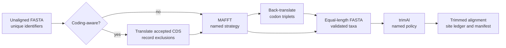

# MAFFT And trimAl Correspondence

MAFFT owns multiple-sequence alignment and trimAl owns external alignment
trimming. Bijux owns the reproducible handoff around those computations: input
validation, named strategy selection, executable identity, captured process
state, output validation, checksums, diagnostics, and the manifest consumed by
tree inference.

## What Correspondence Means At This Boundary

| Statement | Owner | Evidence required |
| --- | --- | --- |
| the input was admissible for the selected route | Bijux validation | identifier, alphabet, coding, exclusion, and source checks |
| this alignment was computed | MAFFT execution through the Bijux adapter | executable identity, command, process state, and native alignment |
| these columns were removed | trimAl execution through the Bijux adapter | policy, native command, input/output matrices, and site ledger |
| the final alignment is the accepted inference input | workflow handoff | artifact checksum, taxa/order, sequence or codon state, partitions, and manifest link |
| the alignment or trimming is biologically optimal | scientific study design | independent adequacy evidence not supplied by adapter completion |

The correspondence claim is therefore about attributable execution and
preserved handoff semantics. It is not a native reimplementation claim and it
does not infer homology quality from a successful process.



## Alignment Strategies Are Explicit

`adapter align` exposes five stable MAFFT strategy names. The manifest retains
the selected name and resolved native arguments:

| Mode | Native argument shape | Intended distinction |
| --- | --- | --- |
| `auto` | `--auto` | let MAFFT select a strategy |
| `linsi` | local-pair plus 1,000 refinement iterations | local homology emphasis |
| `ginsi` | global-pair plus 1,000 refinement iterations | global homology emphasis |
| `einsi` | generalized affine-gap pair plus 1,000 iterations | long-gap and conserved-domain structure |
| `fast` | two guide-tree rebuilds and no iterative refinement | throughput-oriented alignment |

The strategy is a scientific choice. Successful parsing does not establish
that one strategy is optimal for a locus, taxon sample, or downstream model.

## Codon-Aware Alignment Preserves The Translation Contract

With `--codon-aware`, Bijux validates coding nucleotide sequences, resolves an
NCBI genetic code, records excluded sequences and stop-codon behavior,
translates accepted sequences, uses MAFFT on the amino-acid guide, and
back-translates the aligned guide to nucleotide codon triplets.

The accepted result must have equal-length records and a nucleotide alignment
length divisible by three. The output set includes the nucleotide alignment,
guide input, guide alignment, exclusion table, coding summary, and checksums.
This verifies the mechanics of the translation/back-translation contract; it
does not prove annotation correctness or absence of biological frameshifts.

## Trimming Policies Are Not Interchangeable

`adapter trim` supports `gap-threshold`, `gappyout`, `strict`, `strictplus`,
and `automated1`. In `gap-threshold` mode, the configured fraction is converted
to trimAl’s explicit `-gt` argument. The other names map to their corresponding
native automatic policy.

The accepted record retains input and trimmed sequence/site dimensions,
retained and removed site counts, input and output gap percentages, mode, gap
threshold, streams, checksums, and manifest. These measurements describe what
the policy removed; they do not establish that removal improved inference.

## Stage Acceptance And Handoff

| Stage | Accept when | Preserve for review and downstream use |
| --- | --- | --- |
| sequence intake | identifiers are unique, content is non-empty, and declared coding rules are coherent | source checksum, taxa, sequence type, exclusions, coding diagnostics |
| MAFFT execution | executable/version and command are known, process state is accepted, and output is equal-length FASTA | alignment, streams, mode, dimensions, taxa, manifest |
| codon restoration | guide taxa map back to accepted coding records and length is divisible by three | guide files, exclusion and coding tables, final nucleotide alignment |
| trimAl execution | the input is the accepted alignment and trimmed output plus site ledger validate | policy, threshold, dimensions, removed sites, gap summaries, manifest |
| inference handoff | exactly one alignment artifact and checksum are selected | alignment identity, sequence/codon state, partition identity, lineage |

The inference input is the accepted handoff, not the newest FASTA in a
directory. A `fasta-to-tree` workflow composes the same contracts and must
retain the identities and failure states of every included stage.

## Preserve Sequence And Site Coordinates

Alignment changes two identities that downstream analyses often treat as
fixed: a sequence residue acquires an alignment column, and trimming maps an
alignment column into either a retained output column or an explicit removal.
The handoff must therefore retain more than the final matrix dimensions.

| Mapping | Required identity | Failure that blocks the handoff |
| --- | --- | --- |
| source record → accepted record | original identifier, source checksum, exclusion or acceptance reason | duplicate or renamed taxa without a declared mapping |
| coding nucleotide → amino-acid guide | genetic code, codon index, translated residue, stop/ambiguity decision | an accepted codon cannot be reconstructed from the guide record |
| guide alignment → codon alignment | guide column and corresponding nucleotide triplet | back-translation changes order, frame, or accepted taxa |
| MAFFT column → trimAl result | original column index and retained/removed disposition | only a final site count survives |
| trimmed matrix → inference input | artifact checksum, taxon order, sequence type, codon state, and partitions | inference consumes a different or unidentifiable matrix |

This lineage lets a reviewer trace a surprising inferred site or codon back to
the source record. It does not assert that homology or trimming was
biologically correct; those remain scientific judgments outside structural
acceptance.

## Run The Workflow

```bash
bijux-phylogenetics adapter align \
  dataset/sequences.fasta \
  --mode linsi \
  --out artifacts/engines/aligned.fasta \
  --manifest artifacts/engines/alignment-command.json

bijux-phylogenetics adapter trim \
  artifacts/engines/aligned.fasta \
  --mode gap-threshold \
  --gap-threshold 0.1 \
  --out artifacts/engines/trimmed.fasta \
  --manifest artifacts/engines/trimming-command.json
```

For coding sequence:

```bash
bijux-phylogenetics adapter align \
  dataset/coding-sequences.fasta \
  --codon-aware \
  --sequence-type dna \
  --genetic-code 1 \
  --out artifacts/engines/codon-aligned.fasta
```

Use `--executable` when the binary is not on the default path,
`--timeout-seconds` to bound execution, and `--incomplete-run-policy clean`
only when removing an identified incomplete run is intentional.

## Resume And Failure Semantics

`--resume` is reuse under an identity check. The manifest, input checksum,
resolved command, engine version, and output checksums must still match. It is
not permission to accept an arbitrary existing alignment.

The default incomplete-run policy is `reject`. Missing binaries, timeouts,
non-zero exits, empty output, malformed FASTA, unequal aligned lengths, and
missing required artifacts remain visible failures. They are not converted
into warnings merely because an older output exists.

## Correspondence, Not Reimplementation

Bijux does not reproduce MAFFT's scoring/search algorithm or trimAl's site
selection algorithm and does not relabel their outputs as native. The adapter
claim is that the external engine created a structurally accepted artifact
under a reconstructable contract. A numerical parity claim requires an
independent reference, a declared comparison denominator, and a separate
acceptance rule.
