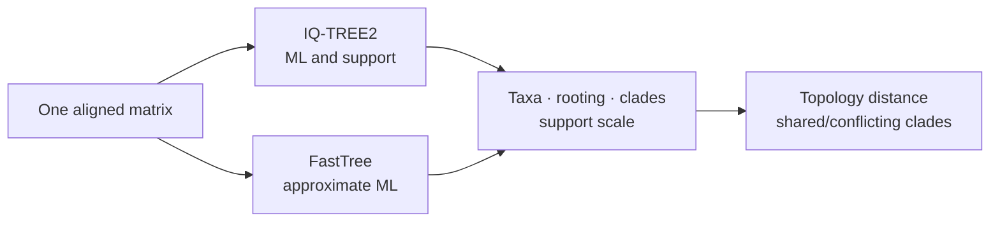

# IQ-TREE2 And FastTree Correspondence

IQ-TREE2 owns likelihood model selection, maximum-likelihood inference, and its
support procedures. FastTree owns approximate large-tree inference and SH-like
local support. Bijux runs, validates, parses, compares, and packages both
without treating their outputs as interchangeable.

## Engine Surfaces

| Engine | Bijux commands | Required review outputs |
| --- | --- | --- |
| IQ-TREE2 | `model-select`, `infer-ml`, `bootstrap`, `sh-alrt`, `consensus`, `reproducibility` | `.iqtree`, `.log`, tree, model, bootstrap/support and consensus artifacts required by the selected run |
| FastTree | `infer-fast`, `infer-large` | valid tree, captured log/runtime state, parsed local support and resource/preflight summaries |
| both | `compare`, `compare-engines` | shared input identity, normalized trees/support, topology distances, conflicts and warnings |

The adapters reject incomplete bundles even when a process exits successfully.
A stale tree from an earlier run is not accepted as evidence for the current
configuration.

## Comparing Trees

`compare-engines` runs IQ-TREE2 and FastTree on the same aligned matrix, then
compares the inferred trees through taxon reconciliation, rooted/unrooted
policy, clade identity, topology distance, and support ledgers. The comparison
retains engine-specific model and run metadata.



UFBoot percentages and FastTree SH-like local-support proportions can be
normalized to a common display range. They remain different statistical
quantities and are labeled by method in every comparison.

## Use The Correspondence Workflow

```bash
bijux-phylogenetics adapter compare-engines \
  dataset/alignment.fasta \
  --out-dir artifacts/engines/tree-comparison
```

Use `adapter reproducibility` when the question is whether repeated IQ-TREE2
runs preserve deterministic artifacts or stable supported topology under a
fixed configuration. Use `infer-large` when streamed preflight and resource
reporting matter for a large aligned matrix.

## Claim Boundary

An engine comparison identifies agreement and conflict on one matrix and
configuration. It does not prove that one engine is universally more accurate,
that their support values have identical meaning, or that the selected model
is biologically adequate. Native Bijux likelihood benchmarks are documented
separately because native-versus-wrapper correspondence is another contract.
