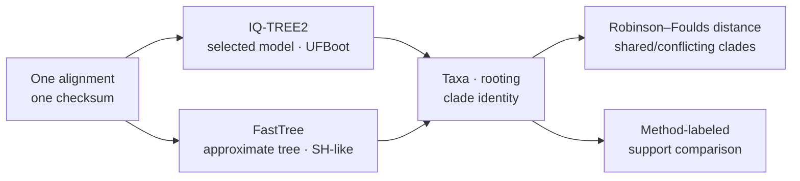

# IQ-TREE2 And FastTree Correspondence

IQ-TREE2 owns likelihood model selection, maximum-likelihood search, ultrafast
bootstrap, and SH-aLRT procedures. FastTree owns approximate tree inference
and its SH-like local support. Bijux gives both engines a common execution and
review boundary without pretending that their models, searches, or support
values are interchangeable.

## Keep Within-Engine And Cross-Engine Questions Separate

| Question | Comparison population | Valid conclusion |
| --- | --- | --- |
| did IQ-TREE2 or FastTree execute reproducibly? | repeated identified runs of the same engine contract | stability or variation under the retained configuration |
| do two engine trees share topology? | reconciled taxa and splits from two complete parent bundles | structural agreement for this matrix and rooting policy |
| do support annotations correspond? | clade-keyed values retaining each method label and scale | observed support relationship without estimand equivalence |
| which engine is biologically more accurate? | requires known truth or independently governed benchmark evidence | not answered by cross-engine agreement alone |

Two engines can agree because both recover the relevant structure, disagree
because their declared models or searches differ, or agree on a wrong answer.
The comparison record reports the observed relationship; accuracy requires a
separate truth-bearing design.

## Choose The Command By Question

| Question | Command | Primary accepted record |
| --- | --- | --- |
| which IQ-TREE2 model wins the declared criterion? | `adapter model-select` | selected model, criterion, candidate table, likelihood and native report |
| what ML tree follows from a specified model? | `adapter infer-ml` | tree, likelihood, model identity, IQ-TREE2 report and log |
| what is the ultrafast-bootstrap support? | `adapter bootstrap` | support tree, replicate tree set, parsed support tables and histograms |
| what do SH-aLRT and ultrafast bootstrap say together? | `adapter sh-alrt` | dual-support tree and method-labeled support rows |
| what consensus follows from retained bootstrap trees? | `adapter consensus` | validated tree-set input and consensus artifact |
| what approximate tree does FastTree infer? | `adapter infer-fast` | tree, runtime record, parsed SH-like local support |
| can a large matrix be processed with resource visibility? | `adapter infer-large` | streamed preflight, tree, runtime/resource rows and warnings |
| where do the two engines agree or conflict? | `adapter compare-engines` | topology distance, clade and support conflict ledgers |
| are repeated IQ-TREE2 outputs stable? | `adapter reproducibility` | repeat identities, pairwise classifications and instability summary |

The adapters reject incomplete bundles even when a process exits successfully.
A current tree without its required native report or log is not an accepted
IQ-TREE2 result, and a stale tree is never evidence for a changed command.

## Engine Result Identity

| Identity field | IQ-TREE2 | FastTree | Comparison consequence |
| --- | --- | --- | --- |
| matrix | alignment checksum, taxa, sequence type, partitions | alignment checksum, taxa, sequence type | differing matrices invalidate the pair |
| model | requested/selected likelihood model and criterion | sequence mode and FastTree model behavior | model names stay engine-specific |
| search control | seed, threads, command, executable version | command, executable version, large-run resource state | reproducibility is judged within the engine contract |
| topology | validated tree, taxon set, rooting policy | validated tree, taxon set, rooting policy | reconcile taxa and rooting before distance |
| support | UFBoot and/or SH-aLRT method and scale | SH-like local-support method and scale | normalize display only; preserve estimand identity |
| completeness | required tree, report, log, support/tree-set sidecars | tree, streams, manifest and requested review outputs | an incomplete side stays out of the compared denominator |

## Cross-Engine Comparison

`compare-engines` runs model selection and supported IQ-TREE2 inference plus
FastTree inference on one alignment. It then reconciles taxa and rooting,
computes topology distance, and classifies shared, engine-specific, and
conflicting clades.



The result reports shared taxa, Robinson–Foulds distance, stable and unstable
clades, support disagreements, high-support conflicts, and serious conflicts.
Those categories describe this matrix and configuration; they are not an
engine accuracy ranking.

UFBoot percentages and FastTree SH-like local-support proportions can be
normalized to a common display range. They remain different statistical
quantities and are labeled by engine and method in every comparison. SH-aLRT
is a third estimand and must remain separately labeled as well.

## Run A Reviewable Comparison

```bash
bijux-phylogenetics adapter compare-engines \
  dataset/alignment.fasta \
  --sequence-type dna \
  --iqtree-seed 11 \
  --iqtree-threads 1 \
  --bootstrap-replicates 1000 \
  --out-dir artifacts/engines/tree-comparison \
  --manifest artifacts/engines/tree-comparison-command.json
```

Use `--iqtree-executable` and `--fasttree-executable` for explicit binary
locations. A timeout or missing engine keeps the paired workflow incomplete;
it does not create an agreement result from the surviving side.

For an already inferred pair, `adapter compare` accepts explicit FastTree and
ML tree paths. That path compares trees; it does not prove that the current
workflow executed either engine.

## Reproducibility Has An Explicit Denominator

`adapter reproducibility` repeats supported IQ-TREE2 inference with a retained
seed, thread count, model-selection path, bootstrap replicate count, and
executable identity. The record includes every run and pairwise classification,
not just the modal topology.

Report:

- requested repeats, completed runs, and accepted bundles;
- seed, threads, model, executable version, and command for every run;
- topology fingerprints and support comparisons;
- equivalent and unstable comparison counts;
- missing, failed, or malformed runs outside the accepted denominator.

A stable filename or one matching consensus is not a reproducibility result.

## Retain Selection And Search Context

The accepted tree must remain connected to the search or approximation that
selected it. That connection is different for each command, but it always
prevents the final Newick file from becoming the entire scientific record.

| Result | Context that must remain attached | Unsupported shortcut |
| --- | --- | --- |
| selected IQ-TREE2 model | candidate set, criterion, score table, ties, and model-selection command | treating the chosen model name as unconditional truth |
| IQ-TREE2 ML tree | starting/search controls, selected model, likelihood, seed, threads, report, and log | comparing only the rendered topology |
| bootstrap or SH-aLRT tree | replicate/test configuration, accepted replicate denominator, method label, native sidecars | reading unlabeled node numbers as generic confidence |
| FastTree result | sequence mode, native command, streams, runtime state, and SH-like scale | describing an approximate search as the IQ-TREE2 procedure |
| cross-engine comparison | both complete parent records plus reconciliation and comparison rules | retaining a merged table without its two engine parents |
| repeated-run summary | every requested run, completion state, topology identity, and pairwise comparison | reporting only the modal or most favorable run |

A comparison artifact is accepted only while both parent records remain
resolvable. If one parent becomes stale or incomplete, preserve the surviving
engine result but withdraw the paired conclusion.

## Comparison Denominator

For a cross-engine statement, retain the selected engines, engines available,
engines executed, complete bundles, and engine pairs actually compared. For
repeated runs, retain requested, executed, accepted, and compared counts.

If IQ-TREE2 is unavailable or FastTree output is malformed, preserve the valid
independent artifact and the failure state, but do not emit a two-engine
agreement claim. Missing execution is coverage, not topology agreement or
disagreement.

## Scientific Boundary

Topology and support correspondence on one matrix does not prove universal
engine accuracy, model adequacy, or biological truth. Model selection is
conditional on the candidate set and criterion. Support summarizes behavior
under a named resampling or local-test procedure. Native Bijux likelihood
benchmarks remain a separate contract because native numerical assurance and
external-wrapper correspondence answer different questions.
