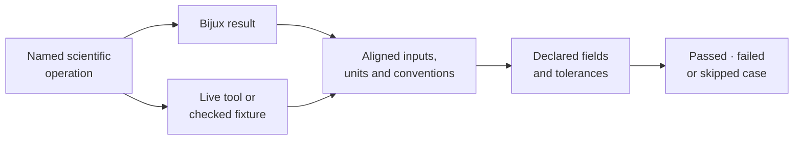

# Parities And Correspondence

Bijux Phylogenetics is compared with established phylogenetic software at
explicit, reviewable boundaries. The comparison may be a live call to an R
package, a checked reference fixture, a benchmark against a named
implementation, or an adapter that executes an external engine. Those are
different relationships and the documentation keeps them separate.

## Reference Landscape

| Relationship | Tools | What the repository owns |
| --- | --- | --- |
| live R parity | APE, GEIGER, phytools | governed cases, R runners, normalization, tolerances, mismatch artifacts |
| checked R-derived correspondence | `nlme`, selected course workflows and fixtures | frozen inputs/outputs, comparison rules, provenance and limits |
| external alignment and tree execution | MAFFT, trimAl, IQ-TREE2, FastTree | adapters, configuration, execution capture, parsing and normalized artifacts |
| external posterior execution and review | MrBayes, BEAST | preparation, execution adapters, trace/tree parsing, diagnostics and reports |

An adapter is not automatically a parity proof. It establishes that the
external program can participate in a governed Bijux workflow. Numerical or
structural equivalence requires a separate comparison with aligned assumptions
and explicit observation rules.

## Three Records, Three Meanings

| Record | Status owner | What it establishes |
| --- | --- | --- |
| parity harness case | live or checked-fixture runner: `passed`, `failed`, `skipped` | whether one registered case executed and satisfied its comparisons |
| external-engine bundle | adapter and workflow result state | whether a named external computation was prepared, executed, parsed, or refused |
| Evidence Book bundle | governed verdict vocabulary | whether identified scientific claims matched, mismatched, or remained non-comparable |

These records may be linked but are not interchangeable. A skipped R case has
no Evidence Book verdict. A successful adapter run is not a parity case. An
open follow-through item describes remaining resolution work; it does not
replace a bundle's recorded verdict.

## Reading Paths

- [R ecosystem](r-ecosystem/index.md) describes direct live parity and checked
  R-derived references.
- [External engines](external-engines/index.md) describes correspondence with
  executables that remain computational owners.
- [Interpreting correspondence](correspondence/index.md) explains case
  selection, normalization, outcomes, artifacts, and claim limits.
- [Verification matrix](correspondence/verification-matrix.md) distinguishes
  live parity, checked fixtures, external execution, and study provenance.
- [Artifacts and reproduction](correspondence/artifacts-and-reproduction.md)
  shows how a comparison remains inspectable after execution.

## The Public Contract

Every parity claim names the external tool and version, Bijux surface, fixture,
parameterization, compared fields, tolerance, execution mode, and case status.
Unavailable R packages and unsupported reference cases remain visible as
skips or out-of-scope boundaries rather than being counted as passes.
