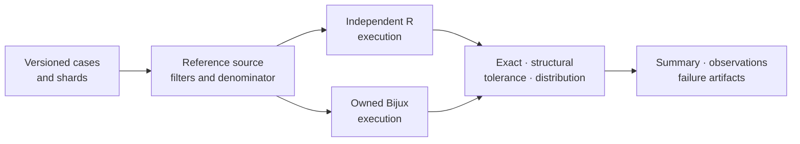

# R Ecosystem Correspondence

Three native parity harnesses execute checked-in R runners against live APE,
GEIGER, and phytools installations. Additional study fixtures retain narrower
R-derived comparisons, including `ape` plus `nlme` PGLS outputs and course
workflows that use packages such as `MCMCglmm` without claiming a live
drop-in-equivalence surface.

| Reference | Strongest governed relationship | Main scientific territory |
| --- | --- | --- |
| [APE](ape.md) | live case registry plus checked fixtures | trees, topology, distances, DNA utilities, covariance, contrasts, ancestral states |
| [GEIGER](geiger.md) | live model registry plus generated review report | continuous and discrete evolutionary-model fitting |
| [phytools](phytools.md) | live case registry plus stochastic-summary policies | signal, Mk models, simulation, stochastic maps, ancestral estimates |
| [`nlme`](study-references.md#ape-plus-nlme) | checked reference outputs with APE covariance | GLS/PGLS coefficients and model comparison |
| [`treeio`, `tidytree`, `ggtree`](study-references.md#treeio-tidytree-and-ggtree) | governed structural evidence or plot-only provenance | study-specific tree data and visualization surfaces |
| [`MCMCglmm`](study-references.md#mcmcglmm) | external study boundary | Bayesian phylogenetic mixed models in PCM4 and PCM5 |

## Registry Lifecycle

A registry entry is the unit of eligibility. A shard is a durable grouping by
owned Python surface and reference operation. A run selects cases from that
registry; it does not discover successful examples after execution.

## Execution Boundary

Live parity is opt-in through `RUN_LIVE_PARITY=1` and requires `Rscript` plus
the named package. The command emits structured summary and observation rows;
failed and skipped cases can be preserved under a failure-artifact directory.
The default parity command uses checked fixtures and does not imply that R ran
on the current machine.

## Read A Harness Result

| Field | Interpretation |
| --- | --- |
| reference source | proves whether the case used live APE, GEIGER, phytools, or a checked fixture |
| registry and shard identity | bounds the operation, model, and fixtures that were eligible for selection |
| selected count | denominator requested by the command after filters |
| passed count | cases whose registered exact, structural, tolerance, or distribution rules all held |
| failed count | executed cases with a Bijux/reference failure, missing output, or comparison mismatch |
| skipped count | selected cases not executed because the live reference environment was unavailable |
| mismatch reason and failure artifacts | preserve why a case did not pass and what is needed to reproduce it |

Report all four counts—selected, passed, failed, and skipped—with the selected
shards. Do not describe only the successful subset as the registry result.

## Execution Identity

Retain the Bijux version, registry case and shard IDs, reference-source label,
R executable identity, R version, package version, fixture hashes, filters,
environment gate, command arguments, start and finish state, and output hashes.
For stochastic cases, also retain the replicate population, seed policy,
summary definition, and invalid-replicate count.

The package version is observed from the live reference process. A current
installation does not retroactively identify an older checked fixture, and a
fixture cannot be relabelled as live because the corresponding package is now
installed.

## Programmatic Entry Points

Each live registry exposes the same review shape from its public module:

| Module | Discover | Execute | Persist |
| --- | --- | --- | --- |
| `bijux_phylogenetics.parity.ape` | `list_ape_parity_cases`, `list_ape_parity_shards` | `run_ape_parity_cases` | summary and observation table writers |
| `bijux_phylogenetics.parity.geiger` | `list_geiger_parity_cases`, `list_geiger_parity_shards` | `run_geiger_parity_cases` | summary, observation, triage, policy, parameterization, and generated-report writers |
| `bijux_phylogenetics.parity.phytools` | `list_phytools_parity_cases`, `list_phytools_parity_shards` | `run_phytools_parity_cases` | summary and observation table writers |

The CLI composes these surfaces. Direct Python use does not weaken the same
selection, environment, status, and artifact requirements.

## Why Several Reference Packages Matter

No single R package owns every convention used in phylogenetics. APE is the
structural baseline, GEIGER is a model-fitting reference, and phytools provides
specialized comparative and stochastic-history behavior. Agreement with one
does not silently grant agreement with another.

The three harnesses share `passed`, `failed`, and `skipped` case status, but
their observation rules remain tool- and shard-specific. That common status
does not erase differences among exact tree structure, tolerance-based model
parameters, and distributional stochastic summaries.

[Study-specific R references](study-references.md) explains the narrower
relationships that enter through Evidence Book workflows rather than a live
package registry.
