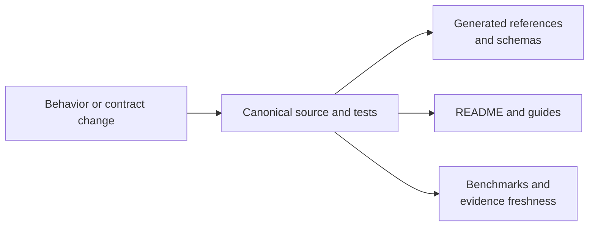

# Documentation Ownership

Each documentation surface has one durable responsibility. Duplication is
acceptable only when the consumer and level of detail differ; scientific facts
must still resolve to the same canonical implementation, schema, artifact, or
evidence record.

## Ownership Map

| Surface | Primary responsibility | Must not become |
| --- | --- | --- |
| root `README.md` | repository identity, installation, capability map, first executable path | exhaustive command or API reference |
| runtime package README | installable distribution contract and representative use | repository maintenance manual |
| alias package README | compatibility behavior and naming differences | a second scientific product description |
| product handbook | methods, architecture, interfaces, operations, quality, limits | source-tree inventory |
| Evidence Book guide | scientific questions and bounded study verdicts | a substitute for bundle records |
| checked-in evidence dossier | provenance, inputs, checks, results, verdicts | marketing narrative |
| maintainer handbook | ownership, change impact, verification, publication | end-user method tutorial |
| generated references | exhaustive CLI/API/index output | hand-edited explanation |

## Canonicality Rules

- Runtime behavior resolves to curated source and contract tests.
- CLI inventory resolves to registered commands and generated reference data.
- Service behavior resolves to the pinned OpenAPI schema and hash.
- Artifact meaning resolves to result, manifest, and schema contracts.
- Evidence status resolves to bundle records and generated indexes.
- Package identity resolves to package metadata and built-artifact inspection.

Prose explains these sources; it does not override them.

## Resolve A Statement To Its Owner

Before editing a claim, identify the object that can prove or falsify it.

| Statement kind | Canonical owner | Documentation responsibility |
| --- | --- | --- |
| public name, signature, or default | curated source and contract tests | explain use and link to generated reference detail |
| command availability and options | CLI registry and generated command reference | provide task-oriented examples without copying the inventory |
| service request or response | pinned OpenAPI schema and server contract tests | explain workflow, failure semantics, and compatibility |
| result or manifest field | versioned schema plus producer/consumer tests | explain interpretation, units, omissions, and migration |
| numerical or topological behavior | implementation plus named validation lane | state corpus, tolerance, assumptions, and exclusions |
| comparison or study verdict | governed evidence bundle and generated index | interpret the bounded result without widening its scope |
| distribution identity | package metadata and built-artifact inspection | state install and compatibility behavior |

If no canonical owner exists, the statement is not ready to be copied across
public surfaces. Establish the contract or narrow the statement first.

## Duplication And Projection

Repeated prose is acceptable only when each copy serves a distinct reader
decision. Keep one canonical explanation and use shorter projections elsewhere:

- entry surfaces identify the product, install path, and supported first action;
- guides explain decisions, workflows, diagnostics, and scientific meaning;
- generated references enumerate public interfaces;
- evidence guides interpret governed records;
- maintainer pages define ownership and change obligations.

Do not duplicate schemas, command inventories, benchmark tables, or verdict
ledgers by hand. Those values drift silently and are better linked or generated.

## Public Writing Standard

Describe the scientific object, method, input, result, assumption, and limit
directly. Avoid editorial statements about how impressive, serious, polished,
or trustworthy the repository appears. Trust follows from concrete contracts,
inspectable provenance, explicit verdicts, and reproducible examples.

Navigation should answer a real user decision. A page made mostly of “read
next,” “why this page matters,” or “what this section should do” is incomplete
until it contains the domain explanation itself.

## Change Propagation

Update every affected projection in the same coherent change. If generated
output and handwritten interpretation are independently reviewable, keep their
commit boundaries separate.

Contract removals and semantic changes require a compatibility decision. State
whether consumers receive a backward-compatible extension, a governed
deprecation, or a breaking schema/interface change; then update migration and
artifact-consumption guidance with the owning contract.

## Review Checklist

- Does the text name a real public import, command, schema, artifact, or study?
- Are native methods and external engines attributed correctly?
- Does the example execute through a supported surface?
- Are defaults and assumptions visible where they affect interpretation?
- Are machine contracts linked instead of reproduced manually?
- Does evidence language match current bundle verdicts and freshness?
- Are limitations stated next to the capability they qualify?
- Does the page contain domain content rather than commentary about writing?

## Generated Content

Do not hand-edit synchronized shared assets, generated CLI reference blocks,
schema hashes, or evidence indexes. Change their canonical source, run the
supported generator, inspect the diff, and validate the governing checksum or
integrity command before commit.
