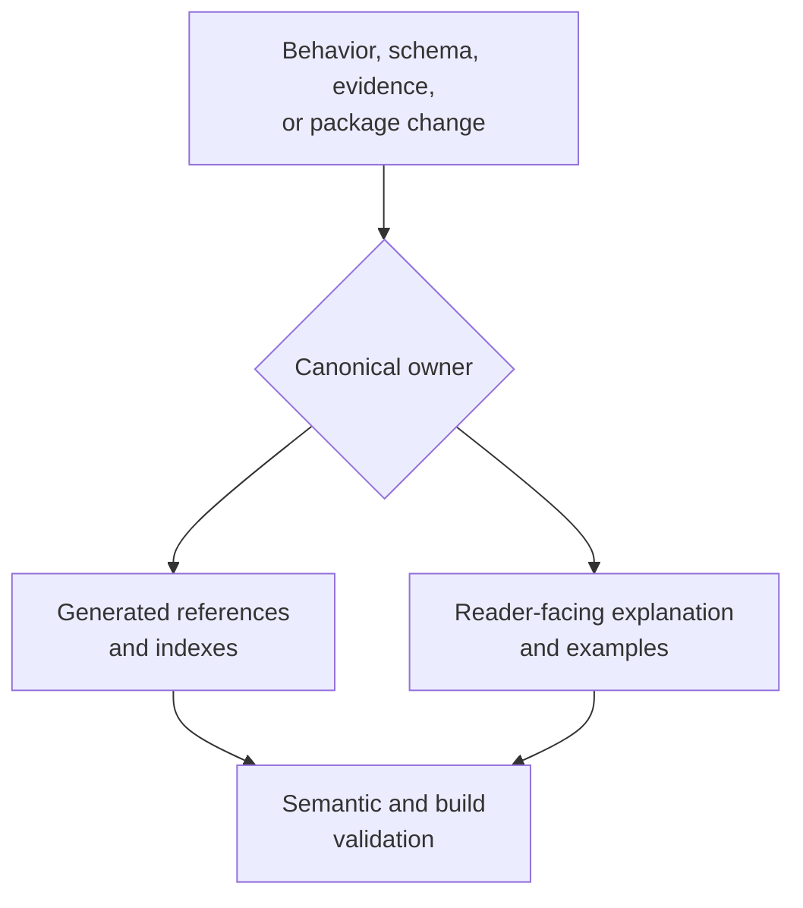
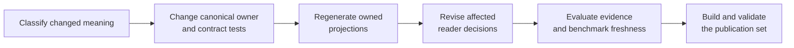

# Documentation System

Every maintained statement has one canonical owner and may have several
projections. Runtime behavior is owned by source and executable contracts;
scientific verdicts are owned by Evidence Book records; package identity is
owned by distribution metadata; generated references are owned by their
generator inputs. Handwritten pages explain those authorities without
replacing them.

## Resolve Ownership Before Editing

| Changed fact | Canonical owner | Maintained projections |
| --- | --- | --- |
| Python signature or typed result | public source surface and contract tests | API guide, examples, generated references |
| CLI command, option, or exit behavior | command registry and CLI tests | CLI reference, workflow guide, README example |
| artifact field or manifest relationship | schema/producer and consumer tests | artifact contract and consumption guide |
| numerical ownership or scientific boundary | implementation, numerical tests, parity/evidence records | domain, workflow, quality, and parity pages |
| evidence verdict or freshness | bundle manifests and generated indexes | Evidence Book study guides and landing ledger |
| distribution name, requirement, or URL | package metadata | root and package READMEs, installation guide |

Edit the owner first. Regenerate owned derivatives with repository commands.
Then revise handwritten explanations whose reader-visible meaning changed.
Never hand-edit a generated page to mask disagreement with its input.

## Separate Reader And Maintainer Language

Reader-facing pages explain the scientific decision: which method applies,
what input contract it accepts, what result it returns, how failure appears,
and what evidence bounds the claim. They should not discuss the writing plan,
page quality, desired impression, or internal delivery sequence.

Maintainer pages explain ownership and propagation: which source establishes a
fact, which projections repeat it, what generator owns derived content, and
which checks block publication. A maintenance instruction belongs here only
when it changes how repository facts are kept coherent.

| Content | Reader-facing location | Maintainer location |
| --- | --- | --- |
| choosing ML, Bayesian, parsimony, simulation, or an adapter | domain and workflow guide | affected-surface inventory and validation route |
| interpreting a result, warning, refusal, or limitation | interface, operations, or quality guide | producer/consumer ownership and compatibility obligations |
| understanding a study verdict | Evidence Book study guide | freshness, regeneration, and publication gate |
| changing an API, command, schema, or artifact | migration guidance when consumers are affected | canonical source, projection set, checks, and release decision |

## Give Every Public Page A Reader Contract

A public page earns its place by helping a reader make a durable decision. Its
opening and structure should let that reader determine:

1. **purpose** — which scientific or operational problem this surface solves;
2. **owner** — which native method, external engine, schema, or evidence record
   owns the behavior or conclusion;
3. **entry point** — how an installed user invokes or inspects it;
4. **result** — which values, diagnostics, refusals, and artifacts come back;
5. **assurance** — which tests, benchmarks, parity cases, or claim records
   support the bounded statement;
6. **boundary** — which broader conclusion remains unavailable;
7. **next decision** — where to go to execute, interpret, verify, or maintain
   the surface.

Do not expose this checklist as editorial commentary on the public page. Write
the answers as direct product and scientific guidance. A reader should not
need repository history, internal planning, or knowledge of the documentation
tree to understand why the page matters.

| Public page kind | Reader decision it must close |
| --- | --- |
| landing page | Is this product relevant, and which path matches my purpose? |
| domain or workflow guide | Which contract applies, and what result or refusal should I expect? |
| interface guide | How do I invoke, persist, and recover without losing semantics? |
| Evidence Book study guide | What was claimed, what evidence exists, what is the verdict, and what remains unresolved? |
| reference page | What exact stable names, fields, defaults, statuses, and compatibility rules may I depend on? |

## Treat Public Examples As Executable Contracts

An example is reader guidance and a compatibility consumer. Review it through
the installed public surface it names, using inputs available to that
installation context.

| Example class | Execution proof | Semantic review |
| --- | --- | --- |
| installation or demo | clean wheel/sdist environment and packaged resources | result scope does not exceed packaging and capability proof |
| Python workflow | curated imports and documented arguments | typed status, diagnostics, persistence, and owner remain visible |
| CLI workflow | registered command, structured output, exit state, and manifest | shell syntax, output channels, omissions, and failure behavior agree |
| external-engine workflow | controlled adapter contract plus named real-engine lane when claimed | executable ownership, version, native artifacts, and unavailable state remain explicit |
| evidence or parity command | governed registry/bundle inputs and retained reports | runtime status, bundle verdict, and resolution vocabulary remain separate |

Do not validate examples by syntax highlighting or source-checkout imports
alone. When full execution requires an unavailable external environment,
verify the controlled boundary and preserve the unexecuted lane as an explicit
limitation rather than rewriting the example as proven live behavior.

## Propagate A Contract Change

1. State the changed behavior or meaning without referring to filenames.
2. Locate the implementation, schema, registry, package metadata, or evidence
   record that owns it.
3. Identify every generated and handwritten projection by consumer decision.
4. Update the owner and its contract tests before changing explanatory prose.
5. Regenerate repository-owned derivatives and inspect their diff separately.
6. Re-evaluate benchmarks and Evidence Book freshness when scientific behavior,
   inputs, defaults, or normalization changed.
7. Run the narrow contract tests, documentation truth contract, and strict site
   build; then inspect the complete publication diff for contradictory claims.

## Documentation Review Packet

A reviewable documentation change records:

- the changed contract and its canonical owner;
- the affected reader decisions and maintained projections;
- generated outputs, with the generator command and source identity;
- examples executed through the installed or explicitly named development
  surface;
- evidence and benchmark records evaluated for freshness;
- checks run, observed results, and any publication blocker;
- deliberate exclusions with the reason they are semantically unaffected.

The packet is an accountability record, not a claim of completeness by volume.
A short correction can require broad review when it changes public meaning; a
large generated diff can require no prose change when semantics are unchanged.

## Maintained Guides

- [Documentation ownership](documentation-ownership.md) explains which
  source owns a fact, how canonicality is resolved, and which duplication is
  intentional.
- [Native surface documentation](native-surface-documentation.md) explains how
  an owned scientific implementation is connected to API, workflow,
  diagnostics, benchmark, and evidence boundaries.

## Completion Criteria

A documentation change is complete when the canonical owner and every affected
projection agree, generated assets are current, examples use installed public
surfaces, links resolve in a strict site build, scientific strength is bounded
by executable evidence, and no maintainer-only delivery commentary appears in
public scientific guidance.
