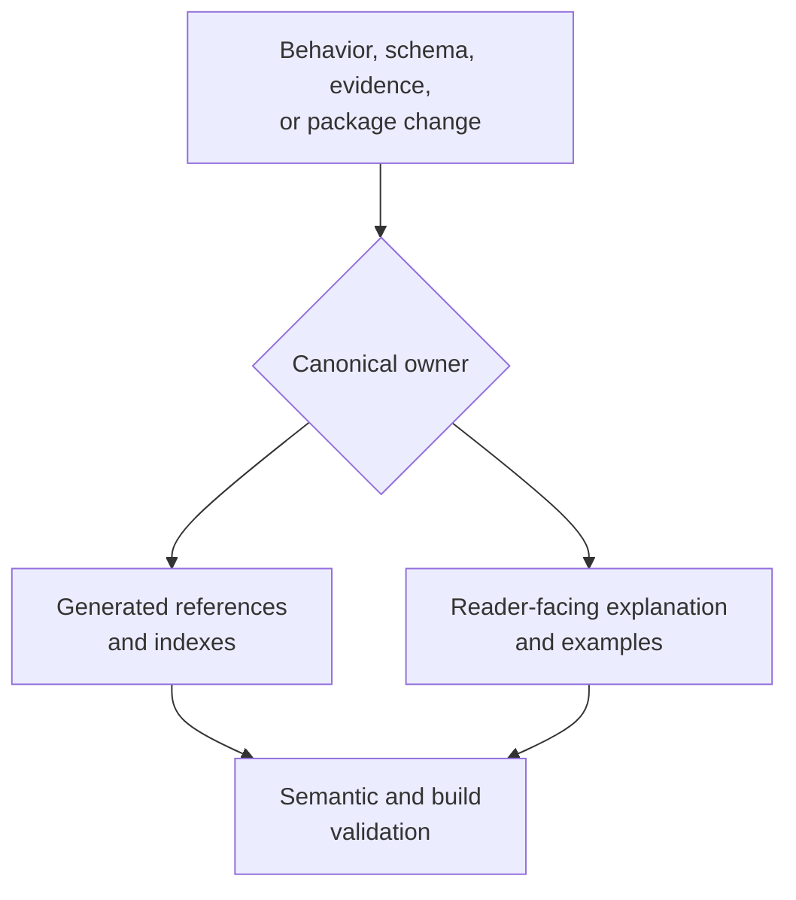

# Documentation System

Every maintained statement has one canonical owner and may have several
projections. Runtime behavior is owned by source and executable contracts;
scientific verdicts are owned by Evidence Book records; package identity is
owned by distribution metadata; generated references are owned by their
generator inputs. Handwritten pages explain those authorities without
replacing them.

## Resolve Ownership Before Editing

| Changed fact | Canonical owner | Maintained projections |
| --- | --- | --- |
| Python signature or typed result | public source surface and contract tests | API guide, examples, generated references |
| CLI command, option, or exit behavior | command registry and CLI tests | CLI reference, workflow guide, README example |
| artifact field or manifest relationship | schema/producer and consumer tests | artifact contract and consumption guide |
| numerical ownership or scientific boundary | implementation, numerical tests, parity/evidence records | domain, workflow, quality, and parity pages |
| evidence verdict or freshness | bundle manifests and generated indexes | Evidence Book study guides and landing ledger |
| distribution name, requirement, or URL | package metadata | root and package READMEs, installation guide |

Edit the owner first. Regenerate owned derivatives with repository commands.
Then revise handwritten explanations whose reader-visible meaning changed.
Never hand-edit a generated page to mask disagreement with its input.

## Maintained Guides

- [Documentation ownership](documentation-ownership.md) explains which
  source owns a fact, how canonicality is resolved, and which duplication is
  intentional.
- [Native surface documentation](native-surface-documentation.md) explains how
  an owned scientific implementation is connected to API, workflow,
  diagnostics, benchmark, and evidence boundaries.

## Completion Criteria

A documentation change is complete when the canonical owner and every affected
projection agree, generated assets are current, examples use installed public
surfaces, links resolve in a strict site build, scientific strength is bounded
by executable evidence, and no maintainer-only delivery commentary appears in
public scientific guidance.
