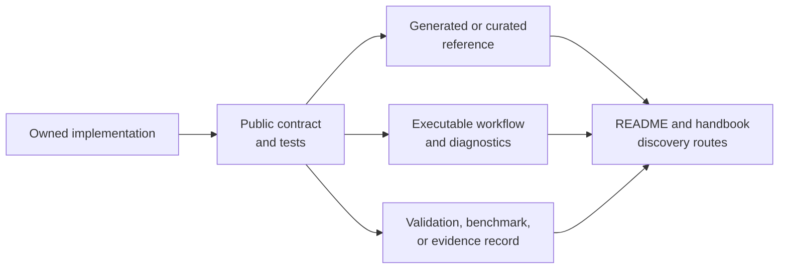

# Native Surface Documentation

Publish a native capability only when readers can identify its computational
owner, execute it through a supported interface, interpret its results and
failures, and locate the proof appropriate to each claim. A symbol in an API
reference establishes discoverability; it does not establish a usable or
validated scientific surface.

## Native Surface Publication Contract

| Contract | Required public evidence |
| --- | --- |
| ownership | named Bijux implementation boundary; external subprocesses or adapters remain attributed |
| interface | stable import, command, service operation, or artifact producer with documented inputs and defaults |
| workflow | executable path from scientific inputs through result interpretation |
| result | return type or artifact contract, units, ordering, provenance, and absence semantics |
| diagnostics | validation failures, convergence or support warnings, partial output, and recovery behavior |
| quality | named structural, contract, numerical, integration, benchmark, or evidence lane |
| discoverability | route from repository and handbook entry surfaces to reference, workflow, and quality guidance |

All seven contracts are required for a flagship surface. A capability can
remain public with narrower coverage, but its documentation must state the
boundary instead of implying flagship assurance.

## Keep Capability And Assurance Separate

| Status | What maintainers may claim | What remains unproved |
| --- | --- | --- |
| implemented | Bijux owns an executable implementation | public stability and correctness |
| contract-tested | public inputs, outputs, and failures satisfy named tests | scientific agreement beyond those cases |
| numerically validated | named values or invariants satisfy explicit rules | corpus-wide behavior and external correspondence |
| benchmarked | defined metrics exist for a named corpus and environment | transfer to untested data or methods |
| evidence-backed | a governed claim has provenance, execution, checks, and verdict | claims outside that bundle's scope |

These states accumulate only when their own proof remains current. Do not use
“native” as shorthand for validated, fast, release-ready, or evidence-backed.

## Documentation Projection

The implementation and tests own behavior. Documentation projects that truth
for different reader decisions; it must not invent a stronger state than the
quality record supports.

## Reference Implementation Pattern

The native maximum-likelihood and Bayesian families demonstrate the expected
projection:

- [native inference and benchmark contracts](../../01-bijux-phylogenetics/interfaces/native-inference-and-benchmarks.md)
  identify public boundaries;
- the maximum-likelihood and Bayesian guides under
  [operations](../../01-bijux-phylogenetics/operations/index.md) show complete
  use and interpretation;
- [native benchmark evidence](../../01-bijux-phylogenetics/quality/native-benchmark-evidence.md)
  defines corpus, metrics, failure accounting, and claim limits.

This pattern is a documentation shape, not proof that the two families share
the same assurance status. Read each linked quality record independently.

## Change Obligations

When a native surface changes, review all affected projections:

1. update the owned implementation and contract tests;
2. regenerate or revise API, CLI, schema, and artifact reference material;
3. revise workflows when inputs, defaults, diagnostics, or interpretation move;
4. rerun the applicable validation and benchmark lanes;
5. refresh governed evidence only when its inputs, method, and verdict remain
   reconstructable;
6. align the root README, package READMEs, site entry points, and capability
   maps without copying exhaustive reference content.

## Publication Blockers

Do not present a native surface as flagship-ready when its public owner is
ambiguous, its example bypasses supported interfaces, result or failure
semantics are unstated, missing cases disappear from aggregates, external work
is attributed to Bijux, or entry surfaces claim assurance that the retained
quality record does not support.

A documented limitation is compatible with publication. A contradiction among
implementation, interface, evidence, and public prose is not.
