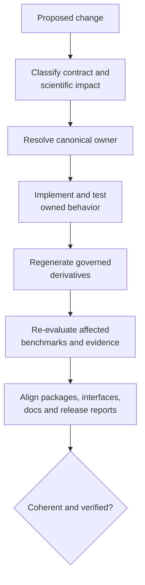
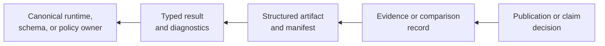
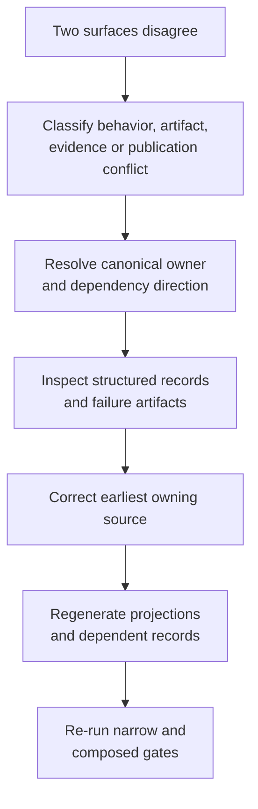

# Maintainer Handbook

Maintaining `bijux-phylogenetics` means preserving one coherent contract across
runtime code, three distributions, command and schema surfaces, generated
artifacts, 43 Evidence Book bundles, documentation, and release metadata. A
change is complete only when its canonical owner, projections, and dependent
assurance records agree.

## Maintain The Promise A Reader Actually Sees

Repository mechanics are means, not the public product. For every change,
translate the internal work into the external promise that must remain true:

| Internal change | Reader-visible promise to re-evaluate |
| --- | --- |
| numerical implementation or default | the documented estimand, result, diagnostics, examples, parity scope, and evidence freshness still agree |
| parser, schema, or manifest | an existing result can still be identified, interpreted, and consumed without silent loss |
| adapter or external-engine support | computation ownership, unavailable state, native outputs, and accepted handoff remain explicit |
| Evidence Book observation or verdict | every public scientific sentence stays inside the current claim and denominator |
| documentation navigation or rendering | readers can still reach the owning contract and distinguish source facts from projections |

Public scientific pages should contain the resulting method, evidence, and
limitation—not the maintenance checklist used to keep them correct. This
handbook owns that checklist so internal process language does not leak into a
study explanation or product guide.

## Maintained Invariants

| Invariant | Failure signal | Owning response |
| --- | --- | --- |
| runtime, alias, and maintainer distributions retain distinct roles | alias gains scientific code or maintainer helpers leak into runtime | restore package boundary and clean-install proof |
| native and external computation remain attributable | adapter output is described as native | correct ownership at source, result, docs, and evidence surfaces |
| structured records own scientific values | a report contains a value absent from JSON or a ledger | add the machine owner before the projection |
| manifests expose identity, inventory, and partial state | successful files hide failed or missing components | repair producer/consumer contract and retained denominator |
| evidence verdicts remain claim-scoped and fresh | broad prose cites neighboring or stale bundles | resolve exact claim, dependency, and freshness owner |
| generated content remains generated | synchronized or indexed output is hand-edited | change the generator or canonical source and regenerate |
| local execution preserves repository hygiene | caches, sites, logs, or reports appear outside `artifacts/` | correct the execution surface and artifact governance |

## Review Changes From The Reader Decision Backward

A maintainer change is complete when every public decision affected by the
change resolves to one coherent repository state. Begin with the strongest
decision a consumer could make from the changed surface, then walk backward to
the canonical owner and forward through every projection.

| Changed statement or surface | First question | Required closure |
| --- | --- | --- |
| capability wording | which exported method and supported composition owns it? | implementation, installed surface, examples, limits, and tests agree |
| numerical or scientific statement | which observation and acceptance rule owns the value? | source inputs, execution, denominator, comparison, verdict, and freshness agree |
| artifact field or omission | which producer defines presence, status, unit, and identity? | producer, old/new consumers, schema, migration behavior, and reports agree |
| package or command promise | which built distribution exposes the behavior? | wheel/sdist inventory, clean install, invocation, exit/refusal semantics, and docs agree |
| release claim | which exact candidate and child reports were evaluated? | revision, versions, artifacts, evidence, limitations, and decision owner form one packet |

Editing the nearest prose is insufficient when the contradiction originates in
code, schema, generated evidence, or release policy. Correct the earliest
owner, regenerate derived records, and then review the public statement in its
final rendered context.

## Keep Status In Its Owning Record

| Record | Governed status | Maintenance rule |
| --- | --- | --- |
| runtime or command | complete, partial, refused, failed, skipped as defined by that contract | preserve component inventory, diagnostics, and failure owner |
| live parity case | `passed`, `failed`, `skipped` | retain selected denominator, raw reference output, and mismatch reason |
| native benchmark observation | `native-advantage`, `native-bug`, `expected-assumption-difference`, `unsupported-case` | quote case and dimension; do not generalize aggregate status |
| Evidence Book bundle | `matched`, `matched_with_tolerance`, `mismatch_explained`, `mismatch_unexplained`, `not_comparable` | change only through governed checks, observations, and adjudication |
| resolution work | open or blocked follow-through | name the missing execution, primary output, observation, or decision |
| release gate | ready or blocked by readiness policy | do not infer scientific equivalence from publication eligibility |

These namespaces are not interchangeable. An open comparison effort does not
create an “open” bundle verdict. A ready release can still publish explicit `not_comparable` boundaries.
A passed live parity case does not promote itself into Evidence Book evidence.

## Change Classification

| Change | Canonical owner | Required dependent review |
| --- | --- | --- |
| Python signature or typed result | runtime export and result contract | compatibility tests, API docs, examples, serialization consumers |
| CLI command, option, default, or exit behavior | registered parser and handler | CLI tests, workflow docs, automation examples |
| artifact schema or manifest | producer and versioned contract | consumer tests, compatibility policy, replay, evidence freshness |
| numerical method, model, tolerance, or default | scientific implementation | known answers, properties, benchmarks, parity, affected study claims |
| external adapter or parser | engine workflow boundary | controlled and real-engine lanes, provenance, incomplete-run recovery |
| package dependency, metadata, or alias | distribution configuration | package boundaries, wheel/sdist inventory, clean install, public metadata |
| Evidence Book input, claim, check, or output | exact bundle and registry | checksums, indexes, freshness, study docs, release language |
| documentation statement or example | owning runtime/evidence record | strict build, semantic truth test, cross-surface claim review |
| release/version policy | release governance | all candidate identities, artifacts, docs, and readiness packets |

If one change fits several rows, take the union of their dependent review.

## Close The Change Dependency Graph

A change is not complete when only its nearest projection agrees. Record the
dependency graph from canonical owner to every consumer whose meaning,
freshness, compatibility, or release decision can change.

| Dependency edge | Closure evidence | Incomplete when |
| --- | --- | --- |
| implementation → public interface | contract tests and curated export or command inventory | an internal path passes while the installed surface differs |
| interface → artifact producer | schema/result tests with complete, partial, refused, and warning states | only the happy-path payload was reviewed |
| artifact → consumer or report | round-trip, omission, unit, status, and lineage checks | presentation survives but structured semantics drift |
| numerical method → benchmark/parity | material-dependency and corpus review plus affected observations | old results remain current by date or filename alone |
| result/comparison → Evidence Book claim | immutable dependency, check, verdict, and freshness record | capability proximity substitutes for claim consumption |
| any public contract → package/docs/release | built-artifact proof, projections, limitation review, and readiness decision | one distribution or reader surface retains prior meaning |

An explicitly unaffected edge still needs a reason tied to semantics, not a
claim that its files were outside the diff. The final handoff identifies every
closed, unaffected, blocked, and unexecuted edge.

### Leave A Closure Receipt

The durable unit of completion is a closure receipt, not a list of changed
files. It identifies the owned contract and before/after meaning, classifies
compatibility and scientific impact, enumerates every dependent edge, and
links each verification outcome to the exact revision or artifact it checked.
It also carries unresolved limitations and the publication decision they
constrain.

A reviewer must be able to reconstruct why an edge was changed, regenerated,
declared unaffected, or blocked. “No diff” is not evidence that a dependency
was reviewed, and a successful command without its selected population and
input identity is not a closed verification edge.

## Scale Review By Semantic Risk

Diff size does not determine review depth. Use the strongest applicable risk:

| Semantic risk | Examples | Required review depth |
| --- | --- | --- |
| local explanatory | wording that preserves contract meaning | strict docs, links, truth assertions, neighboring consistency |
| public invocation | import, command, option, default, example | contract tests, generated references, installed-artifact execution, compatibility |
| artifact compatibility | field, schema, status, unit, omission, manifest relationship | producer/consumer matrix, versioning decision, replay, migration behavior |
| scientific behavior | model, likelihood, optimizer, sampler, reconstruction, tolerance | numerical properties, known answers, diagnostics, benchmarks, parity, evidence freshness |
| claim or publication | verdict, evidence population, limitation, release statement | governed observations, indexes, contradiction audit, readiness packet and decision owner |

A one-line default or unit change may require every row beneath it. A large
generated reference diff may require only local explanatory review when the
canonical contract and semantics are unchanged.

## Resolve Contradictions Before Completion

Do not choose the more favorable surface, average conflicting values, or call
the discrepancy a documentation issue before ownership is known. A limitation
is an agreed bounded contract; a contradiction is unresolved state and blocks
the affected claim or publication surface.

## Resolve Canonical Ownership

Follow the disputed value or rule to the earliest runtime, schema, bundle, or
governance record that defines it. Generated references, READMEs, handbook
pages, metadata, benchmark summaries, and release reports are consumers of
those owners. Correct the owner, regenerate governed projections, then verify
the final reader decision. Never edit a later projection to mask an upstream
numerical, provenance, compatibility, or status defect.

## Change-To-Check Routing

| Changed surface | Minimum narrow check before composed gates |
| --- | --- |
| docs or examples | semantic documentation tests, codespell, strict MkDocs |
| public runtime or CLI | focused contract tests plus installed command proof |
| artifact producer/consumer | schema, round-trip, failure, path, checksum, and replay tests |
| external engine | `engine_contract`; selected `engine_real` where available |
| numerical method | known-answer/property tests plus affected benchmark/parity lane |
| Evidence Book | exact unit input/artifact checks, study build, full validation and freshness |
| package boundary | boundary audit, distribution build, clean-install smoke |
| release governance | report and check forms of every affected readiness surface |

The narrow check accelerates diagnosis; it does not remove downstream checks
from the final verification set.

## Continue With The Owning Handbook

| Maintenance question | Owning handbook | Leave with |
| --- | --- | --- |
| Which source owns a public statement or generated reference? | [Documentation system](documentation-system/index.md) | canonical owner, affected projections, reader contract, documentation checks |
| Can a capability, comparison, or evidence statement be published? | [Trust surfaces](trust-surfaces/index.md) | one revision-coherent trust packet and bounded language |
| Where should a run write, what may be committed, and which release gate applies? | [Repository operations](repository-operations/index.md) | command receipt, governed/transient classification, validation and candidate identity |

## Release Evidence

Retain commit, resolved version, lock, distribution filenames and hashes,
metadata, clean-install outcomes, API hash, strict docs result, evidence and
artifact-governance reports, optional-engine denominator, benchmark and parity
observations, bounded limitations, readiness output, and decision owner.

“CI passed” is not a reconstructable release packet. Skipped optional engines,
deselected slow tests, unsupported comparisons, and non-comparable evidence
must remain visible.

## Escalation Boundaries

Stop and treat the condition as a blocker when package identity, schema
compatibility, artifact integrity, evidence provenance, or candidate identity
cannot be established. Do not repair a failing verdict by weakening tolerance,
removing a case, or changing prose. Do not patch generated shared standards in
the downstream repository. Do not broaden a claim because an adjacent method
passes.

A bounded limitation can remain when its owner, status, scope, and resolution
path are explicit. A contradiction cannot be accepted as a limitation.
