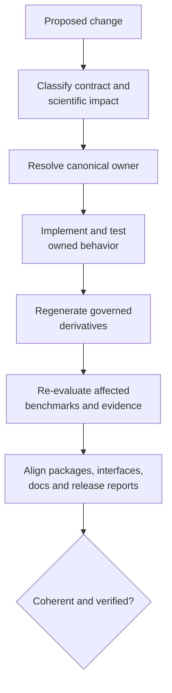
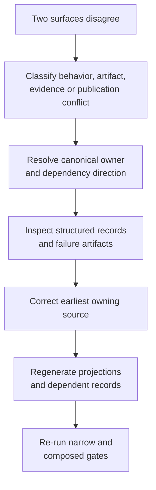
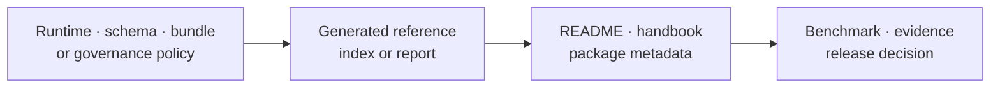

# Maintainer Handbook

Maintaining `bijux-phylogenetics` means preserving one coherent contract across
runtime code, three distributions, command and schema surfaces, generated
artifacts, 43 Evidence Book bundles, documentation, and release metadata. A
change is complete only when its canonical owner, projections, and dependent
assurance records agree.

## Maintained Invariants

| Invariant | Failure signal | Owning response |
| --- | --- | --- |
| runtime, alias, and maintainer distributions retain distinct roles | alias gains scientific code or maintainer helpers leak into runtime | restore package boundary and clean-install proof |
| native and external computation remain attributable | adapter output is described as native | correct ownership at source, result, docs, and evidence surfaces |
| structured records own scientific values | a report contains a value absent from JSON or a ledger | add the machine owner before the projection |
| manifests expose identity, inventory, and partial state | successful files hide failed or missing components | repair producer/consumer contract and retained denominator |
| evidence verdicts remain claim-scoped and fresh | broad prose cites neighboring or stale bundles | resolve exact claim, dependency, and freshness owner |
| generated content remains generated | synchronized or indexed output is hand-edited | change the generator or canonical source and regenerate |
| local execution preserves repository hygiene | caches, sites, logs, or reports appear outside `artifacts/` | correct the execution surface and artifact governance |

## Keep Status In Its Owning Record

| Record | Governed status | Maintenance rule |
| --- | --- | --- |
| runtime or command | complete, partial, refused, failed, skipped as defined by that contract | preserve component inventory, diagnostics, and failure owner |
| live parity case | `passed`, `failed`, `skipped` | retain selected denominator, raw reference output, and mismatch reason |
| native benchmark observation | `native-advantage`, `native-bug`, `expected-assumption-difference`, `unsupported-case` | quote case and dimension; do not generalize aggregate status |
| Evidence Book bundle | `matched`, `matched_with_tolerance`, `mismatch_explained`, `mismatch_unexplained`, `not_comparable` | change only through governed checks, observations, and adjudication |
| resolution work | open or blocked follow-through | name the missing execution, primary output, observation, or decision |
| release gate | ready or blocked by readiness policy | do not infer scientific equivalence from publication eligibility |

These namespaces are not interchangeable. An open comparison effort does not
create an “open” bundle verdict. A ready release can still publish explicit `not_comparable` boundaries.
A passed live parity case does not promote itself into Evidence Book evidence.

## Change Classification

| Change | Canonical owner | Required dependent review |
| --- | --- | --- |
| Python signature or typed result | runtime export and result contract | compatibility tests, API docs, examples, serialization consumers |
| CLI command, option, default, or exit behavior | registered parser and handler | CLI tests, workflow docs, automation examples |
| artifact schema or manifest | producer and versioned contract | consumer tests, compatibility policy, replay, evidence freshness |
| numerical method, model, tolerance, or default | scientific implementation | known answers, properties, benchmarks, parity, affected study claims |
| external adapter or parser | engine workflow boundary | controlled and real-engine lanes, provenance, incomplete-run recovery |
| package dependency, metadata, or alias | distribution configuration | package boundaries, wheel/sdist inventory, clean install, public metadata |
| Evidence Book input, claim, check, or output | exact bundle and registry | checksums, indexes, freshness, study docs, release language |
| documentation statement or example | owning runtime/evidence record | strict build, semantic truth test, cross-surface claim review |
| release/version policy | release governance | all candidate identities, artifacts, docs, and readiness packets |

If one change fits several rows, take the union of their dependent review.

## Scale Review By Semantic Risk

Diff size does not determine review depth. Use the strongest applicable risk:

| Semantic risk | Examples | Required review depth |
| --- | --- | --- |
| local explanatory | wording that preserves contract meaning | strict docs, links, truth assertions, neighboring consistency |
| public invocation | import, command, option, default, example | contract tests, generated references, installed-artifact execution, compatibility |
| artifact compatibility | field, schema, status, unit, omission, manifest relationship | producer/consumer matrix, versioning decision, replay, migration behavior |
| scientific behavior | model, likelihood, optimizer, sampler, reconstruction, tolerance | numerical properties, known answers, diagnostics, benchmarks, parity, evidence freshness |
| claim or publication | verdict, evidence population, limitation, release statement | governed observations, indexes, contradiction audit, readiness packet and decision owner |

A one-line default or unit change may require every row beneath it. A large
generated reference diff may require only local explanatory review when the
canonical contract and semantics are unchanged.

## Resolve Contradictions Before Completion

Do not choose the more favorable surface, average conflicting values, or call
the discrepancy a documentation issue before ownership is known. A limitation
is an agreed bounded contract; a contradiction is unresolved state and blocks
the affected claim or publication surface.

## Resolve Canonical Ownership

Before editing, follow the value or rule to its source:

Correct the earliest owning layer. Do not hand-edit a generated index to hide
a bad source record, change prose to mask a numerical mismatch, or loosen a
tolerance to preserve a desired decision.

## Stewardship Workflow

1. Identify repository revision, branch, worktree state, and existing user
   changes.
2. Classify compatibility, scientific, artifact, evidence, package, and
   publication impact.
3. Resolve the canonical source and every generated or public projection.
4. Implement the smallest complete owned change with failure-path tests.
5. Run the narrow relevant check and inspect retained artifacts.
6. Regenerate governed derivatives through repository tooling.
7. Re-evaluate benchmarks, parity cases, and evidence records whose material
   dependencies changed.
8. Align runtime, alias, package metadata, API, CLI, docs, and release surfaces.
9. Run composed gates appropriate to the change and confirm only intentional
   source changes remain.
10. Retain a handoff with exact verification, unexecuted lanes, risks, and
    decision artifacts.

## Change-To-Check Routing

| Changed surface | Minimum narrow check before composed gates |
| --- | --- |
| docs or examples | semantic documentation tests, codespell, strict MkDocs |
| public runtime or CLI | focused contract tests plus installed command proof |
| artifact producer/consumer | schema, round-trip, failure, path, checksum, and replay tests |
| external engine | `engine_contract`; selected `engine_real` where available |
| numerical method | known-answer/property tests plus affected benchmark/parity lane |
| Evidence Book | exact unit input/artifact checks, study build, full validation and freshness |
| package boundary | boundary audit, distribution build, clean-install smoke |
| release governance | report and check forms of every affected readiness surface |

The narrow check accelerates diagnosis; it does not remove downstream checks
from the final verification set.

## Handbook Areas

- [Documentation system](documentation-system/index.md) defines canonical
  sources, generated projections, ownership, and native-surface coverage.
- [Trust surfaces](trust-surfaces/index.md) governs cross-surface claims,
  status namespaces, validation lanes, and study guides.
- [Repository operations](repository-operations/index.md) covers environment,
  artifacts, release alignment, and operational verification.

## Release Evidence

Retain commit, resolved version, lock, distribution filenames and hashes,
metadata, clean-install outcomes, API hash, strict docs result, evidence and
artifact-governance reports, optional-engine denominator, benchmark and parity
observations, bounded limitations, readiness output, and decision owner.

“CI passed” is not a reconstructable release packet. Skipped optional engines,
deselected slow tests, unsupported comparisons, and non-comparable evidence
must remain visible.

## Escalation Boundaries

Stop and treat the condition as a blocker when package identity, schema
compatibility, artifact integrity, evidence provenance, or candidate identity
cannot be established. Do not repair a failing verdict by weakening tolerance,
removing a case, or changing prose. Do not patch generated shared standards in
the downstream repository. Do not broaden a claim because an adjacent method
passes.

A bounded limitation can remain when its owner, status, scope, and resolution
path are explicit. A contradiction cannot be accepted as a limitation.
