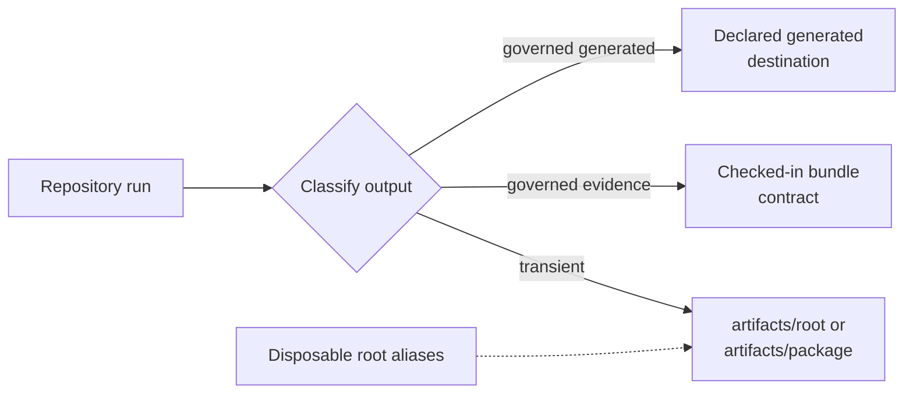

# Artifact Hygiene

Repository execution writes transient environments, caches, reports, build
products, and run results under `artifacts/`. Checked-in evidence and governed
generated documentation remain in their declared repository-owned locations;
artifact cleanup must never treat them as disposable run output.

## Classify Before Writing

| Output class | Destination | Retention rule |
| --- | --- | --- |
| tool environment or cache | `artifacts/root/` | disposable; recreate from governed configuration |
| repository report | `artifacts/root/` | retain for the review interval; do not commit by default |
| package build, test, or benchmark output | `artifacts/<package>/` | disposable unless a named publication process promotes it |
| cross-package scratch output | `artifacts/tmp/` | disposable and safe to regenerate |
| checked-in Evidence Book artifact | governed bundle path | preserve provenance and validate with evidence checks |
| generated site/reference source | declared `docs/`, API, or schema destination | update only through its owning generator and integrity check |

Location follows ownership, not filename extension. A JSON report from a local
audit is transient; a JSON schema or evidence manifest can be governed source.

## Artifact Lifecycle Record

For any report retained beyond the command that produced it, record:

| Field | Why it is required |
| --- | --- |
| producer | identifies the owning command and package rather than inferring ownership from the path |
| revision and configuration | ties the report to the source and policy it evaluated |
| inputs | distinguishes a fresh run from reuse of an unrelated prior artifact |
| completion state | separates complete reports from diagnostic partial output |
| output inventory | makes expected, present, missing, failed, and skipped records reviewable |
| integrity | carries hashes or equivalent identity when another gate consumes the report |
| retention purpose | states which active review or release decision still depends on it |

A report without revision and producer identity is useful as local diagnostic
output but cannot serve as reconstructable release evidence.

## Canonical Paths

Prefer the canonical artifact-owned paths directly when a maintainer command needs a concrete executable or output root:

- root environment: `artifacts/root/check-venv/`
- tox work directory: `artifacts/root/tox/`
- hypothesis state: `artifacts/root/hypothesis/`
- benchmark scratch space: `artifacts/root/benchmarks/`
- documentation site: `artifacts/root/docs/site/`

Those are the durable contract paths. Root aliases exist only as disposable
compatibility conveniences.

Commands may replace transient reports at canonical paths. A reviewer who
needs to retain one decision must copy or archive the complete report packet
through a governed process, including its revision and input identities; a
screenshot or isolated JSON fragment is not sufficient.

## Disposable Root Aliases

The root `.venv`, `.tox`, `.hypothesis`, and `.benchmarks` paths should be
treated as temporary alias links into `artifacts/root/`.

- `make setup` may recreate them
- `make clean-root-artifacts` may remove them
- maintainers should not depend on them as the only route to governed
  environments or caches

If one alias becomes a real directory instead of a symlink, that is drift, not
an acceptable steady state.

The governed audit also rejects root `.pytest_cache`, `.ruff_cache`, and
`.mypy_cache` directories. Run `make check-artifact-governance` to verify root
aliases, forbidden caches, tox work location, and Make target output paths.

## Safe Cleanup

Use `make clean-root-artifacts` for repository-owned disposable aliases. Treat
cache and run-product removal as a separate, explicitly scoped operation.
Before broader cleanup:

1. resolve every target to an explicit path beneath this repository's
   `artifacts/` tree;
2. distinguish a symlink from a real directory and inspect its target;
3. preserve reports required for an active review or release decision;
4. exclude checked-in evidence, schemas, documentation sources, and generated
   destinations governed by another command;
5. run the narrow producing command again when reproducibility is being
   verified;
6. confirm `git status` and `make check-artifact-governance` after cleanup.

Never infer a destructive cleanup target from an unresolved environment
variable, broad glob, workspace root, or parent directory.

## Review Checklist

- Does a new command write into `artifacts/` rather than the root?
- Does a new guide point to the canonical artifact path instead of only to
  `./.venv`?
- Does cleanup remove disposable aliases and stray caches without touching
  checked-in evidence?
- Can every retained report be tied to the revision and command that produced
  it?
- Does a producer create its destination rather than depending on unrelated
  prior runs?
- Does the worktree remain free of untracked run products after verification?

## Failure Conditions

Treat a real directory at a governed alias path, a forbidden root cache,
output outside the owned artifact tree, cleanup that can reach checked-in
records, an untraceable release report, or a command that relies on stale
prior output as an operational defect. Do not hide the defect with ignore
rules; correct the producer, alias, or cleanup boundary.

Also treat cross-run contamination as a defect: a command must not accept a
prior output merely because it occupies the expected path. Resume or reuse
requires the producer's identity checks over inputs, configuration, executable
where relevant, completion state, and recorded output inventory.
