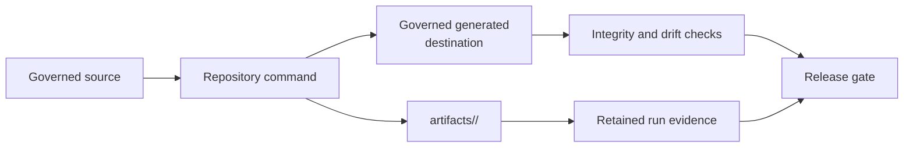
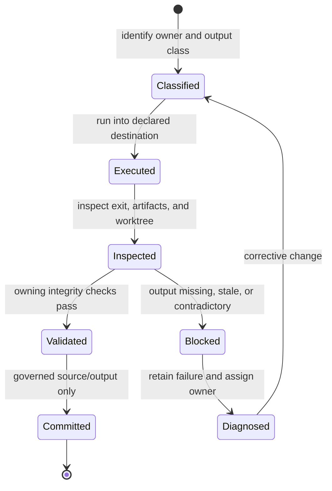
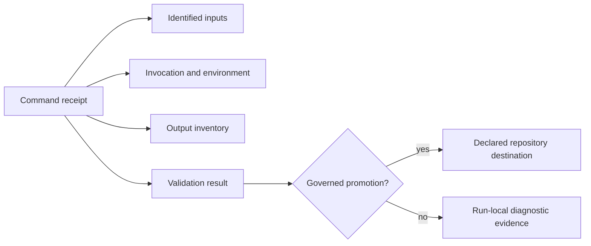

# Repository Operations

Repository operations preserve the boundary between governed source,
repository-owned generated output, transient local runs, and publishable
artifacts. A successful command is insufficient if its outputs cannot be
classified, reproduced, or removed without damaging source state.

## Classify Every Output

| Output class | Destination | Commit policy |
| --- | --- | --- |
| local environments, logs, reports, sites, benchmarks, and smoke runs | `artifacts/` under the owning command | never commit unless explicitly governed |
| generated documentation assets and references | declared repository-owned destination | regenerate, validate, and commit with source inputs when required |
| Evidence Book indexes and governed result projections | `evidence-book/` declared paths | regenerate with evidence tooling and review separately from interpretation |
| package wheels, source distributions, and install-smoke environments | package-specific `artifacts/` path | do not commit; retain for local release review |
| synchronized shared standards | managed `.bijux/shared/` and `.github/` paths | consume from the governed upstream source; do not hand-edit |

Root clutter, ad hoc caches, and output written into package source are
operational failures even when ignored by Git. The run layout must make
ownership and disposal unambiguous.

## Follow The Repository State Machine

The state transition is based on retained evidence, not terminal appearance.
An exit code of zero does not establish output completeness, and an expected
scientific limitation does not make a release failure when its governing
record and publication language agree.

## Decide Whether Generated Output Is Governed

Before committing generated content, identify all four parts of its contract:

| Contract part | Required answer |
| --- | --- |
| owner | which checked-in source, schema, registry, or evidence record determines the output? |
| generator | which repository command reproduces it without undocumented local state? |
| destination | which declared path is the authoritative checked-in projection? |
| validator | which drift, schema, checksum, or integrity check rejects disagreement? |

If any answer is missing, treat the output as a transient artifact until its
governance is defined. Do not promote a local report merely because it is
useful, and do not discard a governed projection merely because it can be
regenerated.

## Inspect Each Handoff

For any repository command, review the input identity, command and environment
identity, output inventory, status and warning channels, and resulting worktree
state. A handoff is complete only when downstream consumers can distinguish:

- no output was expected;
- output was produced and accepted;
- execution failed before output;
- output was produced but rejected by validation;
- output is scientifically bounded but operationally valid;
- output is stale because an upstream identity changed.

Collapsing these states into “pass” or “fail” hides the action a maintainer must
take and can silently narrow the denominator of a published report.

## Preserve A Command Receipt

Every material generation, verification, benchmark, package, or evidence run
needs a small receipt that makes the handoff reconstructable without terminal
scrollback.

| Receipt field | Required content |
| --- | --- |
| source state | repository revision plus clean state or an explicit digest of intentional uncommitted inputs |
| invocation | exact repository command, resolved configuration, and policy identity |
| environment | runtime, relevant dependency, and external-executable versions |
| input set | roles, paths, and content identities consumed by the command |
| output root | owned run directory or governed generated destination |
| terminal state | start/end time, exit, refusal, timeout, warnings, and failure code |
| inventory | expected, produced, missing, rejected, and checksum-covered outputs |
| validation | validator identity, result, and links to detailed reports |

The receipt records facts; it does not turn an output into governed source.
Promotion still requires a canonical owner, deterministic destination,
generator contract, and validator. Never place credentials or unrelated host
state in the receipt.

## Isolate Runs Before Comparing Them

Every verification, benchmark, evidence build, and package smoke run needs an
owned run root or a producer-enforced identity check. Shared output directories
otherwise allow stale files from one execution to satisfy another.

| Isolation boundary | Required control | Contamination signal |
| --- | --- | --- |
| inputs | checksums and immutable or copied run-local identity | a run reads a mutable file whose revision is not retained |
| configuration and policy | content identity recorded with the command | output exists but the settings that produced it differ |
| output root | clean run identity or validated resume manifest | undeclared pre-existing files appear in the accepted inventory |
| generated destination | generator owns exact expected files and drift check | obsolete generated files survive because no producer removes or rejects them |
| comparison | both parent run identities and explicit join keys | rows are paired by filename, order, or directory proximity |
| aggregate gate | child report revisions and hashes | reports from different candidate states are combined |

Clean execution does not mean deleting diagnostic evidence. Preserve a failed
run under its identity, diagnose it, and create a separate root for the next
attempt. Promotion selects governed outputs through their producer; it never
merges successful fragments from several run roots.

## Repository Gate Routing

| Changed surface | Minimum repository gate |
| --- | --- |
| documentation source or navigation | `make docs` plus the documentation truth contract |
| Evidence Book structure, bundle contract, or index | `make validate-evidence-book` |
| command output paths or artifact lifecycle | `make check-artifact-governance` |
| package, schema, evidence, or publication alignment | `make check-release-readiness` |

These gates complement the owning unit and contract tests; they do not replace
them. Run narrower checks while developing and the complete affected gate
before declaring the repository state publishable.

## Maintained Guides

- [Artifact hygiene](artifact-hygiene.md) explains canonical artifact paths,
  disposable aliases, cleanup expectations, and root-clutter review.
- [Release surface alignment](release-surface-alignment.md) explains how docs,
  metadata, packages, schemas, evidence, and governed reports must agree before
  publication.

## Operational Completion

Before committing, inspect tracked and untracked state, verify only intentional
source or governed output changed, and run the narrow owning checks. Before
release, build and install published artifacts, validate documentation and
schemas, confirm Evidence Book integrity and freshness, retain the exact gate
reports, and leave the worktree clean.

Do not delete or omit a failed run to produce a passing-looking release record.
Classify the failure, preserve the relevant artifacts, and stop the affected
publication claim until its governing check passes.
