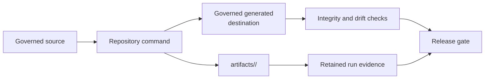

# Repository Operations

Repository operations preserve the boundary between governed source,
repository-owned generated output, transient local runs, and publishable
artifacts. A successful command is insufficient if its outputs cannot be
classified, reproduced, or removed without damaging source state.

## Classify Every Output

| Output class | Destination | Commit policy |
| --- | --- | --- |
| local environments, logs, reports, sites, benchmarks, and smoke runs | `artifacts/` under the owning command | never commit unless explicitly governed |
| generated documentation assets and references | declared repository-owned destination | regenerate, validate, and commit with source inputs when required |
| Evidence Book indexes and governed result projections | `evidence-book/` declared paths | regenerate with evidence tooling and review separately from interpretation |
| package wheels, source distributions, and install-smoke environments | package-specific `artifacts/` path | do not commit; retain for local release review |
| synchronized shared standards | managed `.bijux/shared/` and `.github/` paths | consume from the governed upstream source; do not hand-edit |

Root clutter, ad hoc caches, and output written into package source are
operational failures even when ignored by Git. The run layout must make
ownership and disposal unambiguous.

## Maintained Guides

- [Artifact hygiene](artifact-hygiene.md) explains canonical artifact paths,
  disposable aliases, cleanup expectations, and root-clutter review.
- [Release surface alignment](release-surface-alignment.md) explains how docs,
  metadata, packages, schemas, evidence, and governed reports must agree before
  publication.

## Operational Completion

Before committing, inspect tracked and untracked state, verify only intentional
source or governed output changed, and run the narrow owning checks. Before
release, build and install published artifacts, validate documentation and
schemas, confirm Evidence Book integrity and freshness, retain the exact gate
reports, and leave the worktree clean.

Do not delete or omit a failed run to produce a passing-looking release record.
Classify the failure, preserve the relevant artifacts, and stop the affected
publication claim until its governing check passes.
