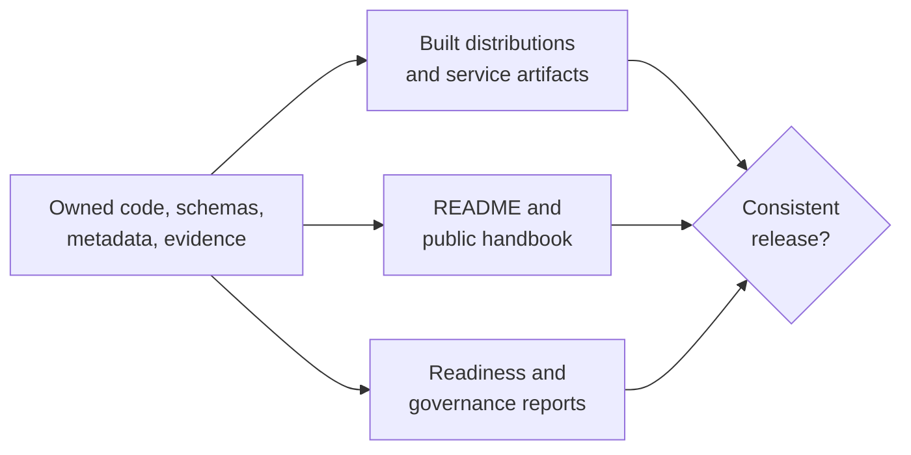

# Release Surface Alignment

Release surfaces are aligned when one identified revision exposes the same
package identity, public contracts, computational ownership, artifact
semantics, evidence boundaries, and maturity status everywhere a consumer can
encounter them. Green checks are necessary; retained reports and direct
cross-surface comparison establish that they describe the same release.

## Alignment Matrix

| Contract | Surfaces that must agree | Evidence to retain |
| --- | --- | --- |
| identity and version | root/package README, package metadata, installed module, CLI, wheel and sdist | built filenames, inspected metadata, installed version output |
| canonical and alias behavior | distributions, imports, commands, resources, compatibility guide | clean-install and alias contract results |
| public interface | runtime source, generated API/CLI/OpenAPI reference, examples | contract tests, schema hash, strict docs build |
| computational ownership | native implementation, adapter/subprocess boundary, diagnostics, method guides | execution-surface and package-boundary reports |
| artifact semantics | producers, versioned schemas, consumers, workflow guides | schema and producer/consumer compatibility results |
| scientific assurance | validation lanes, benchmark records, Evidence Book bundles, public claims | current provenance, checks, verdicts, freshness and coverage reports |
| maturity and publication | classifiers, repository status, readiness policy, public wording | publish- and release-readiness reports |

## Review Sequence

1. identify the commit, governed configuration, and intended distributions;
2. generate reports with `make report-release-readiness` and inspect warnings,
   exclusions, and open boundaries;
3. build and inspect distributions rather than relying on source-tree imports;
4. run strict documentation and semantic contract validation;
5. compare public statements with package, execution, artifact, benchmark, and
   evidence owners;
6. enforce the complete gate with `make check-release-readiness`;
7. retain report paths and exact outcomes with the release decision.

`check-release-readiness` enforces configuration single-source-of-truth,
evidence governance, execution ownership, package boundaries, package bundles,
and publish readiness. It does not replace `make docs-check`, installed-package
smoke tests, or human comparison of scientific wording with bounded evidence.

## Contradiction Review

Before publication, answer from retained evidence:

- Do source metadata and both built distribution formats identify the same
  version and package roles?
- Can canonical and alias installations execute their documented commands?
- Do generated references and examples match current signatures, defaults, and
  failure behavior?
- Are native and external computational owners attributed consistently?
- Do artifact schemas match producers, consumers, and evidence dependencies?
- Does each assurance statement resolve to the correct lane, corpus,
  tolerance, verdict, and freshness state?
- Are unsupported, skipped, mismatched, and non-comparable cases visible?

## Release Blockers

Block release for identity or version divergence, clean-install failure,
canonical/alias contract drift, stale generated references, undeclared schema
or artifact incompatibility, ambiguous computational ownership, missing
readiness output, evidence-integrity or freshness failure, or a public claim
stronger than its retained proof.

An explicit bounded limitation can be published. A gate weakened to make a
contradiction disappear cannot.
