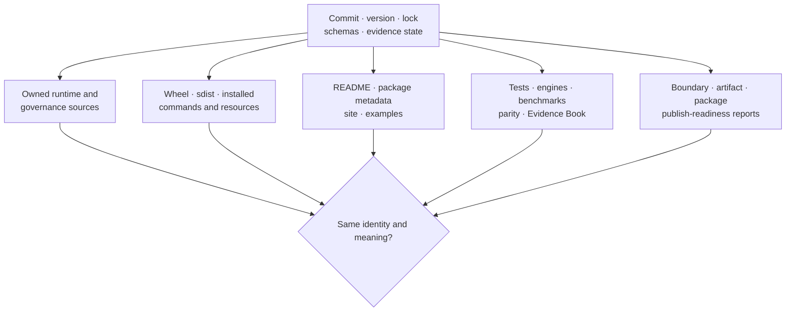
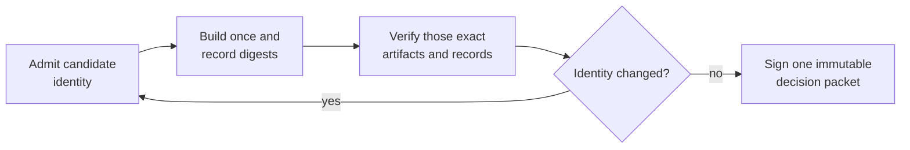

# Release Surface Alignment

Release surfaces are aligned when one identified candidate exposes the same
package identity, public contracts, computational ownership, artifact meaning,
scientific boundaries, and maturity state everywhere a consumer can encounter
them. Alignment is demonstrated by direct comparison of retained records, not
by assuming that independently green workflows describe the same candidate.



## Alignment Matrix

| Contract | Surfaces that must agree | Evidence to retain |
| --- | --- | --- |
| candidate identity | commit, version, lock, schemas, evidence inputs, optional-engine denominator | identity record and digests before and after review |
| distribution roles | runtime, compatibility alias, maintainer package, wheel and sdist metadata | package-boundary report, built inventories, clean-install results |
| installed interface | source exports/parser, installed imports/commands, API/CLI docs and examples | focused contracts, installed help, OpenAPI hash, strict docs build |
| computational ownership | native implementation, adapter/subprocess, result provenance, method guides | execution-surface report, manifests, controlled/real-engine records |
| artifact semantics | producer, schema/version, consumer, replay, reports and evidence dependencies | compatibility tests, checksums, inventory, replay classification |
| scientific assurance | tests, benchmark rows, parity observations, bundle claims and public statements | selected denominators, tolerances, statuses, freshness, limitations |
| maturity and publication | classifiers, package metadata, readiness policy, release notes | publish scorecard, closure criteria, blocker register, decision packet |

## Build The Alignment Packet

Generate governance records before enforcing them:

```bash
make report-release-readiness
```

This composes configuration, Evidence Book, artifact, execution, package, and
publish-readiness report surfaces under `artifacts/root/`. Review each record's
input identity, issue count, status, and limitations. There is no single
`release-readiness.json`; the report set is intentionally decomposed by owner.

Then collect distribution and public-surface evidence:

```bash
make package-verify
make docs
```

Record built artifact digests, clean-install imports and commands, strict docs
result, schema hash, and exact selected test/engine/benchmark/evidence records.

## Freeze The Candidate Before Verification

Admit one commit, version, dependency lock, schema set, evidence state, and
optional-engine denominator before the release review begins. Build the wheel,
source distribution, documentation, reports, and checks from that admitted
identity, then record their digests in the decision packet.

Do not rebuild a failed artifact in place and keep the earlier successful
checks. Any source change, lock resolution, generated schema, evidence refresh,
artifact rebuild, or selected-engine change creates a different candidate and
invalidates every decision edge that consumed the previous identity. Historical
records remain valid for their own candidate; they cannot be combined with the
new packet.



Verification results must identify their input artifacts, not only the source
commit. Two builds from the same commit can differ when the environment,
dependency resolution, generated inputs, or external tools differ.

## Compare Identity Across Surfaces

Verify all of the following resolve to the candidate:

- root and package metadata version;
- wheel and sdist filenames and embedded metadata;
- `importlib.metadata.version(...)` for canonical runtime, alias, and
  maintainer distributions in clean environments;
- `bijux-phylogenetics --version`;
- OpenAPI schema hash and artifact schema versions;
- documentation version links and examples;
- Evidence Book input manifests, output checksums, and freshness dependencies;
- benchmark, parity, and real-engine executable/runtime identities.

If two surfaces cannot be joined by exact identity, they cannot jointly support
the release decision.

## Compare Meaning Across Surfaces

Identity equality is necessary but insufficient. Review semantic joins:

| Public statement | Owning record |
| --- | --- |
| method is native | runtime implementation plus native-only enforcement and numerical assurance |
| result uses MAFFT, IQ-TREE2, MrBayes, or BEAST | external manifest with executable and adapter identity |
| command or Python example is supported | installed parser or curated export and contract test |
| result is reproducible | manifest/replay comparison with exact meaning named |
| numerical behavior agrees | parity or benchmark observation with case, quantity, policy, and denominator |
| study claim is supported | exact Evidence Book claim, check, observation, bundle verdict, and freshness |
| candidate is publishable | publish-readiness blocker register and composed release checks |

Do not let a shared adjective—“ready,” “matched,” “validated,” or
“reproducible”—join records that use different definitions.

## Review Status Denominators

For each test, engine, benchmark, parity, and evidence surface, retain selected
case IDs and counts for every status. Verify public summaries do not exclude
failed, skipped, unsupported, mismatched, or non-comparable records.

The Evidence Book currently contains 43 bundles across five study families.
Release statements about the complete book must resolve to all 43 current
manifests, not only the matched PCM1 and PCM2 subsets.

## Release Decision Record

| Field | Required evidence |
| --- | --- |
| identity | commit, resolved version, distributions, lock, schemas, Python/platform, governed configuration |
| build | wheel/sdist names, hashes, metadata, licenses, package inventory |
| installed behavior | clean imports, canonical/alias commands, resources, representative structured output |
| public contracts | API/schema hash, CLI discovery, strict docs and semantic tests, examples |
| scientific assurance | exact test/benchmark/parity/evidence lanes, denominators, tolerances, verdicts, freshness |
| external coverage | selected engines, executable versions, executed/skipped/failed cases, manifests |
| governance | config, artifact, execution, package, evidence, publish-readiness report paths and outcomes |
| decision | ready/blocked, blockers, bounded limitations, reviewer, timestamp, artifact destination |

The record is append-only for that candidate. A changed commit, rebuilt
distribution, dependency resolution, evidence bundle, or optional-engine
selection requires a new packet.

## Enforce After Review

```bash
make check-publish-readiness
make check-release-readiness
```

`check-release-readiness` enforces configuration source-of-truth, evidence and
artifact governance, execution ownership, package boundaries, package bundles,
and publish readiness. It does not replace source tests, strict docs, package
verification, optional real-engine lanes, benchmark/parity review, or the
human semantic comparison.

## Release Blockers

Block release for:

- candidate, version, distribution, lock, schema, or evidence identity drift;
- wheel/sdist metadata, inventory, license, or clean-install failure;
- canonical and alias behavior or ownership divergence;
- stale generated references or unsupported documented syntax;
- unresolved schema or artifact compatibility;
- ambiguous native versus external computational ownership;
- missing expected outputs, denominators, diagnostics, or readiness records;
- evidence integrity/freshness failure or a public claim stronger than its
  retained proof;
- a changed tolerance, excluded case, or weakened gate used to make a
  contradiction disappear.

### Limitation Versus Contradiction

| Condition | Release treatment |
| --- | --- |
| claim is explicitly `not_comparable`, fresh, and described within that boundary | publishable limitation when readiness policy permits it |
| optional engine is unavailable and the selected denominator records `skipped` | visible coverage limitation, not a fabricated pass |
| FastTree comparison records an expected model-assumption difference | bounded correspondence limitation; do not call it likelihood parity |
| RAxML comparison is `unsupported-case` | explicit coverage gap; exclude from favorable aggregate claims |
| public prose says matched while the bundle says `not_comparable` | blocker: semantic contradiction |
| report is green but candidate identity or skipped cases cannot be reconstructed | blocker: missing decision evidence |
| package installs but canonical and alias behavior diverge | blocker: distribution contract failure |

Readiness means the release claims are supported and contradictions are absent.
It does not mean every scientific comparison has a favorable verdict.
