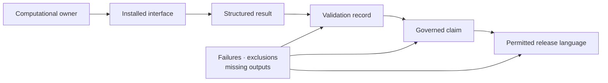
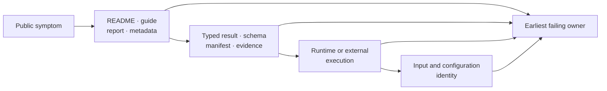
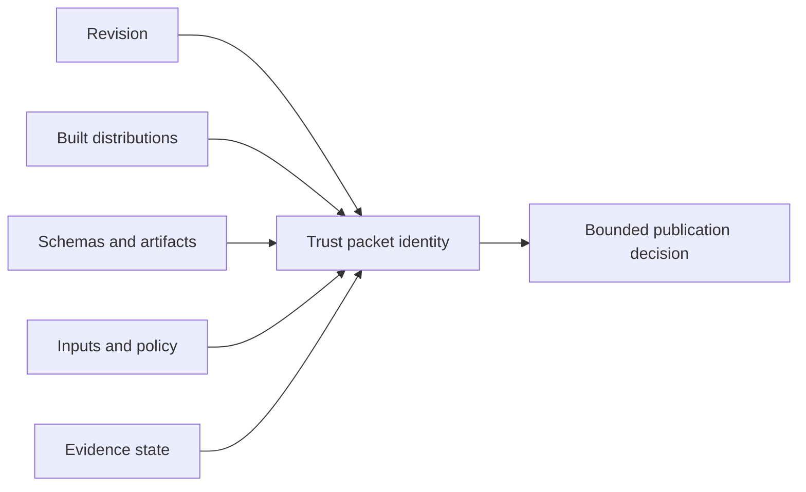

# Trust Surfaces

Trust is a traceability property. A public statement is supportable only when
its computational owner, installed interface, structured output, validation
record, evidence verdict, and release language agree. No surface may silently
borrow authority from another.

## Questions Owned By Each Surface

| Surface | Question it answers | Record that carries authority |
| --- | --- | --- |
| computation | Who performed the numerical work? | native implementation or named external engine |
| interface | How can an installed user invoke it? | curated Python export, CLI registration, or service schema |
| result | What was produced, omitted, or refused? | typed result, serialized payload, manifest, and warnings |
| validation | What behavior was exercised under which denominator? | test, benchmark, or live parity record |
| evidence | What claim follows from governed observations? | claim-scoped Evidence Book bundle and verdict |
| publication | What may a release say now? | readiness decision reconciled with current limitations |

A passing test does not create a parity verdict. A live parity case does not
create an Evidence Book verdict. A ready release does not turn an explicit
`not_comparable` boundary into equivalence.

## Trace A Claim Across Surfaces

| Claim element | Owning record | Cross-surface acceptance gate |
| --- | --- | --- |
| method ownership | native implementation or named external engine invocation | every interface, artifact, and guide attributes the same owner |
| invocation | curated export, registered command, or service schema | installed package can execute the documented path with declared defaults |
| result meaning | typed result and versioned serialization contract | status, units, omissions, warnings, and diagnostics survive projection |
| validation scope | test, benchmark, live parity, or recovery population | selected, executed, failed, skipped, and excluded denominators are visible |
| scientific conclusion | current claim-scoped Evidence Book bundle | observations, checks, verdict, limitation, and freshness support the exact statement |
| publication language | release decision consuming the above records | no weaker or contradictory upstream record is hidden |

Acceptance at one row does not skip the next. A report can serialize correctly
while carrying an unsupported claim; a claim can be scientifically bounded
while an example invokes the wrong installed surface.

## Failure Ownership Flow

Diagnose backward until the earliest contradictory or missing owner is found.
Correcting a later projection may make the symptom disappear while leaving the
scientific or compatibility defect intact.

## Detect Cross-Surface Drift

| Drift | Detection question | Required correction |
| --- | --- | --- |
| ownership drift | Is an adapter or external posterior described as native? | restore the actual computational owner everywhere |
| interface drift | Do examples use undocumented imports, commands, or fields? | move examples to supported surfaces or change the contract |
| artifact drift | Can a report value be traced to structured output? | repair the producer/consumer contract before presentation |
| evidence drift | Does prose exceed the bundle verdict, scope, or freshness? | narrow the statement and link the governing record |
| status drift | Has a runtime state been restated as an evidence or release status? | restore the vocabulary owned by each record |
| package drift | Do canonical and alias distributions imply different capability? | align metadata, README, install smoke, and release records |
| release drift | Does publication proceed with failed or missing governed output? | stop the gate and preserve the blocking status |

## Trust Decision Packet

For a material scientific or public-interface change, retain enough context to
reconstruct the decision without relying on CI history or maintainer memory:

- repository revision and resolved package versions;
- computational owner and supported invocation surface;
- input, configuration, seed, model, and external-tool identity;
- selected-case denominator and produced/missing artifact inventory;
- exact validation commands and observed outcomes;
- affected claims, bundle revisions, verdicts, and resolution records;
- permitted user-facing statement and named limitations;
- release-readiness result and decision owner.

The packet is incomplete when a skipped optional lane disappears into an
aggregate pass, a report cannot be reconstructed from structured output, or a
claim lacks a current governed record.

## Reject Mixed-Revision Trust Packets

A trust packet must describe one reconstructable repository and evidence
state. Do not combine favorable reports produced from different revisions,
policies, inputs, package builds, or generated indexes.

| Conflict | Deciding owner | Required resolution |
| --- | --- | --- |
| runtime result and report disagree | typed result/schema and producer contract | correct the earliest producer or projection, then regenerate both |
| parity summary and observations disagree | registry selection and observation ledger | preserve failure rows and rebuild the summary |
| bundle manifest and generated evidence index disagree | bundle plus index generator/freshness contract | block the claim until regenerated state agrees |
| package README and installed artifact disagree | built distribution metadata and public smoke contract | correct metadata or prose and rebuild the package |
| release report cites stale child output | child report identity and aggregate dependency contract | rerun the child and aggregate gates from one candidate revision |

Timestamp proximity is not identity. The packet records revision, policy,
input, generated-state, and artifact hashes so a reviewer can prove that all
constituent decisions were simultaneously valid.

## Define One Trust Packet Identity

Treat the packet as a joined record, not a directory of favorable files:

> **repository revision × distribution set × schema × inputs × policy × evidence state**

| Identity component | What must resolve |
| --- | --- |
| repository revision | source, generated state, and clean or explicitly captured worktree condition |
| distribution set | canonical and alias package names, versions, built-artifact hashes, and installed smoke result |
| schema | OpenAPI and artifact contract revisions understood by producers and consumers |
| inputs | tree, alignment, traits, configuration, benchmark corpus, or evidence-source digests |
| policy | tolerances, selection, failure handling, freshness, and release criteria actually applied |
| evidence state | claim, bundle, generated index, observation, and verdict identities from one coherent record set |

If one component cannot be joined, the packet may still diagnose the gap but
cannot support the combined publication claim. A rerun that refreshes one
component creates a new packet identity and requires every material edge to be
reconciled again.

## Maintained Guides

- [Cross-surface contract maintenance](public-trust-surface-maintenance.md)
  maps runtime, evidence, package, documentation, and release changes across
  their canonical owners and public projections.
- [Public interface and artifact maintenance](public-interface-and-artifact-maintenance.md)
  covers Python and CLI selection, structured results, manifests, schemas,
  and report consumers.
- [Evidence claim and study-guide maintenance](trust-lane-and-study-guide-maintenance.md)
  governs claim promotion, status ownership, evidence freshness, and the
  language exposed by PCM study guides.

## Release Review Questions

- Can every capability claim identify native or external ownership?
- Can every example execute through a supported installed surface?
- Can every reported value be traced to typed or machine-readable output?
- Can every evidence statement identify a current claim and verdict?
- Are failures, skips, `not_comparable` cases, and incomplete artifacts visible?
- Do both distribution names, site navigation, and release metadata agree?
- Could a reviewer reconstruct the decision from retained records alone?
