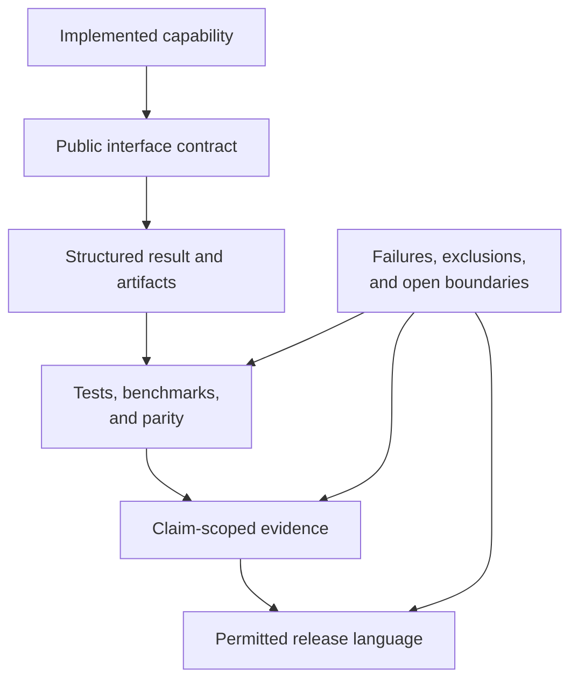

# Trust Surfaces

Trust depends on agreement among runtime ownership, public interfaces,
artifacts, validation records, Evidence Book verdicts, package metadata, and
release gates. Each surface answers a different question; none may silently
borrow authority from another.

## Detect Cross-Surface Drift

| Drift | Detection question | Required correction |
| --- | --- | --- |
| ownership drift | Is an adapter or external posterior described as native? | restore the actual computational owner everywhere |
| interface drift | Do examples use undocumented imports, commands, or fields? | move examples to supported surfaces or change the contract |
| artifact drift | Can a report value be traced to structured output? | repair the producer/consumer contract before presentation |
| evidence drift | Does prose exceed the bundle verdict, scope, or freshness? | narrow the statement and link the governing record |
| package drift | Do canonical and alias distributions imply different capability? | align metadata, README, install smoke, and release records |
| release drift | Does publication proceed with failed or missing governed output? | stop the gate and preserve the blocking status |

## Maintained Guides

- [Public trust surface maintenance](public-trust-surface-maintenance.md)
  maps runtime, evidence, package, and release changes across public contracts.
- [Public interface and artifact maintenance](public-interface-and-artifact-maintenance.md)
  covers Python/CLI selection, structured results, manifests, schemas, and
  report consumers.
- [Trust lane and study guide maintenance](trust-lane-and-study-guide-maintenance.md)
  keeps validation language and PCM study claims aligned with their strongest
  current records.

## Release Review Questions

- Can every capability claim identify native or external ownership?
- Can every example execute through a supported installed surface?
- Can every reported value be traced to typed or machine-readable output?
- Can every evidence statement identify a current claim and verdict?
- Are failures, skips, `not_comparable` cases, and incomplete artifacts visible?
- Do both distribution names, site navigation, and release metadata agree?
