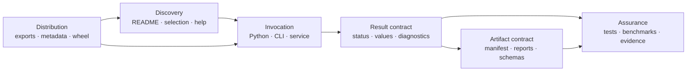
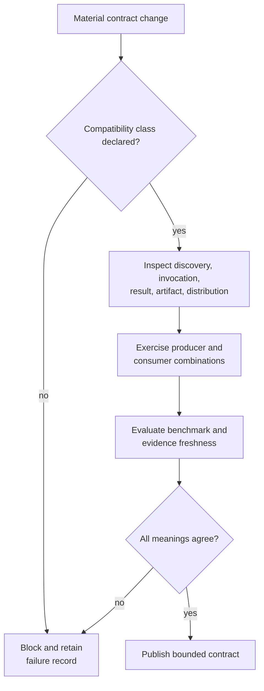

# Public Interface And Artifact Maintenance

The public contract spans discovery, invocation, structured results, durable
artifacts, package identity, and scientific assurance. A change is incomplete
when one layer advertises behavior that another layer cannot execute, consume,
or substantiate.

## Preserve One Meaning Across Every Projection

For each changed field or behavior, record a projection ledger:

| Projection | Required review |
| --- | --- |
| Python result | type, default, omission, warning, error, and compatibility meaning |
| CLI or service | translation, status, exit or transport behavior, and serialized field |
| manifest and artifact | schema, units, denominator, provenance, inventory, and migration decision |
| report or figure | source field, transformation, missingness, warning visibility, and caption scope |
| benchmark or evidence consumer | observation identity, acceptance rule, claim dependency, and freshness |
| package and documentation | installed discovery path, example, version, and bounded support language |

The ledger closes only when each applicable projection either preserves the
canonical meaning or refuses incompatibility explicitly. A successful site
build or JSON parse does not close a semantic discrepancy.

## Contract Projection Matrix

| Changed contract | Canonical owner | Projections and consumers to inspect |
| --- | --- | --- |
| curated Python name, signature, or result | runtime source and contract tests | Python/API guides, examples, package exports, serialization |
| CLI command, option, stream, or exit status | command registry and CLI tests | generated reference, workflows, shell examples, automation consumers |
| service request or response | pinned OpenAPI schema and service tests | API guide, clients, schema digest, artifact consumers |
| result field or status meaning | typed result, schema, producer and consumer tests | artifact guide, reports, examples, Evidence Book adapters |
| workflow artifact family | producer manifest and artifact schema | consumption guide, runbook, cleanup rules, release inventory |
| native or external computation ownership | implementation boundary and diagnostics | selection guidance, domain guide, README, benchmarks, provenance |
| distribution exposure or compatibility | package metadata and built wheel | install guides, alias contract, import examples, project URLs |
| scientific support statement | named validation or evidence record | method guide, capability matrix, study guide, release language |

The matrix is a search plan, not permission to edit every surface. Inspect each
projection and change only those whose meaning or consumer contract changed.

## Maintain The Artifact Handoff

An interface result and its persisted artifact are separate compatibility
surfaces. For every material change, establish:

1. whether in-memory consumers observe a new name, type, default, status, or
   omission rule;
2. whether serialized consumers observe a field, schema version, path,
   manifest relationship, ordering, unit, or precision change;
3. whether old producers remain readable by new consumers and new producers by
   old consumers;
4. whether a migration, deprecation, dual-read period, or explicit breaking
   boundary is required;
5. whether Evidence Book or benchmark consumers become stale even when schema
   validation still passes.

Schema-valid data can still be semantically incompatible. A field whose unit,
denominator, provenance, or omission behavior changed requires a compatibility
decision even when its JSON type did not.

## Evolve Schemas Without Erasing Failure State

Classify an artifact change as additive, behaviorally changed, deprecated, or
breaking before changing producers. Version the semantic contract whenever an
existing consumer could interpret the same bytes differently, even if the
schema remains structurally valid.

| Evolution case | Producer obligation | Consumer obligation |
| --- | --- | --- |
| additive optional field | define absence semantics and deterministic default behavior | preserve unknown fields where round-trip matters and do not infer new success state |
| renamed or split field | retain an explicit mapping and deprecation boundary | reject ambiguity rather than choosing one source silently |
| unit, denominator, or status change | publish a new semantic version with provenance | require the matching version before interpretation |
| partial or failed output | serialize terminal status, produced inventory, missing inventory, warnings, and cause | surface the incomplete state before reading values |
| breaking inventory or relationship | provide a migration or a hard compatibility refusal | never fabricate missing links from file names or directory layout |

Exercise old-producer/new-consumer, new-producer/old-consumer, and current
producer/current-consumer combinations where the compatibility policy claims
support. A migration is successful only when status, provenance, exclusions,
and missing outputs survive—not merely when the document parses.

## Public Result Invariants

Across Python, CLI, service, and artifact forms, preserve these meanings:

- status is available before a consumer interprets numerical values;
- warnings, refusals, missing cases, and partial outputs remain visible;
- native and external computation owners remain attributable;
- input, method, software, and configuration identities survive serialization;
- omitted rows do not disappear from the eligible denominator;
- diagnostics remain linked to the result they qualify;
- scientific support is cited from its owning benchmark or evidence record.

Presentation layers may summarize these fields, but they may not convert a
partial result into success, an external result into native output, a runtime
parity pass into an Evidence Book match, or `not_comparable` into failure.

## Review A Material Interface Change

The review record names the canonical owner, compatibility class, affected
projections, producer/consumer combinations, generated outputs, scientific
records evaluated for freshness, and exact verification outcomes.

## Drift Signatures

- A workflow exists in source but cannot be discovered through a supported
  installed interface.
- Selection guidance routes readers to a surface with different failure or
  artifact semantics.
- CLI help changes while generated command references or shell examples remain
  stale.
- A typed result changes while artifact schemas or consumers retain the older
  omission rules.
- A package README imports a symbol absent from its built wheel.
- An external-engine workflow is presented without engine identity or as a
  native computation.
- A report renders successfully while dropping warnings, missing taxa, failed
  chains, or excluded observations.
- A capability statement survives after its benchmark or Evidence Book input
  identity changed.

## Publication Decision

The interface set is coherent when a reader can discover the supported surface,
invoke it through an installed contract, interpret status and diagnostics,
consume its durable artifacts, identify the computation owner, and locate the
evidence that bounds any scientific claim. Block publication when any required
handoff contradicts another, when compatibility is undeclared, or when a
generated projection cannot be reproduced from its canonical owner.
