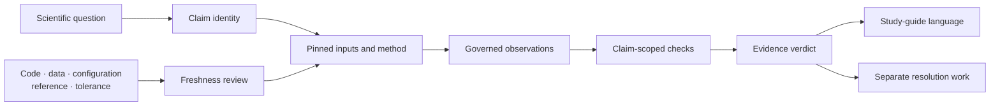

# Evidence Claim And Study-Guide Maintenance

A study guide is a public projection of governed evidence, not an independent
place to decide what the software proved. Maintain the claim from its inputs
through its verdict first; then make the guide state that result, its boundary,
and the record needed to reproduce it.

## Propagate From The Changed Owner

| Changed owner | Recompute or review first | Then regenerate or revise |
| --- | --- | --- |
| source, dataset, or tree identity | input manifests, admitted population, and dependent freshness | observations, verdicts, indexes, and study interpretation |
| runtime method or external adapter | affected executions, result schemas, diagnostics, and artifact bundles | comparisons, evidence freshness, and capability language |
| observation key, normalization, or tolerance | raw-to-normalized mapping and complete claim denominator | claim verdict, mismatch records, guide tables, and summaries |
| claim dependency or wording | claim scope and required observations | bundle summary, study guide, site index, and release statement |
| generated index or guide only | canonical bundle and current projections | regenerate the stale projection; do not edit evidence to match it |

Move forward from the earliest changed authority. Editing the study guide first
can temporarily hide a stale or contradictory claim while leaving every
machine consumer wrong.

## Keep Status Namespaces Separate

| Record | Valid status language | What it establishes |
| --- | --- | --- |
| runtime execution | states defined by that command or result contract | whether work ran and what it produced |
| live parity case | `passed`, `failed`, `skipped` | outcome among selected registry cases |
| Evidence Book claim | `matched`, `matched_with_tolerance`, `mismatch_explained`, `mismatch_unexplained`, `not_comparable` | adjudication of governed observations |
| resolution work | open or blocked follow-through | whether a mismatch or comparison boundary has an owned next action |
| release readiness | ready or blocked | whether repository publication policy is satisfied |

Never invent an “open” evidence verdict. Never translate `not_comparable` into
failed execution. Never use release readiness as evidence of numerical or
scientific equivalence.

## Claim Dependency Record

Every public evidence statement must resolve to one governed claim with:

- stable study, evidence, and claim identifiers;
- source citation and acquisition provenance;
- input hashes and the exact taxa or observations admitted to the analysis;
- executable owner, package or external-tool version, configuration, and seed;
- model family, parameterization, units, missing-data policy, and denominator;
- raw observations for both sides of a comparison;
- named check, tolerance rationale, and observed difference;
- claim-level verdict, explanation where required, and freshness state;
- artifact paths needed to reconstruct the statement.

Bundle-level metadata cannot substitute for absent claim-level observations.
A contract-only wrapper with no governed primary output can document intended
ownership and required artifacts; it cannot support a numerical-result claim.

## Promote A Result Into A Public Claim

1. Name the scientific quantity and the exact comparison being adjudicated.
2. Pin the inputs, method identity, model parameterization, and computation
   owner before interpreting output.
3. Preserve raw observations and missing outputs; do not begin from rendered
   prose or a plot.
4. Apply a claim-scoped check whose tolerance is justified independently of
   the observed difference.
5. Assign exactly one Evidence Book verdict from the governed vocabulary.
6. Record explanation and resolution work separately when the verdict requires
   follow-through.
7. Regenerate indexes and verify that the claim map, parity dashboard,
   mismatch archive, study index, and guide agree.
8. Publish the narrowest statement supported by the current record.

## Write A Study Guide From Evidence

A study guide must let a reader answer five questions without reading
repository internals:

1. What biological or methodological question is being examined?
2. Which data, taxa, model, and computation owner define the analysis?
3. Which outputs actually exist, and which expected outputs are absent?
4. What does each governed claim conclude under its recorded tolerance?
5. What remains unsupported, non-comparable, or unresolved?

Use a claim table when a study contains multiple evidence bundles. Each row
should identify the claim, method family, governed output, current verdict,
and the exact condition for stronger language. Keep narrative interpretation
downstream of that table so prose cannot outrun the record.

## Reader-Facing Claim Anatomy

A public study statement should contain, directly or through an adjacent claim
table:

| Element | Required content |
| --- | --- |
| population | taxa, observations, dataset revision, and material exclusions |
| computation | model, parameterization, implementation owner, version, and configuration |
| quantity | exact estimand, units/scale, node/parameter identity, and transformation |
| comparison | reference owner, normalization, observation rule, tolerance, and denominator |
| conclusion | current claim verdict expressed in bounded scientific language |
| limitation | missing outputs, mismatches, non-comparable boundary, or untested scope |
| audit route | bundle, machine result, check, provenance, and freshness record |

This is scientific content, not page-planning commentary. The reader should be
able to tell what was observed, under which model, and where the conclusion
stops without learning the repository's internal delivery history.

## Reconcile Conflicting Evidence Projections

When a guide, manifest, generated index, result table, or release statement
disagrees:

1. freeze the affected public claim at the narrowest non-contradictory state;
2. identify each record's canonical owner and generation path;
3. compare claim identity, input hashes, result rows, checks, verdict, and
   freshness rather than visible wording alone;
4. correct the earliest wrong owner or regenerate the stale projection;
5. retain the contradiction and failed validation until all dependent surfaces
   agree;
6. rerun exact-bundle validation, evidence indexes, documentation truth, and
   release consumers before restoring stronger language.

Never resolve the conflict by selecting the matched row, deleting the mismatch,
or weakening the truth assertion. Until ownership is reconciled, the affected
statement remains blocked.

## Freshness Triggers

Re-evaluate every dependent claim when any of these changes:

- source data, filtering, taxon reconciliation, or missing-data handling;
- tree topology, rooting, branch lengths, labels, or node identity;
- numerical implementation, dependency, default, optimizer, or random seed;
- model family, formula, contrast, transform, prior, or parameter bounds;
- reference implementation, external-engine version, or invocation mode;
- result schema, artifact inventory, tolerance, or adjudication rule;
- prose that broadens the population, method, metric, or confidence level.

A timestamp alone does not establish freshness. The bundle must bind the
material dependency identities used to produce its observations.

## Handle Non-Comparable Claims

`not_comparable` is a complete evidence verdict when the governed comparison
cannot be made. The guide must name why: missing primary output, unsupported
model family, incompatible parameterization, unavailable reference record, or
another explicit boundary. It must also distinguish what was verified—such as
input identity or wrapper contract—from the scientific result that was not.

Create resolution work only when there is a concrete owner and closure record.
For example, require a retained posterior table with model, chain, seed, and
diagnostic identity rather than the vague instruction to “add parity.” The
resolution state remains separate from the verdict until governed observations
justify a new adjudication.

## Drift Signals

Treat these as blocking review findings:

- a guide says “validated” without naming the validation lane;
- a bundle verdict differs from its claim row or public study summary;
- a rendered table contains values absent from governed structured output;
- matched language appears while the claim is `not_comparable` or stale;
- selected, executed, and successfully compared denominators are collapsed;
- an external engine or R package is described as native computation;
- missing outputs, skipped cases, warnings, or tolerance changes disappear;
- one successful claim is generalized to a model family or study.

## Completion Criteria

Claim maintenance is complete only when canonical bundle records validate,
generated evidence indexes are current, affected public guides use the same
scope and verdict, separate resolution work remains visible, artifact paths
resolve, and release language stays within the strongest current evidence.
