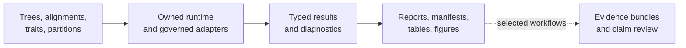
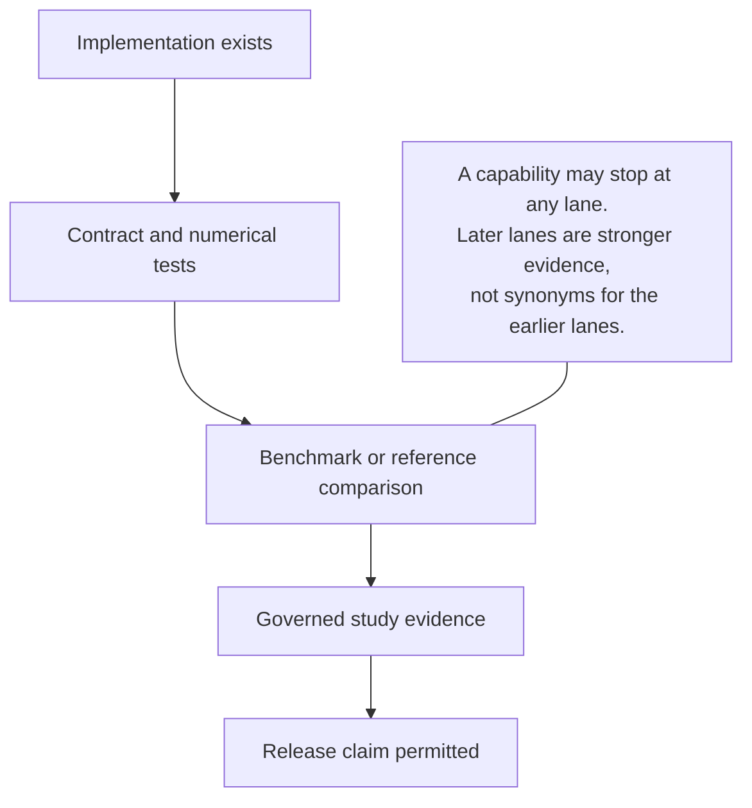

# Bijux Phylogenetics

One repository connects three things that scientific software too often keeps
apart: an executable phylogenetics runtime, study-level evidence for selected
comparative claims, and the controls that keep releases aligned with both.

The runtime is broad; the available evidence is deliberately claim-specific.
Implementation, contract tests, benchmarks, and governed studies therefore
carry separate status instead of collapsing into a single maturity label.

## Explore The Project

| Goal | Destination | Coverage |
| --- | --- | --- |
| run an analysis | [Product handbook](01-bijux-phylogenetics/index.md) | which Python, CLI, or artifact surface fits the work |
| inspect a scientific claim | [Evidence book](02-bijux-phylogenetics-evidence-book/index.md) | which bundle, provenance record, and open boundary support it |
| maintain or release the repository | [Maintainer handbook](03-bijux-phylogenetics-maintain/index.md) | how code, docs, packages, and evidence stay synchronized |

## What The Runtime Owns

The canonical `bijux-phylogenetics` package contains more than command wrappers.
It owns tree and alignment semantics, native finite-state likelihood machinery,
supported maximum-likelihood and Bayesian inference paths, comparative and
ancestral analysis, parsimony, simulations, datasets, diagnostics, and
review-oriented output contracts.

External programs still matter. MAFFT, trimAl, IQ-TREE2, FastTree, MrBayes, and
BEAST are exposed through adapters where execution belongs to those engines.
The docs identify that boundary instead of describing an adapter as a native
implementation.

## The Trust Model

Use the [validation lanes](01-bijux-phylogenetics/quality/validation-lanes.md)
to interpret claims. A passing unit test proves a contract under its fixtures;
it does not, by itself, prove parity with a reference analysis. An evidence
bundle records a particular study execution; it does not certify every model,
dataset, or scientific interpretation.

## Essential Workflows And Contracts

- [Runtime system map](01-bijux-phylogenetics/architecture/runtime-system-map.md)
  — follow data from input contracts to reviewable artifacts.
- [Surface selection](01-bijux-phylogenetics/interfaces/surface-selection.md)
  — choose Python, CLI, or persisted artifacts by intended consumer.
- [Native maximum-likelihood workflows](01-bijux-phylogenetics/operations/native-maximum-likelihood-workflows.md)
  — understand the owned inference result and search evidence.
- [Native Bayesian workflows](01-bijux-phylogenetics/operations/native-bayesian-workflows.md)
  — see the supported DNA inference boundary and diagnostics.
- [Evidence reading guide](01-bijux-phylogenetics/foundation/claim-reading-guide.md)
  — trace a public statement to its strongest available proof.

## Distribution Map

| Distribution | Purpose |
| --- | --- |
| `bijux-phylogenetics` | canonical runtime, public Python API, and CLI |
| `phylogenetic` | shorter compatibility distribution for the same runtime |
| `bijux-phylogenetics-dev` | repository-only documentation, evidence, API, and release checks |

The alias does not represent a reduced scientific edition. Maintainer tooling
is intentionally separate from both runtime distributions.

## Scope Boundary

This project provides software and inspectable analytical evidence. It does
not replace study design, model criticism, domain expertise, or independent
review. Reproducibility tells you how a result was obtained; it does not make
the biological conclusion inevitable.
