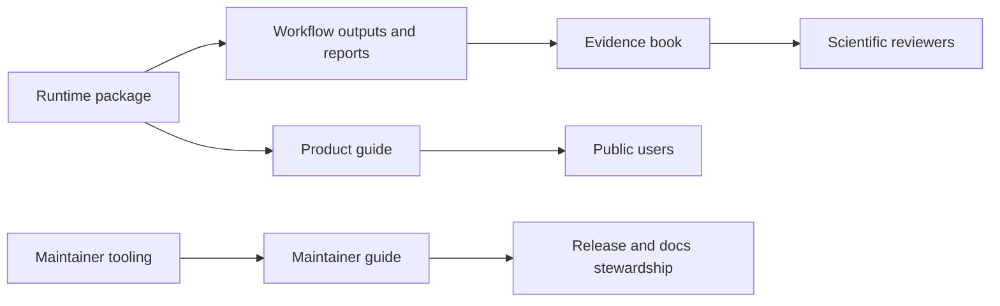

# Bijux Phylogenetics

<!-- bijux-phylogenetics-badges:generated:start -->

<!-- bijux-phylogenetics-badges:generated:end -->

`bijux-phylogenetics` is a reproducible phylogenetics toolkit for tree
inspection, alignment review, native inference, comparative analysis,
ancestral reconstruction, evidence-linked reporting, and governed workflow
bundles.

This documentation is split into three reader-facing surfaces so claims stay
clear:

- the product guide explains what the runtime does and how to use it
- the evidence book explains what has been checked against governed study
  records
- the maintainer guide explains how documentation, release, and repository
  health stay aligned

## Start By Goal

- I want to understand the runtime surface and choose the right interface.
  Start with the [Phylogenetics product guide](phylogenetics/index.md).
- I want to understand what has been checked on course-derived comparative
  studies.
  Start with the [Evidence Book](phylogenetics-evidence-book/index.md).
- I want to maintain this repository without letting docs and release claims
  drift.
  Start with the [Maintainer guide](phylogenetics-maintainer/index.md).

## What This Repository Publishes

- `bijux-phylogenetics`
  The canonical runtime distribution and the documentation center of gravity.
- `phylogenetic`
  A shorter compatibility distribution that maps to the same runtime story.
- `bijux-phylogenetics-dev`
  Repository-owned maintainer tooling for docs, release, and quality
  automation.

## Product Highlights

- owned tree, split, and tree-set review on the `PhyloTree` runtime
- native finite-state likelihood across nucleotide, protein, codon, and
  discrete Mk families
- native maximum-likelihood result objects with support and benchmark evidence
- native Bayesian DNA workflows for supported fixed-topology and
  joint-topology runs
- comparative and ancestral workflows that write reviewable artifacts instead
  of opaque notebook state
- governed wrapper orchestration for external scientific engines when the
  wrapper is itself the honest public surface

## Read In Order

1. [Product guide](phylogenetics/index.md)
2. [Surface selection guide](phylogenetics/interfaces/surface-selection.md)
3. [Installation and setup](phylogenetics/operations/installation-and-setup.md)
4. [Claim reading guide](phylogenetics/foundation/claim-reading-guide.md)
5. [Evidence Book](phylogenetics-evidence-book/index.md)
6. [Release review workflow](phylogenetics/quality/release-review-workflow.md)

## Important Boundary

The runtime surface is broader than the currently closed evidence surface. The
documentation keeps that distinction explicit on purpose. A feature can be
published, documented, and usable without implying that every scientific claim
around it is already closed by study evidence.
