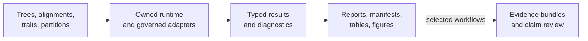
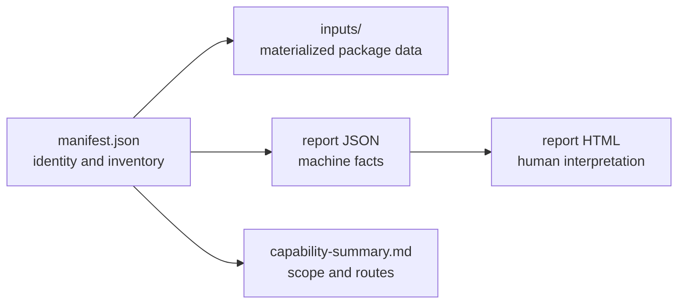
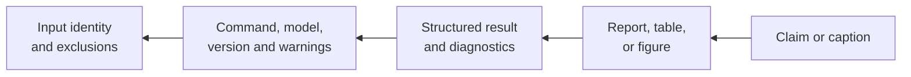
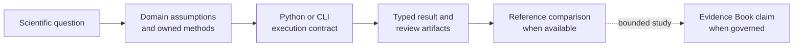
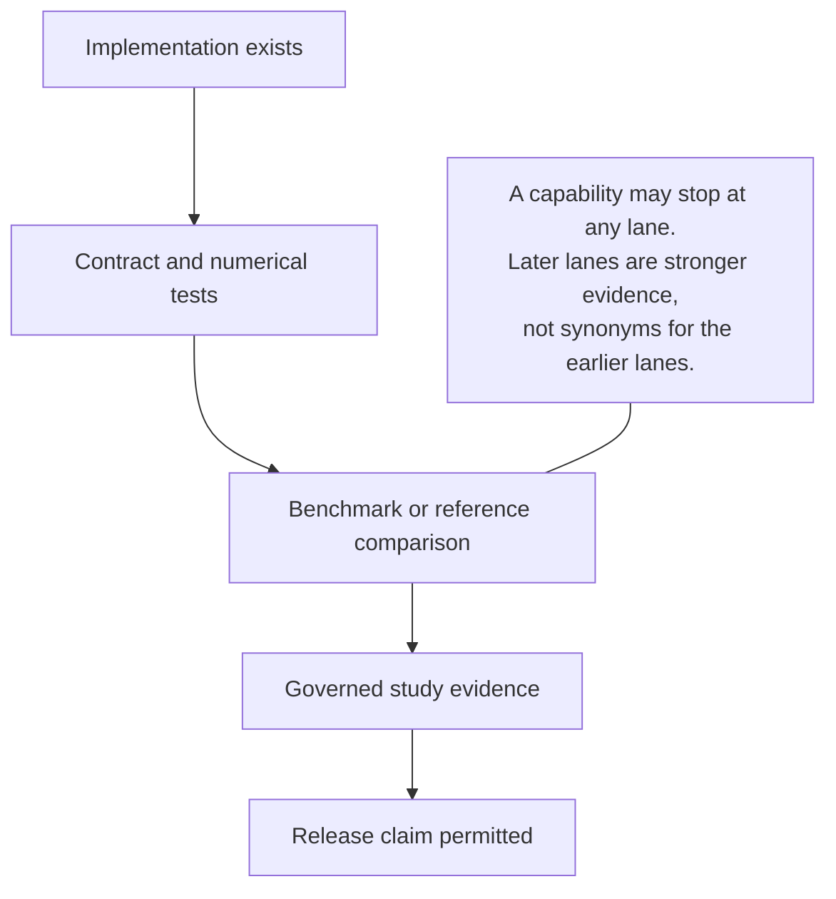

# Bijux Phylogenetics

<!-- bijux-phylogenetics-badges:generated:start -->
[](https://pypi.org/project/bijux-phylogenetics/)
[](https://github.com/bijux/bijux-phylogenetics/blob/main/LICENSE)
[](https://github.com/bijux/bijux-phylogenetics/actions/workflows/verify.yml?query=branch%3Amain)
[](https://github.com/bijux/bijux-phylogenetics/actions/workflows/release-pypi.yml)
[](https://github.com/bijux/bijux-phylogenetics/actions/workflows/release-ghcr.yml)
[](https://github.com/bijux/bijux-phylogenetics/actions/workflows/release-github.yml)
[](https://github.com/bijux/bijux-phylogenetics/actions/workflows/deploy-docs.yml)
[](https://github.com/bijux/bijux-phylogenetics/releases)
[](https://github.com/bijux?tab=packages&repo_name=bijux-phylogenetics)
[](https://github.com/bijux/bijux-phylogenetics/tree/main/packages)

[](https://pypi.org/project/bijux-phylogenetics/)
[](https://pypi.org/project/phylogenetic/)

[](https://github.com/bijux/bijux-phylogenetics/pkgs/container/bijux-phylogenetics%2Fbijux-phylogenetics)
[](https://github.com/bijux/bijux-phylogenetics/pkgs/container/bijux-phylogenetics%2Fphylogenetic)

[](https://bijux.io/bijux-phylogenetics/01-bijux-phylogenetics/)
[](https://bijux.io/bijux-phylogenetics/01-bijux-phylogenetics/)
<!-- bijux-phylogenetics-badges:generated:end -->

One repository connects three things that scientific software too often keeps
apart: an executable phylogenetics runtime, study-level evidence for selected
comparative claims, and the controls that keep releases aligned with both.

The runtime is broad; the available evidence is deliberately claim-specific.
Implementation, contract tests, benchmarks, and governed studies therefore
carry separate status instead of collapsing into a single maturity label.



## Run The Installed Runtime

The packaged capability demo is the shortest path from installation to a
reviewable artifact set:

```bash
python -m pip install bijux-phylogenetics
bijux-phylogenetics demo run \
  --out artifacts/capability-demo \
  --manifest artifacts/capability-demo/manifest.json \
  --json
```

The run materializes packaged inputs and generates four HTML reports. Read the
manifest before the reports: it records the command result and output
identities needed to audit the run. The demo validates packaging, tree and
table intake, comparison, and reporting; it is not a numerical inference
benchmark.

### Follow The Demo Records



The manifest binds the run. The JSON reports preserve inspectable facts. The
HTML reports are presentations of those facts. `capability-summary.md` tells
you what the demonstration exercised, but it does not promote the synthetic
example into accuracy or biological evidence.

## Explore The Project

| Goal | Destination | Coverage |
| --- | --- | --- |
| run an analysis | [Product handbook](01-bijux-phylogenetics/index.md) | which Python, CLI, or artifact surface fits the work |
| understand a scientific capability | [Scientific domains](02-bijux-phylogenetics-domains/index.md) | objects, methods, assumptions, outputs, and failure modes |
| inspect a scientific claim | [Evidence book](03-bijux-phylogenetics-evidence-book/index.md) | which bundle, provenance record, and open boundary support it |
| compare with established tools | [Parities and correspondence](04-bijux-phylogenetics-parities/index.md) | which APE, GEIGER, phytools, and external-engine relationships are governed |
| maintain or release the repository | [Maintainer handbook](05-bijux-phylogenetics-maintain/index.md) | how code, docs, packages, and evidence stay synchronized |

## Locate The Authoritative Record

| Reader question | Inspect first | Then verify |
| --- | --- | --- |
| What inputs and outputs belonged to a run? | workflow manifest | referenced files, checksums, diagnostics, and software identity |
| What did a Python or CLI method return? | typed result or structured JSON | public contract, warnings, absence semantics, and persisted artifacts |
| Did a reference implementation agree? | parity summary and observation rows | selected registry case, normalization, tolerances, and raw reference output |
| What supports a scientific statement? | Evidence Book manifest and claim records | provenance, input manifest, checks, freshness, and current bundle verdict |
| Is a release internally consistent? | release-readiness report | built distributions, strict docs, package boundaries, and evidence governance |

HTML and figures are interpretation surfaces. When a value also exists in JSON,
TSV, a schema-governed result, or a bundle manifest, the structured record owns
its identity and status.

## Trace A Result When Something Looks Wrong

Start at the observation that surprised you and move upstream to the component
that made the disputed decision. Do not begin by rerunning the entire workflow
or editing a report.



| Symptom | Inspect first | Deciding owner | Do not conclude from |
| --- | --- | --- | --- |
| a taxon is absent | exclusion and reconciliation rows | input/tree/alignment contract | the final tip count alone |
| a coefficient changed | design matrix, covariance, transform, and fitted population | comparative model | matching formula text |
| a topology differs | taxon reconciliation, rooting, model, seed, and search state | inference method or external engine | a rendered tree image |
| support values disagree | method label, scale, clade identity, and denominator | support procedure | normalized display percentages |
| an ancestral value moved | node identity, model, tree, state scale, and uncertainty | reconstruction method | node array position |
| a parity case failed | raw observations, normalization, tolerance, and reference identity | parity registry case | package-wide pass counts |
| a study claim is unavailable | bundle verdict, primary outputs, checks, and freshness | Evidence Book claim | neighboring runtime capability |

This trace preserves negative evidence. A failed check, missing output, or
unresolved convention belongs in the record that owns it; changing a caption
or omitting a row cannot resolve the underlying result.

## Build A Review Packet

A durable analysis is a connected set of records, not a directory of files.
Retain the smallest packet that lets another person establish identity,
execution, interpretation, and completeness without rerunning the process.

| Packet component | Minimum content | Reject the packet when… |
| --- | --- | --- |
| identity | package and external-engine versions, operation, configuration, seed, input hashes | the computation owner or exact inputs cannot be identified |
| execution | exit or completion state, warnings, search/sampling diagnostics, parser state | a report exists but execution state is unknown |
| results | typed or structured estimates, topology/history identity, uncertainty, exclusions | headline values exist only in prose or figures |
| inventory | expected and present outputs, schemas, checksums where governed | missing outputs disappear from the denominator |
| interpretation | model assumptions, units/scales, comparison rule, bounded non-claims | the scientific meaning depends on undocumented defaults |
| claim evidence | claim ID, provenance, observations, acceptance rule, freshness, verdict | a broad conclusion is inferred from a neighboring bundle |

Runtime work normally stops after the first five components. The sixth exists
only for claims governed by the Evidence Book.

## Follow A Scientific Question



A runtime method can be useful without a corresponding Evidence Book bundle.
Conversely, a study can retain an external computation owner while Bijux
governs its inputs, provenance, checks, and verdict. The links above keep those
relationships explicit.

## Choose The Evidence Needed For The Decision

| Decision | Minimum useful record | Stronger record when the claim requires it |
| --- | --- | --- |
| can this input be parsed and validated? | typed result or structured command output | fixture-backed contract test |
| did this analysis produce its declared artifacts? | manifest plus checksum-resolved inventory | reproducible replay under the recorded environment |
| does a numerical method behave on a named corpus? | benchmark or known-answer record | governed reference comparison |
| does Bijux agree with APE, GEIGER, or phytools for a selected case? | live registry observation with denominator and tool identity | Evidence Book claim when the study consumes that comparison |
| can a scientific statement be published? | current claim verdict and provenance | release-readiness record confirming all public projections agree |

Do not demand study evidence for a simple parser decision, and do not use a
parser success to justify a scientific statement. Match the proof to the
decision being made.

## What The Runtime Owns

The canonical `bijux-phylogenetics` package contains more than command wrappers.
It owns tree and alignment semantics, native finite-state likelihood machinery,
supported maximum-likelihood and Bayesian inference paths, comparative and
ancestral analysis, parsimony, simulations, datasets, diagnostics, and
review-oriented output contracts.

External programs still matter. MAFFT, trimAl, IQ-TREE2, FastTree, MrBayes, and
BEAST are exposed through adapters where execution belongs to those engines.
The docs identify that boundary instead of describing an adapter as a native
implementation.

## The Trust Model



Use the [validation lanes](01-bijux-phylogenetics/quality/validation-lanes.md)
to interpret claims. A passing unit test proves a contract under its fixtures;
it does not, by itself, prove parity with a reference analysis. An evidence
bundle records a particular study execution; it does not certify every model,
dataset, or scientific interpretation.

Runtime parity and Evidence Book status use different vocabularies. Live APE,
GEIGER, and phytools harnesses report cases as `passed`, `failed`, or `skipped`.
Governed study bundles use `matched`, `matched_with_tolerance`,
`mismatch_explained`, `mismatch_unexplained`, or `not_comparable`. A skipped
runtime case is not an evidence verdict, and an open follow-through item is not
a replacement for the recorded bundle verdict.

## Essential Workflows And Contracts

- [Runtime system map](01-bijux-phylogenetics/architecture/runtime-system-map.md)
  — follow data from input contracts to reviewable artifacts.
- [Surface selection](01-bijux-phylogenetics/interfaces/surface-selection.md)
  — choose Python, CLI, or persisted artifacts by intended consumer.
- [Native maximum-likelihood workflows](01-bijux-phylogenetics/operations/native-maximum-likelihood-workflows.md)
  — understand the owned inference result and search evidence.
- [Native Bayesian workflows](01-bijux-phylogenetics/operations/native-bayesian-workflows.md)
  — see the supported DNA inference boundary and diagnostics.
- [Evidence reading guide](01-bijux-phylogenetics/foundation/claim-reading-guide.md)
  — trace a public statement to its strongest available proof.

## Distribution Map

| Distribution | Purpose |
| --- | --- |
| `bijux-phylogenetics` | canonical runtime, public Python API, and CLI |
| `phylogenetic` | shorter compatibility distribution for the same runtime |
| `bijux-phylogenetics-dev` | repository-only documentation, evidence, API, and release checks |

The alias does not represent a reduced scientific edition. Maintainer tooling
is intentionally separate from both runtime distributions.

## Scope Boundary

This project provides software and inspectable analytical evidence. It does
not replace study design, model criticism, domain expertise, or independent
review. Reproducibility tells you how a result was obtained; it does not make
the biological conclusion inevitable.
