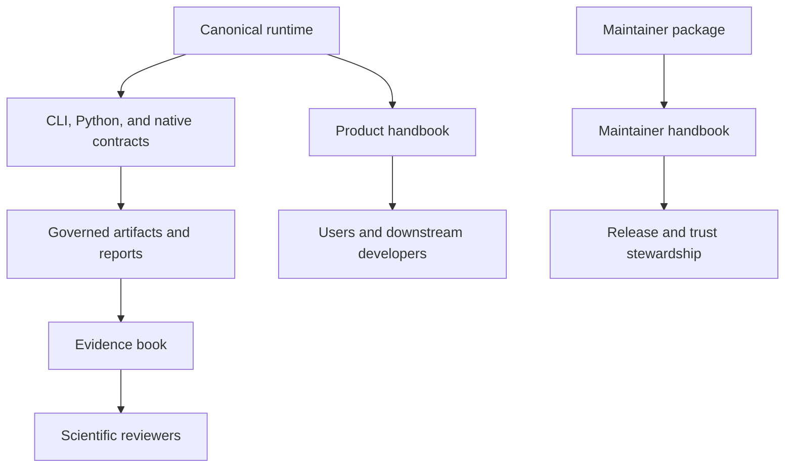
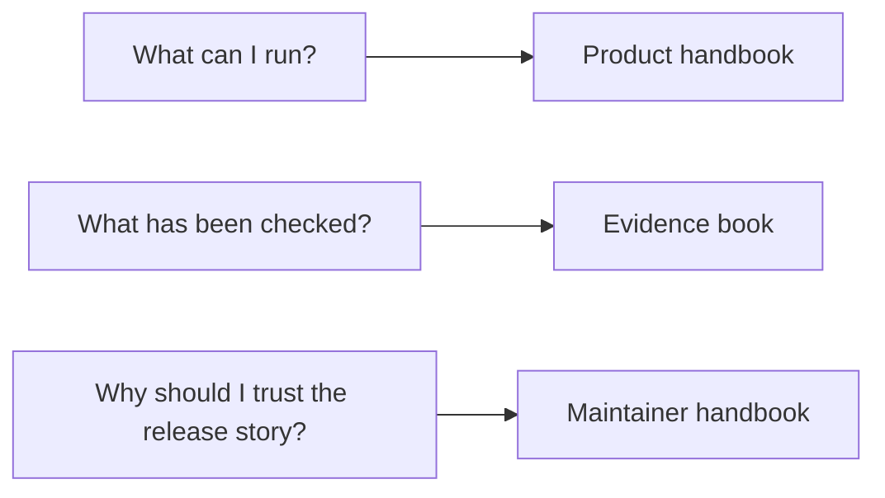

# Bijux Phylogenetics

<!-- bijux-phylogenetics-badges:generated:start -->

<!-- bijux-phylogenetics-badges:generated:end -->

`bijux-phylogenetics` is a large phylogenetics runtime and evidence-bearing
repository. The checked-in tree already covers owned tree semantics, alignment
processing, native likelihood and inference, comparative analysis, ancestral
reconstruction, explicit parsimony, report generation, benchmark review, and
governed study evidence.

This site exists to make that depth visible without overstating what has been
scientifically closed.

## What Readers Should Understand Immediately

| Surface | What it is for |
| --- | --- |
| [Product handbook](01-bijux-phylogenetics/index.md) | runtime ownership, interfaces, workflows, outputs, and quality reading |
| [Evidence book](02-bijux-phylogenetics-evidence-book/index.md) | governed comparative-study dossiers, bundle IDs, provenance, and bounded study claims |
| [Maintainer handbook](03-bijux-phylogenetics-maintain/index.md) | documentation truth, release alignment, artifact hygiene, and public trust stewardship |

## What The Checked-In Runtime Already Covers

| Capability family | Publicly visible depth |
| --- | --- |
| Trees | `PhyloTree`, rootedness, support normalization, topology comparison, clades, MRCA review, tree sets, and rendering |
| Alignments | FASTA validation, trimming, translation, coding checks, partition-aware handling, and packaged example inputs |
| Native inference | finite-state likelihood, native maximum-likelihood result objects, supported native Bayesian DNA workflows, and benchmark surfaces |
| Comparative biology | PGLS, signal, regression interpretation, discrete evolution, diversification, and model-selection reading |
| Ancestral and parsimony analysis | continuous and discrete reconstruction, uncertainty-ledger outputs, and explicit parsimony families |
| Datasets and reporting | packaged datasets, study inputs, benchmark corpora, HTML and TSV outputs, manifests, and evidence-linked bundles |

## Start By Goal

- I want to understand what the runtime owns and which interface I should use.
  Start with the [Phylogenetics product handbook](01-bijux-phylogenetics/index.md).
- I want to understand what the governed comparative-study record actually
  proves.
  Start with the [Evidence book](02-bijux-phylogenetics-evidence-book/index.md).
- I want to understand how the repository keeps documentation and release
  language honest.
  Start with the [Maintainer handbook](03-bijux-phylogenetics-maintain/index.md).

## Reader Routes

- Read the product handbook when the question is about runtime behavior,
  package roles, interfaces, workflows, outputs, or validation lanes.
- Read the evidence book when the question is about provenance, bundle IDs,
  study dossiers, or bounded parity claims.
- Read the maintainer handbook when the question is about narrative
  alignment, artifact hygiene, metadata truth, or release readiness.

## Flagship Starting Points

- [Surface selection guide](01-bijux-phylogenetics/interfaces/surface-selection.md)
- [Native maximum-likelihood workflows](01-bijux-phylogenetics/operations/native-maximum-likelihood-workflows.md)
- [Native Bayesian workflows](01-bijux-phylogenetics/operations/native-bayesian-workflows.md)
- [Validation lanes](01-bijux-phylogenetics/quality/validation-lanes.md)
- [Evidence book overview](02-bijux-phylogenetics-evidence-book/index.md)
- [Maintainer handbook overview](03-bijux-phylogenetics-maintain/index.md)

## Important Boundary

The code surface is broader than the currently closed evidence surface, and
the evidence surface is narrower than the full runtime surface. These docs
keep that distinction explicit on purpose. A feature can be documented and
usable without claiming that every surrounding scientific interpretation has
already been closed by governed study evidence.
