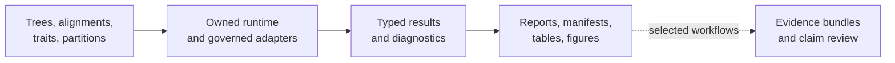
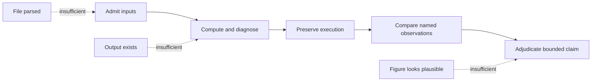
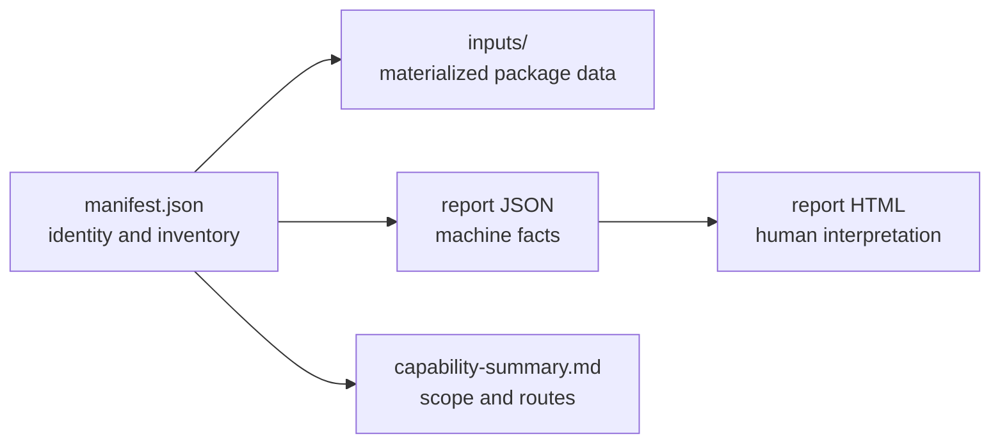
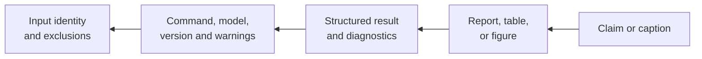
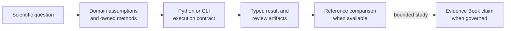
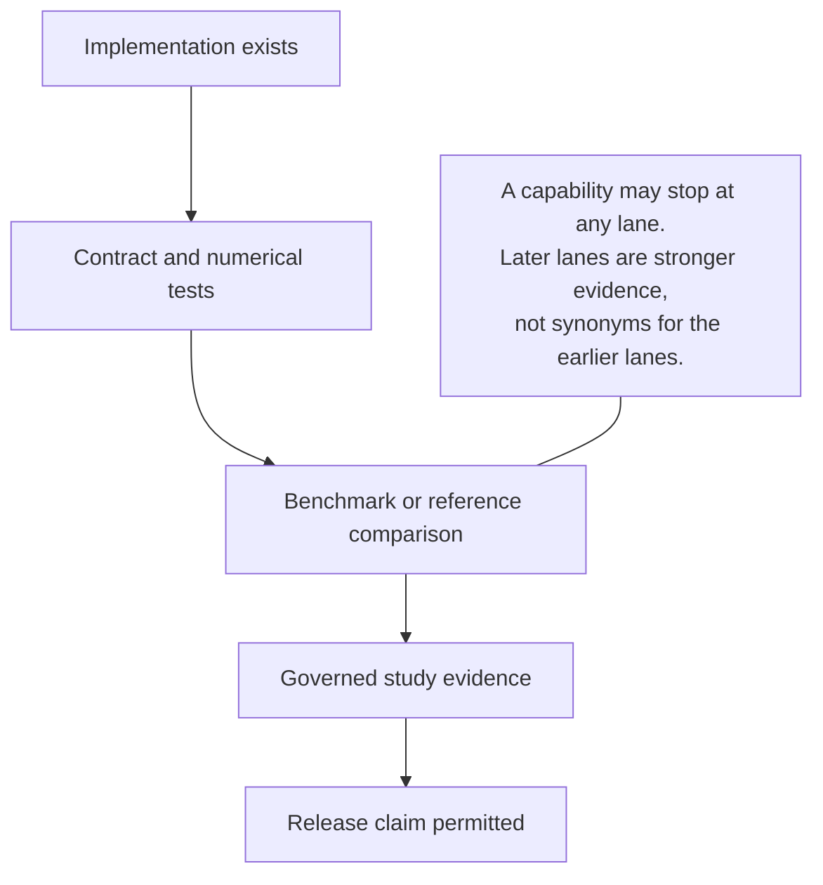

# Bijux Phylogenetics

<!-- bijux-phylogenetics-badges:generated:start -->
[](https://pypi.org/project/bijux-phylogenetics/)
[](https://github.com/bijux/bijux-phylogenetics/blob/main/LICENSE)
[](https://github.com/bijux/bijux-phylogenetics/actions/workflows/verify.yml?query=branch%3Amain)
[](https://github.com/bijux/bijux-phylogenetics/actions/workflows/release-pypi.yml)
[](https://github.com/bijux/bijux-phylogenetics/actions/workflows/release-ghcr.yml)
[](https://github.com/bijux/bijux-phylogenetics/actions/workflows/release-github.yml)
[](https://github.com/bijux/bijux-phylogenetics/actions/workflows/deploy-docs.yml)
[](https://github.com/bijux/bijux-phylogenetics/releases)
[](https://github.com/bijux?tab=packages&repo_name=bijux-phylogenetics)
[](https://github.com/bijux/bijux-phylogenetics/tree/main/packages)

[](https://pypi.org/project/bijux-phylogenetics/)
[](https://pypi.org/project/phylogenetic/)

[](https://github.com/bijux/bijux-phylogenetics/pkgs/container/bijux-phylogenetics%2Fbijux-phylogenetics)
[](https://github.com/bijux/bijux-phylogenetics/pkgs/container/bijux-phylogenetics%2Fphylogenetic)

[](https://bijux.io/bijux-phylogenetics/01-bijux-phylogenetics/)
[](https://bijux.io/bijux-phylogenetics/01-bijux-phylogenetics/)
<!-- bijux-phylogenetics-badges:generated:end -->

One repository connects three things that scientific software too often keeps
apart: an executable phylogenetics runtime, study-level evidence for selected
comparative claims, and publication controls that keep the two aligned.

The runtime is broad; the available evidence is deliberately claim-specific.
Implementation, contract tests, benchmarks, and governed studies therefore
carry separate status instead of collapsing into a single maturity label.



## Understand The Project In Plain Terms

Bijux Phylogenetics is not a single tree-building algorithm and not a facade
that makes every external tool look scientifically identical. It is a runtime
for preserving the meaning of a phylogenetic analysis across five moments:

1. observations become an admitted taxon and character population;
2. a native method or named external engine owns the computation;
3. diagnostics determine whether the result is interpretable;
4. manifests and structured outputs make the result portable;
5. selected public claims undergo a separate, claim-scoped evidence review.

You may stop after any honest terminal state. A validated dataset, a refused
model, an accepted runtime result without reference parity, and a current
Evidence Book claim are all different useful outcomes. The site keeps those
outcomes separate so capability is not advertised as proof and missing
evidence is not disguised as success.

## Start With The Decision In Front Of You

You do not need to learn the repository vocabulary before finding the right
record. Choose the decision you are making now:

| Your immediate decision | Start here | Stop when you have |
| --- | --- | --- |
| Can I run the package and inspect its outputs? | [installed runtime](#run-the-installed-runtime) | a manifest-linked demonstration and its explicit limits |
| Which method and assumptions fit my scientific object? | [scientific domains](02-bijux-phylogenetics-domains/index.md) | a model, estimand, admitted population, and diagnostic contract |
| Which interface should own my analysis? | [product handbook](01-bijux-phylogenetics/index.md) | a Python, CLI, adapter, or artifact-consumer route |
| Does Bijux correspond to a named tool for this case? | [parities and correspondence](04-bijux-phylogenetics-parities/index.md) | aligned observations, denominator, and bounded outcome |
| What supports a public scientific statement? | [Evidence Book](03-bijux-phylogenetics-evidence-book/index.md) | a current claim, governed observations, verdict, and limitations |

These routes can share data and software without sharing a conclusion. A
runtime result may be complete without parity evidence, and a study dossier
may remain valuable while its numerical comparison is explicitly unavailable.

## The Public Record Has Four Independent Depths

The site distinguishes how much of a result is exposed, not merely whether a
feature name appears.

| Depth | Public question | Record that answers it |
| --- | --- | --- |
| capability | What scientific object and operation are supported? | domain contract with assumptions, inputs, outputs, and refusal conditions |
| execution | Who performed the computation, and did it terminate acceptably? | native result or external-engine execution and parser records |
| reproducibility | Can the exact run and every accepted output be reconstructed? | manifest, environment, configuration, attempts, checksums, and inventory |
| evidence | Which bounded statement is supported at this revision? | claim-indexed bundle with observations, checks, verdict, limitations, and freshness |

These depths may legitimately differ for one surface. Capability documentation
can be complete while study evidence is absent; an external execution can be
reproducible while numerical correspondence is unresolved. Each page names
the strongest record it actually owns.

## Choose What Must Be Trusted

The same analysis can be sound at one layer and unresolved at another. Begin
with the decision that must survive review, then inspect the record that owns
that decision.

| Decision | Owning record | A weaker record cannot establish it |
| --- | --- | --- |
| Can these inputs enter this analysis? | validation result with taxon, state, schema, and exclusion details | successful file parsing |
| Did the requested computation reach an interpretable state? | typed runtime result with model state, diagnostics, warnings, and status | process exit or output-file presence |
| Can another person reconstruct the execution? | manifest linked to exact inputs, configuration, environment, attempts, and outputs | a figure or copied command |
| Does Bijux correspond to a named reference here? | parity case with aligned assumptions, observation keys, tolerance, and complete denominator | similar headline values |
| Does the repository support this scientific statement? | current Evidence Book claim with provenance, primary outputs, checks, verdict, and limitations | capability documentation or a neighboring bundle |



Not every workflow must reach the final node. The honest stopping point may be
a refused input, a valid runtime result with no reference comparison, or a
`not_comparable` evidence claim whose missing observations are explicitly
recorded.

## Run The Installed Runtime

The packaged capability demo is the shortest path from installation to a
reviewable artifact set:

```bash
python -m pip install bijux-phylogenetics
bijux-phylogenetics demo run \
  --out artifacts/capability-demo \
  --manifest artifacts/capability-demo/manifest.json \
  --json
```

The run materializes packaged inputs and generates four HTML reports. Read the
manifest before the reports: it records the command result and output
identities needed to audit the run. The demo validates packaging, tree and
table intake, comparison, and reporting; it is not a numerical inference
benchmark.

### Follow The Demo Records



The manifest binds the run. The JSON reports preserve inspectable facts. The
HTML reports are presentations of those facts. `capability-summary.md` tells
you what the demonstration exercised, but it does not promote the synthetic
example into accuracy or biological evidence.

## Explore The Project

| Goal | Destination | Coverage |
| --- | --- | --- |
| run an analysis | [Product handbook](01-bijux-phylogenetics/index.md) | which Python, CLI, or artifact surface fits the work |
| understand a scientific capability | [Scientific domains](02-bijux-phylogenetics-domains/index.md) | objects, methods, assumptions, outputs, and failure modes |
| inspect a scientific claim | [Evidence book](03-bijux-phylogenetics-evidence-book/index.md) | which bundle, provenance record, and open boundary support it |
| compare with established tools | [Parities and correspondence](04-bijux-phylogenetics-parities/index.md) | which APE, GEIGER, phytools, and external-engine relationships are governed |
| maintain or release the repository | [Maintainer handbook](05-bijux-phylogenetics-maintain/index.md) | how code, docs, packages, and evidence stay synchronized |

## Follow A Complete Reader Journey

The shortest trustworthy route is a connected study guide, not an exhaustive
API or command inventory:

| You are holding… | Continue with… | Finish by reviewing… |
| --- | --- | --- |
| raw sequence records | [Sequence-to-tree study](01-bijux-phylogenetics/operations/sequence-to-tree-study.md) | stage outputs, engine identities, manifest and acceptance rule |
| a tree and trait table | [Comparative and ancestral study](01-bijux-phylogenetics/operations/comparative-and-ancestral-study.md) | admitted taxa, model-specific diagnostics and separate claims |
| two candidate topologies | [Topology comparison study](01-bijux-phylogenetics/operations/topology-comparison-study.md) | shared-taxon denominator, rooting and split observations |
| structured results needing review | [Analysis report handoff](01-bijux-phylogenetics/operations/analysis-report-handoff.md) | backward trace from every displayed value to its owner |
| an exception, partial result or failed command | [Result and refusal semantics](01-bijux-phylogenetics/interfaces/result-and-refusal-semantics.md) | scientific state, stable code, details and consumer decision |
| a run that another person must reconstruct | [Reproducibility records](01-bijux-phylogenetics/interfaces/reproducibility-records.md) | inputs, environment, configuration, attempts, inventory and acceptance |
| a claim that needs citation | [Reading an evidence bundle](03-bijux-phylogenetics-evidence-book/reading-an-evidence-bundle.md) | claim observations, checks, verdict, limitations and freshness |

If the journey stops early, preserve the stopping state. A refused input,
missing engine, partial output, non-comparable claim, or stale bundle can still
be a complete review record without being a successful scientific conclusion.

## Explore The Runtime By Scientific Object

The scientific domain, not the interface name, determines the assumptions and
review record:

| Starting object or result | Owning guide | What remains attached |
| --- | --- | --- |
| packaged dataset or taxon-indexed study table | [Datasets and study inputs](02-bijux-phylogenetics-domains/data-and-structure/datasets-and-study-inputs.md) | provenance, schema, taxon linkage, transformations, exclusions and workflow identity |
| Newick, Nexus, FASTA or tabular interchange | [Data interchange and identity](02-bijux-phylogenetics-domains/data-and-structure/data-interchange-and-identity.md) | source bytes, parsed semantics, derivations and round-trip loss |
| a tree to reroot, prune, extract, rescale or compare | [Tree operations and identity](02-bijux-phylogenetics-domains/data-and-structure/tree-operations-and-identity.md) | operation invariant, structural node/branch keys, population change and derived identity |
| bootstrap, posterior, gene, candidate or sensitivity trees | [Tree sets, consensus and support](02-bijux-phylogenetics-domains/data-and-structure/tree-sets-consensus-and-support.md) | population meaning, member denominator, consensus/selection policy and support method |
| a model or topology selected from candidates | [Search, model selection and support](02-bijux-phylogenetics-domains/inference/search-model-selection-and-support.md) | eligible/attempted/evaluated populations, failures, rule, ties and method-specific support |
| simulated truth and estimator results | [Simulation recovery and calibration](02-bijux-phylogenetics-domains/scientific-assurance/simulation-recovery-and-calibration.md) | generator/estimator identity, replicate states, regime metrics, calibration and independence basis |
| discrete node states or branch transitions | [Discrete ancestral states and transitions](02-bijux-phylogenetics-domains/evolutionary-analysis/discrete-ancestral-states-and-transitions.md) | state order, root prior, full node probabilities, branch opportunities and tree-set stability |
| discrete regions and migration events | [Biogeography and migration](02-bijux-phylogenetics-domains/evolutionary-analysis/biogeography-and-migration.md) | state model, constraints, chronology, tree-set stability and exclusions |
| continuous coordinates and map geometry | [Continuous phylogeography and maps](02-bijux-phylogenetics-domains/evolutionary-analysis/continuous-phylogeography-and-maps.md) | node uncertainty, branch movement, outliers, marker/line ledgers and render identity |
| host or niche state histories | [Host association and niche evolution](02-bijux-phylogenetics-domains/evolutionary-analysis/host-association-and-niche-evolution.md) | ancestral ambiguity, transition opportunity, unsupported claims and clade burden |
| tables, figures, methods text or publication packages | [Reporting and rendering](02-bijux-phylogenetics-domains/scientific-assurance/reporting-and-rendering.md) and [publication artifact review](02-bijux-phylogenetics-domains/scientific-assurance/publication-artifact-review.md) | structured source, visual encoding, inventory, audit, comparison and revalidation |

Several objects can participate in one study, but their records do not merge.
A map line, host switch, dataset export, and Evidence Book claim retain separate
owners even when they share a tree and taxon population.

## Choose The Durable Record First

Begin with the decision another person must be able to review, then choose the
runtime surface. This prevents a convenient command or attractive report from
becoming the accidental evidence standard.


| Decision to preserve | Required durable record | Interface is secondary because… |
| --- | --- | --- |
| whether an input is admissible | structured validation result with exclusions and input identity | Python and CLI may project the same validation contract differently |
| which topology or model was selected | result plus candidates, objective or support, configuration, and diagnostics | the winning value alone erases the selection denominator |
| whether an external engine completed acceptably | manifest, engine identity, command, native outputs, parser state, and normalized result | a wrapper cannot replace the external computation record |
| whether two implementations correspond | selected case, both observations, normalization, tolerance, and verdict | matching display values do not establish comparable estimands |
| whether a scientific statement is supportable | current Evidence Book claim record and its complete governed bundle | runtime availability and neighboring evidence do not transfer support |

If the required record cannot be produced, narrow the intended conclusion
before execution. Do not compensate afterward with a richer narrative.

## Locate The Authoritative Record

| Reader question | Inspect first | Then verify |
| --- | --- | --- |
| What inputs and outputs belonged to a run? | workflow manifest | referenced files, checksums, diagnostics, and software identity |
| What did a Python or CLI method return? | typed result or structured JSON | public contract, warnings, absence semantics, and persisted artifacts |
| Did a reference implementation agree? | parity summary and observation rows | selected registry case, normalization, tolerances, and raw reference output |
| What supports a scientific statement? | Evidence Book manifest and claim records | provenance, input manifest, checks, freshness, and current bundle verdict |
| Is a release internally consistent? | release-readiness report | built distributions, strict docs, package boundaries, and evidence governance |

HTML and figures are interpretation surfaces. When a value also exists in JSON,
TSV, a schema-governed result, or a bundle manifest, the structured record owns
its identity and status.

## Trace A Result When Something Looks Wrong

Start at the observation that surprised you and move upstream to the component
that made the disputed decision. Do not begin by rerunning the entire workflow
or editing a report.



| Symptom | Inspect first | Deciding owner | Do not conclude from |
| --- | --- | --- | --- |
| a taxon is absent | exclusion and reconciliation rows | input/tree/alignment contract | the final tip count alone |
| a coefficient changed | design matrix, covariance, transform, and fitted population | comparative model | matching formula text |
| a topology differs | taxon reconciliation, rooting, model, seed, and search state | inference method or external engine | a rendered tree image |
| support values disagree | method label, scale, clade identity, and denominator | support procedure | normalized display percentages |
| an ancestral value moved | node identity, model, tree, state scale, and uncertainty | reconstruction method | node array position |
| a parity case failed | raw observations, normalization, tolerance, and reference identity | parity registry case | package-wide pass counts |
| a study claim is unavailable | bundle verdict, primary outputs, checks, and freshness | Evidence Book claim | neighboring runtime capability |

This trace preserves negative evidence. A failed check, missing output, or
unresolved convention belongs in the record that owns it; changing a caption
or omitting a row cannot resolve the underlying result.

## Build A Review Packet

A durable analysis is a connected set of records, not a directory of files.
Retain the smallest packet that lets another person establish identity,
execution, interpretation, and completeness without rerunning the process.

| Packet component | Minimum content | Reject the packet when… |
| --- | --- | --- |
| identity | package and external-engine versions, operation, configuration, seed, input hashes | the computation owner or exact inputs cannot be identified |
| execution | exit or completion state, warnings, search/sampling diagnostics, parser state | a report exists but execution state is unknown |
| results | typed or structured estimates, topology/history identity, uncertainty, exclusions | headline values exist only in prose or figures |
| inventory | expected and present outputs, schemas, checksums where governed | missing outputs disappear from the denominator |
| interpretation | model assumptions, units/scales, comparison rule, bounded non-claims | the scientific meaning depends on undocumented defaults |
| claim evidence | claim ID, provenance, observations, acceptance rule, freshness, verdict | a broad conclusion is inferred from a neighboring bundle |

Runtime work normally stops after the first five components. The sixth exists
only for claims governed by the Evidence Book.

## Follow A Scientific Question



A runtime method can be useful without a corresponding Evidence Book bundle.
Conversely, a study can retain an external computation owner while Bijux
governs its inputs, provenance, checks, and verdict. The links above keep those
relationships explicit.

## Choose The Evidence Needed For The Decision

| Decision | Minimum useful record | Stronger record when the claim requires it |
| --- | --- | --- |
| can this input be parsed and validated? | typed result or structured command output | fixture-backed contract test |
| did this analysis produce its declared artifacts? | manifest plus checksum-resolved inventory | reproducible replay under the recorded environment |
| does a numerical method behave on a named corpus? | benchmark or known-answer record | governed reference comparison |
| does Bijux agree with APE, GEIGER, or phytools for a selected case? | live registry observation with denominator and tool identity | Evidence Book claim when the study consumes that comparison |
| can a scientific statement be published? | current claim verdict and provenance | release-readiness record confirming all public projections agree |

Do not demand study evidence for a simple parser decision, and do not use a
parser success to justify a scientific statement. Match the proof to the
decision being made.

## What The Runtime Owns

The canonical `bijux-phylogenetics` package contains more than command wrappers.
It owns tree and alignment semantics, native finite-state likelihood machinery,
supported maximum-likelihood and Bayesian inference paths, comparative and
ancestral analysis, parsimony, simulations, typed dataset families,
biogeographic and ecological review, diagnostics, supplementary tables, tree
and trait rendering, reproducibility manifests, and publication-package
review contracts.

This breadth has distinct evidence depths. A dataset loader, migration-event
summary, rendered tree package, numerical benchmark, and Evidence Book verdict
are each useful records, but none inherits the assurance vocabulary of the
others.

External programs still matter. MAFFT, trimAl, IQ-TREE2, FastTree, MrBayes, and
BEAST are exposed through adapters where execution belongs to those engines.
The docs identify that boundary instead of describing an adapter as a native
implementation.

## The Trust Model



Use the [validation lanes](01-bijux-phylogenetics/quality/validation-lanes.md)
to interpret claims. A passing unit test proves a contract under its fixtures;
it does not, by itself, prove parity with a reference analysis. An evidence
bundle records a particular study execution; it does not certify every model,
dataset, or scientific interpretation.

Runtime parity and Evidence Book status use different vocabularies. Live APE,
GEIGER, and phytools harnesses report cases as `passed`, `failed`, or `skipped`.
Governed study bundles use `matched`, `matched_with_tolerance`,
`mismatch_explained`, `mismatch_unexplained`, or `not_comparable`. A skipped
runtime case is not an evidence verdict, and an open follow-through item is not
a replacement for the recorded bundle verdict.

## Scope Boundary

This project provides software and inspectable analytical evidence. It does
not replace study design, model criticism, domain expertise, or independent
review. Reproducibility tells you how a result was obtained; it does not make
the biological conclusion inevitable.
