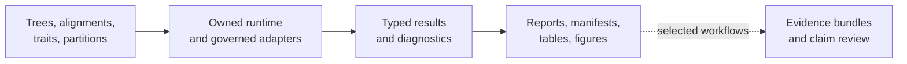
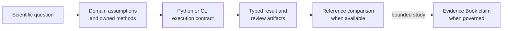
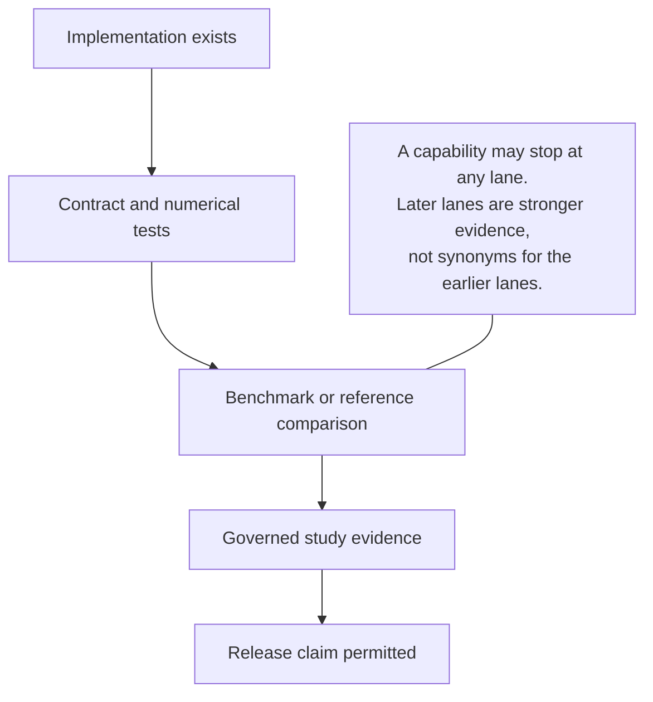

# Bijux Phylogenetics

<!-- bijux-phylogenetics-badges:generated:start -->
[](https://pypi.org/project/bijux-phylogenetics/)
[](https://github.com/bijux/bijux-phylogenetics/blob/main/LICENSE)
[](https://github.com/bijux/bijux-phylogenetics/actions/workflows/verify.yml?query=branch%3Amain)
[](https://github.com/bijux/bijux-phylogenetics/actions/workflows/release-pypi.yml)
[](https://github.com/bijux/bijux-phylogenetics/actions/workflows/release-ghcr.yml)
[](https://github.com/bijux/bijux-phylogenetics/actions/workflows/release-github.yml)
[](https://github.com/bijux/bijux-phylogenetics/actions/workflows/deploy-docs.yml)
[](https://github.com/bijux/bijux-phylogenetics/releases)
[](https://github.com/bijux?tab=packages&repo_name=bijux-phylogenetics)
[](https://github.com/bijux/bijux-phylogenetics/tree/main/packages)

[](https://pypi.org/project/bijux-phylogenetics/)
[](https://pypi.org/project/phylogenetic/)

[](https://github.com/bijux/bijux-phylogenetics/pkgs/container/bijux-phylogenetics%2Fbijux-phylogenetics)
[](https://github.com/bijux/bijux-phylogenetics/pkgs/container/bijux-phylogenetics%2Fphylogenetic)

[](https://bijux.io/bijux-phylogenetics/01-bijux-phylogenetics/)
[](https://bijux.io/bijux-phylogenetics/01-bijux-phylogenetics/)
<!-- bijux-phylogenetics-badges:generated:end -->

One repository connects three things that scientific software too often keeps
apart: an executable phylogenetics runtime, study-level evidence for selected
comparative claims, and the controls that keep releases aligned with both.

The runtime is broad; the available evidence is deliberately claim-specific.
Implementation, contract tests, benchmarks, and governed studies therefore
carry separate status instead of collapsing into a single maturity label.



## Run The Installed Runtime

The packaged capability demo is the shortest path from installation to a
reviewable artifact set:

```bash
python -m pip install bijux-phylogenetics
bijux-phylogenetics demo run \
  --out artifacts/capability-demo \
  --manifest artifacts/capability-demo/manifest.json \
  --json
```

The run materializes packaged inputs and generates four HTML reports. Read the
manifest before the reports: it records the command result and output
identities needed to audit the run. The demo validates packaging, tree and
table intake, comparison, and reporting; it is not a numerical inference
benchmark.

## Explore The Project

| Goal | Destination | Coverage |
| --- | --- | --- |
| run an analysis | [Product handbook](01-bijux-phylogenetics/index.md) | which Python, CLI, or artifact surface fits the work |
| understand a scientific capability | [Scientific domains](02-bijux-phylogenetics-domains/index.md) | objects, methods, assumptions, outputs, and failure modes |
| inspect a scientific claim | [Evidence book](03-bijux-phylogenetics-evidence-book/index.md) | which bundle, provenance record, and open boundary support it |
| compare with established tools | [Parities and correspondence](04-bijux-phylogenetics-parities/index.md) | which APE, GEIGER, phytools, and external-engine relationships are governed |
| maintain or release the repository | [Maintainer handbook](05-bijux-phylogenetics-maintain/index.md) | how code, docs, packages, and evidence stay synchronized |

## Follow A Scientific Question



A runtime method can be useful without a corresponding Evidence Book bundle.
Conversely, a study can retain an external computation owner while Bijux
governs its inputs, provenance, checks, and verdict. The links above keep those
relationships explicit.

## What The Runtime Owns

The canonical `bijux-phylogenetics` package contains more than command wrappers.
It owns tree and alignment semantics, native finite-state likelihood machinery,
supported maximum-likelihood and Bayesian inference paths, comparative and
ancestral analysis, parsimony, simulations, datasets, diagnostics, and
review-oriented output contracts.

External programs still matter. MAFFT, trimAl, IQ-TREE2, FastTree, MrBayes, and
BEAST are exposed through adapters where execution belongs to those engines.
The docs identify that boundary instead of describing an adapter as a native
implementation.

## The Trust Model



Use the [validation lanes](01-bijux-phylogenetics/quality/validation-lanes.md)
to interpret claims. A passing unit test proves a contract under its fixtures;
it does not, by itself, prove parity with a reference analysis. An evidence
bundle records a particular study execution; it does not certify every model,
dataset, or scientific interpretation.

## Essential Workflows And Contracts

- [Runtime system map](01-bijux-phylogenetics/architecture/runtime-system-map.md)
  — follow data from input contracts to reviewable artifacts.
- [Surface selection](01-bijux-phylogenetics/interfaces/surface-selection.md)
  — choose Python, CLI, or persisted artifacts by intended consumer.
- [Native maximum-likelihood workflows](01-bijux-phylogenetics/operations/native-maximum-likelihood-workflows.md)
  — understand the owned inference result and search evidence.
- [Native Bayesian workflows](01-bijux-phylogenetics/operations/native-bayesian-workflows.md)
  — see the supported DNA inference boundary and diagnostics.
- [Evidence reading guide](01-bijux-phylogenetics/foundation/claim-reading-guide.md)
  — trace a public statement to its strongest available proof.

## Distribution Map

| Distribution | Purpose |
| --- | --- |
| `bijux-phylogenetics` | canonical runtime, public Python API, and CLI |
| `phylogenetic` | shorter compatibility distribution for the same runtime |
| `bijux-phylogenetics-dev` | repository-only documentation, evidence, API, and release checks |

The alias does not represent a reduced scientific edition. Maintainer tooling
is intentionally separate from both runtime distributions.

## Scope Boundary

This project provides software and inspectable analytical evidence. It does
not replace study design, model criticism, domain expertise, or independent
review. Reproducibility tells you how a result was obtained; it does not make
the biological conclusion inevitable.
