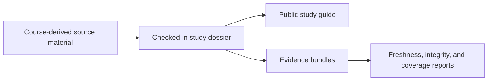

# Evidence Book

This section explains the governed comparative-study record behind the public
phylogenetics runtime.

The five study families come from course-derived material that the repository
has converted into checked-in, reviewable evidence. All five now have governed
bundle IDs. Some families already support stronger parity statements than
others, and some still keep explicit analytical boundaries open.

## How To Use This Section

- Read these guides when you want the scientific story in plain language.
- Follow the linked dossier and index reports when you need bundle-level proof,
  provenance, freshness, or coverage detail.
- Do not read the study guides as blanket proof that every nearby runtime
  feature is fully closed by evidence.

## Start Here

- checked-in study dossiers:
  [`evidence-book/README.md`](https://github.com/bijux/bijux-phylogenetics/blob/main/evidence-book/README.md)
- repository-wide review reports:
  [`evidence-book/index/`](https://github.com/bijux/bijux-phylogenetics/tree/main/evidence-book/index)

Treat those checked-in reports as the current source of truth when you need
live repository status rather than the stable narrative on this page.

## At A Glance

- studies: `5`
- evidence bundles: `43`
- freshness statuses: `current=43`
- coverage gaps still tracked: `28`
- maturity tier: `reviewable_but_incomplete`

## Core Reading Order

1. [PCM1: primate longevity signal](pcm1-primate-longevity-signal/index.md)
2. [PCM2: primate PGLS and signal](pcm2-primate-pgls-and-signal/index.md)
3. [PCM3: primate continuous and categorical regression](pcm3-primate-continuous-and-categorical-regression/index.md)
4. [PCM4: cichlid Bayesian linear and phylogenetic mixed models](pcm4-cichlid-bayesian-linear-and-phylogenetic-mixed-models/index.md)
5. [PCM5: cichlid phylogenetic generalized linear mixed models](pcm5-cichlid-phylogenetic-generalized-linear-mixed-models/index.md)

That sequence mirrors the teaching progression: preparation first, then
comparative regression, then the cichlid mixed-model families where external
posterior tooling remains the largest open boundary.

Start with PCM1 when you want the full preparation path from raw primate traits
and tree files to signal estimation and ancestral reconstruction.

## Study Atlas

| Study | Main question | Evidence IDs | Current repository state |
| --- | --- | --- | --- |
| [PCM1](pcm1-primate-longevity-signal/index.md) | How do raw primate traits and tree inputs become a usable signal and ancestral-state workflow? | `evidence-001` to `evidence-009` | Governed bundles deployed; plotting boundary remains explicit |
| [PCM2](pcm2-primate-pgls-and-signal/index.md) | How do baseline GLS, PGLS, transformed trees, and signal tests behave on the same primate dataset? | `evidence-001` to `evidence-010` | Governed bundles deployed; one analytical boundary remains explicit |
| [PCM3](pcm3-primate-continuous-and-categorical-regression/index.md) | How should continuous predictors, categorical predictors, interactions, and phylogenetic correction be interpreted together? | `evidence-001` to `evidence-008` | Governed bundles deployed; lecture-specific verdicts remain narrower |
| [PCM4](pcm4-cichlid-bayesian-linear-and-phylogenetic-mixed-models/index.md) | Where does the cichlid workflow move from standard regression into Bayesian mixed models with a phylogenetic effect? | `evidence-001` to `evidence-007` | Governed bundles deployed; posterior workflow still external |
| [PCM5](pcm5-cichlid-phylogenetic-generalized-linear-mixed-models/index.md) | How do count models, binary-style models, repeated measures, and posterior signal fit together in one study family? | `evidence-001` to `evidence-009` | Governed bundles deployed; posterior mixed-model workflow still external |

## Review Reports

- teaching and migration index:
  [`evidence-book/index/teaching-and-migration.md`](https://github.com/bijux/bijux-phylogenetics/blob/main/evidence-book/index/teaching-and-migration.md)
- parity dashboard:
  [`evidence-book/index/parity-dashboard.md`](https://github.com/bijux/bijux-phylogenetics/blob/main/evidence-book/index/parity-dashboard.md)
- freshness report:
  [`evidence-book/index/freshness-report.md`](https://github.com/bijux/bijux-phylogenetics/blob/main/evidence-book/index/freshness-report.md)
- integrity report:
  [`evidence-book/index/integrity-report.md`](https://github.com/bijux/bijux-phylogenetics/blob/main/evidence-book/index/integrity-report.md)
- coverage gaps:
  [`evidence-book/index/coverage-gaps.md`](https://github.com/bijux/bijux-phylogenetics/blob/main/evidence-book/index/coverage-gaps.md)
- claim re-audit:
  [`evidence-book/index/claim-reaudit.md`](https://github.com/bijux/bijux-phylogenetics/blob/main/evidence-book/index/claim-reaudit.md)
- closure criteria:
  [`evidence-book/index/closure-criteria.md`](https://github.com/bijux/bijux-phylogenetics/blob/main/evidence-book/index/closure-criteria.md)

## Reading Boundary

These guides explain what the checked-in studies support today. They do not
hide external dependencies, and they do not turn bundle deployment into a
blanket claim of complete reproduction.
