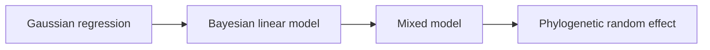

# PCM4: Cichlid Bayesian Linear And Phylogenetic Mixed Models

PCM4 introduces the cichlid parasite dataset and the first Bayesian
mixed-model workflow in the course-derived evidence book.

## What PCM4 Answers

PCM4 is the point where the repository has to be especially precise about what
it does and does not reproduce. The core lecture depends on posterior sampling,
random-effect uncertainty, and a phylogenetic inverse covariance passed into
`MCMCglmm`.

## Read PCM4 In Order

1. [mixed-model evidence boundary](mixed-model-evidence-boundary.md)

## What The Repository Already Provides

- a complete checked-in source record for the cichlid lecture family
- explicit dataset and provenance registration
- a named governed parity decomposition showing how the lecture should be
  reviewed
- one governed parity bundle ID for each lecture slice, `evidence-001` through
  `evidence-007`
- a Brownian PGLS comparator surface that matches the lecture's final
  comparison step

## What PCM4 Does Not Prove

- It does not prove that the repository owns the lecture's full posterior
  workflow today.
- It does not substitute nearby regression utilities for an `MCMCglmm` result.
- It does not hide the fact that posterior summaries and random-effect
  uncertainty still sit outside the checked-in parity surface.

## Checked-In Evidence Record

The full checked-in record lives under
[`evidence-book/studies/cichlid-bayesian-linear-and-phylogenetic-mixed-models/`](https://github.com/bijux/bijux-phylogenetics/blob/main/evidence-book/studies/cichlid-bayesian-linear-and-phylogenetic-mixed-models/README.md).

## Checked-In Inputs

- lecture source copies:
  `cichlid.csv`, `cichlidtree.nex`, and `fishdata.RData`
- study-local catalogs:
  [dataset catalog](https://github.com/bijux/bijux-phylogenetics/blob/main/evidence-book/studies/cichlid-bayesian-linear-and-phylogenetic-mixed-models/datasets/README.md)
  and
  [provenance guide](https://github.com/bijux/bijux-phylogenetics/blob/main/evidence-book/studies/cichlid-bayesian-linear-and-phylogenetic-mixed-models/provenance/README.md)

## Evidence Bundle Atlas

- `evidence-001`: data-tree alignment and species summarization
- `evidence-002`: Gaussian baseline regression
- `evidence-003` to `evidence-006`: posterior diagnostics, inverse setup,
  fixed effects, and variance components
- `evidence-007`: Brownian comparator bridge
