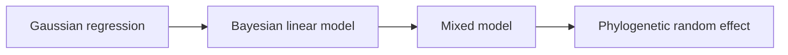

# PCM4: Cichlid Bayesian Linear And Phylogenetic Mixed Models

PCM4 introduces the cichlid parasite dataset and the first Bayesian
mixed-model workflow in the course-derived evidence book.

## Why PCM4 Matters

PCM4 is where the repository has to be especially precise about what it does
and does not reproduce. The core lecture depends on posterior sampling,
random-effect uncertainty, and a phylogenetic inverse covariance passed into
`MCMCglmm`.

## Read PCM4 In Order

1. [Mixed-model evidence boundary](mixed-model-evidence-boundary.md)

## Checked-In Study Dossier

The full checked-in record lives under
[`evidence-book/studies/cichlid-bayesian-linear-and-phylogenetic-mixed-models/`](https://github.com/bijux/bijux-phylogenetics/blob/main/evidence-book/studies/cichlid-bayesian-linear-and-phylogenetic-mixed-models/README.md).

## Inputs And Evidence Map

- lecture source copies:
  `cichlid.csv`, `cichlidtree.nex`, and `fishdata.RData`
- catalogs:
  [dataset catalog](https://github.com/bijux/bijux-phylogenetics/blob/main/evidence-book/studies/cichlid-bayesian-linear-and-phylogenetic-mixed-models/datasets/README.md)
  and
  [provenance guide](https://github.com/bijux/bijux-phylogenetics/blob/main/evidence-book/studies/cichlid-bayesian-linear-and-phylogenetic-mixed-models/provenance/README.md)
- evidence bundles:
  `evidence-001` through `evidence-007`

## What To Take From PCM4

- the cichlid lecture family is fully documented and decomposed into governed
  evidence units
- the Brownian PGLS comparator is useful context, but it is not a substitute
  for the lecture's posterior workflow
- the main scientific boundary is posterior mixed-model reproduction, not basic
  study intake

## What Not To Overread

- PCM4 does not prove repository-owned replacement of the lecture's full
  posterior workflow.
- It does not treat nearby regression utilities as if they were `MCMCglmm`
  results.
- It keeps posterior summaries and random-effect uncertainty outside the
  current parity claim on purpose.
