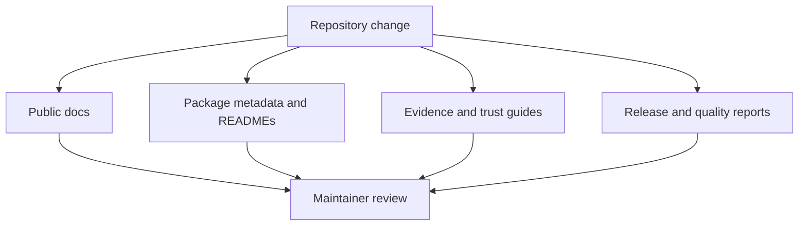
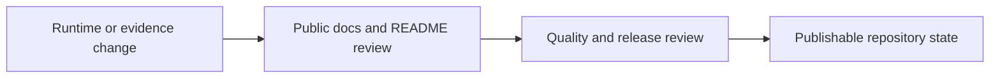

# Maintainer Guide

Use this handbook when the question is about repository health, release
alignment, or documentation stewardship rather than runtime product use.

## What Maintainers Are Responsible For

- keeping public docs, package READMEs, and metadata aligned with the actual
  runtime surface
- preserving the boundary between native ownership, wrapper orchestration, and
  evidence closure
- keeping release narratives truthful across documentation and governed
  readiness reports
- preventing root clutter and unmanaged artifact drift

## Stewardship Loop

## What This Handbook Helps Prevent

- public pages that understate the runtime depth now present in the code and
  tests
- native surfaces that appear in code but disappear from package READMEs or
  release guidance
- evidence-book pages that sound conclusive when the governed study record is
  still bounded
- repository runs that leave unmanaged root artifacts behind

## Read By Question

- How do repository runs keep root aliases disposable and avoid root clutter?
  [Artifact hygiene](artifact-hygiene.md)
- How should public docs and package READMEs map to the runtime surface?
  [Documentation ownership](documentation-ownership.md)
- How do flagship native surfaces stay documented across reference, workflow,
  and quality pages?
  [Native surface documentation](native-surface-documentation.md)
- How do architecture, evidence, and release pages stay aligned as one public
  trust story?
  [Public trust surface maintenance](public-trust-surface-maintenance.md)
- How do interface guides, artifact guides, and metadata links stay aligned?
  [Public interface and artifact maintenance](public-interface-and-artifact-maintenance.md)
- How do validation-lane guides and PCM study guides stay aligned with trust
  language?
  [Trust lane and study guide maintenance](trust-lane-and-study-guide-maintenance.md)
- How should a release-minded maintainer check narrative alignment?
  [Release surface alignment](release-surface-alignment.md)

For maintainers scanning by keyword, this guide explicitly covers artifact hygiene, native surface documentation, public trust surface maintenance, public interface and artifact maintenance, trust lane and study guide maintenance, and release surface alignment.
