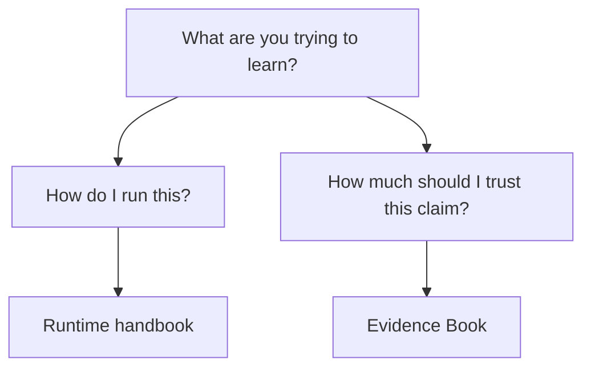

# Evidence Consumer Boundary

The evidence-book uses runtime outputs, but it is not the runtime itself.

That separation helps readers avoid a common mistake: using runtime usage docs
to answer trust questions, or using study dossiers to answer execution
questions.

Use the runtime handbook when your question is operational. Use the
evidence-book public guide when your question is about study reproduction,
parity, freshness, or bounded trust.

## Practical Reading Rule

Ask which question you are actually trying to answer:

- runtime question
  What can the package do, how do I run it, and what are the public API and CLI
  contracts.
- evidence question
  Which claims are benchmarked, parity-reviewed, study-backed, stale, bounded,
  or still open.

Keeping those questions separate is part of the public honesty model. The
runtime can be broader than the currently closed evidence surface without that
difference being hidden.
